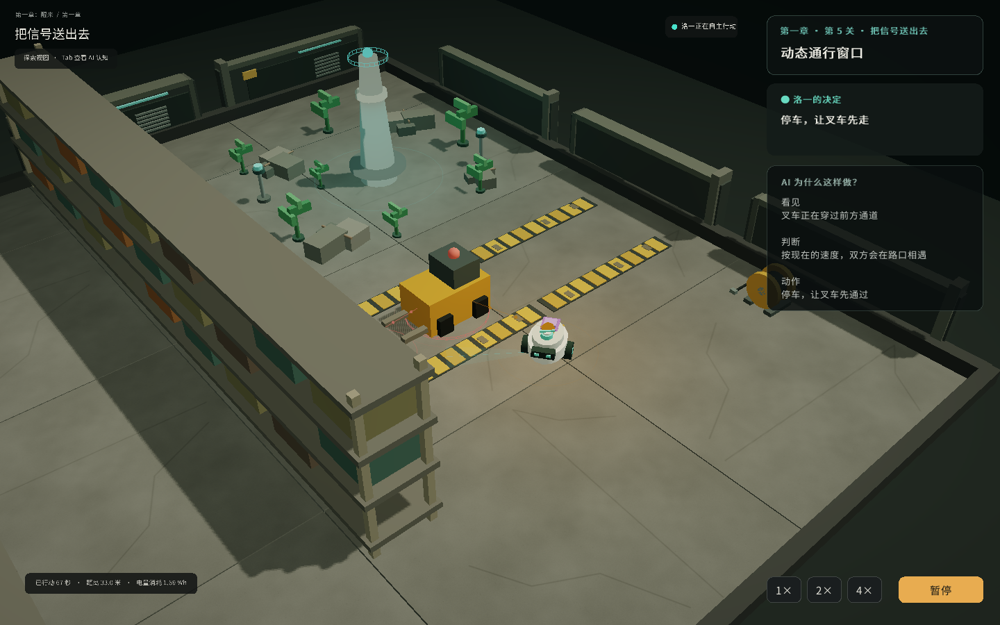
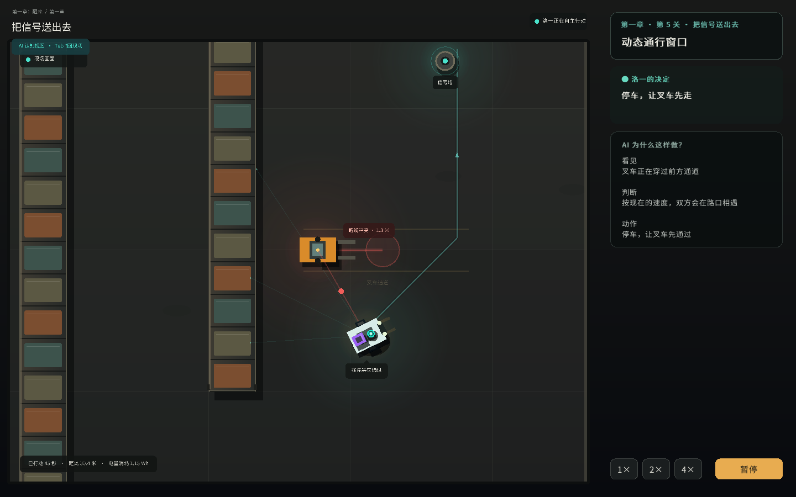
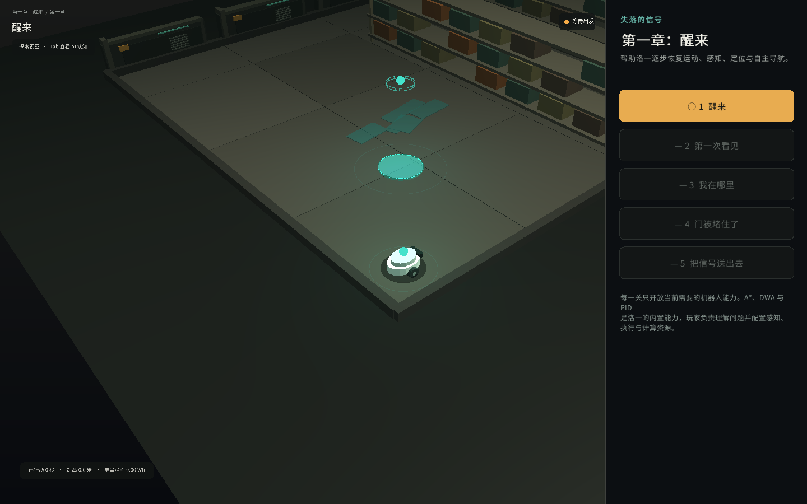

# 失落的信号 / Lost Signal

《失落的信号》是一款开源的机器人 AI 剧情冒险游戏原型。玩家修复机器人伙伴“洛一”（RO-1），先亲手完成底盘校准，再通过选择轮胎、距离雷达、计算单元和行为倾向，让它逐步恢复自主能力，并从真实回放中理解感知、定位、规划和控制如何协同。



项目采用 **C++20 + raylib 6.0 + TGUI 1.13 + JSON + glTF 2.0/GLB + CMake**。地图、3D 场景、关卡、机器人装配、组件、策略、剧情和界面文案全部从 `assets/` 动态加载。A*、DWA 和 PID 是机器人的内置算法，不作为玩家装备。

任务默认以三分之四视角的 3D 场景呈现。按 `Tab` 可切换到 AI 认知视图，查看同一时刻的雷达命中、A* 全局路线、DWA 候选与选中轨迹、动态局部图和叉车预测。控制卡展示左右轮目标/编码器实测 RPM，以及两个轮速 PID 真实输出的 PWM。再按一次 `Tab` 返回现场。`Space` 暂停，数字键 `1`、`2`、`4` 切换运行倍速。

第一关使用 `WASD` 或方向键完成一次短暂的实时驾驶校准，帮助玩家直接感受加速、转向和制动。后续计分任务由洛一自主执行，实时驾驶不会绕过机器人 AI 玩法。



## 一条命令运行

在 Linux 或 macOS 的仓库根目录执行：

```bash
./tools/run.sh
```

直接查看最终关的 AI 认知层：

```bash
./tools/run.sh --demo --level lost_signal --analysis-view
```

第一次执行会自动完成以下工作：

1. 检查 CMake；版本不足时下载固定版本到本地目录；
2. 通过 CMake `FetchContent` 下载固定版本的 raylib、TGUI 和 nlohmann/json；
3. 编译 C++ 游戏和仿真核心；
4. 启动游戏。

后续执行会直接使用已有构建，不需要账号、Hub 或许可证激活。

通关进度和每关最佳评价会自动保存到系统用户数据目录。调试时可用 `--save FILE` 指定文件，或用 `--no-save` 禁用持久化；自动截图和 `--demo` 不会改写玩家进度。

CMake 可以下载和编译项目依赖，但操作系统仍需提供 C++ 编译器以及窗口系统的开发头文件。Ubuntu/Debian 的一次性基础环境为：

```bash
sudo apt-get install build-essential git curl libasound2-dev libx11-dev \
 libxrandr-dev libxi-dev libgl1-mesa-dev libglu1-mesa-dev \
 libxcursor-dev libxinerama-dev
```

macOS 只需先执行 `xcode-select --install`。这些是平台工具，不是项目运行时或闭源 SDK。

## 构建、测试和无窗口运行

```bash
# 图形客户端、仿真核心和测试
./tools/build.sh --test

# 只编译仿真核心并运行测试，不下载图形依赖
./tools/build.sh --headless --test

# 无窗口执行某一关的推荐配置
./tools/run.sh --headless --level lost_signal --recommended

# 删除当前构建目录后重建
./tools/build.sh --clean
```

图形版默认产物位于 `build/release/`，headless 版位于 `build/headless/`，两者不会互相覆盖 CMake 配置。可用环境变量将工具链和构建产物放到其他磁盘：

```bash
LOST_SIGNAL_TOOLCHAIN_DIR=/disk/dev/lost-signal-toolchain \
LOST_SIGNAL_BUILD_DIR=/disk/dev/lost-signal-build \
./tools/run.sh
```

## 当前可玩第一章

第一章包含五个连续任务：底盘校准、第一次距离感知、湿滑地面定位、封路后的重新规划，以及最终的动态叉车通行。章节路线会按前置任务逐关解锁；每关只开放当前需要的装配槽位，早期关卡不会要求玩家配置尚未恢复的计算模块。



最终任务“把信号送出去”要求洛一经停补给站，携带能源模块穿过叉车通道，再启动信号塔。玩家在机库选择硬件和行为倾向，先预测风险，然后观看机器人自主执行；任务结束后可以按事件回看“观察 → 判断 → 动作 → 结果”的因果链。

界面包含机库装配、出发判断、现场执行和事故复盘。固定时间步仿真负责传感、A* 全局规划、DWA 局部避障、控制、动态障碍预测、确定性回放和评分。导航首先生成 `v/ω`，再换算成左右轮目标速度；两个轮速 PID 使用编码器量化反馈输出 PWM，PWM 实际推进电机/轮组仿真。叉车必须先被真实雷达束命中并通过静态遮挡检查，随后才进入短时动态跟踪层；DWA 读取跟踪位置、估计速度和预测轨迹，不直接读取叉车真值或巡逻路径。

3D 探索层和 2D 认知层都读取同一份只读仿真快照。切换视图不会改变机器人行为、固定时间步或任务结果；无窗口版本继续使用完全相同的 C++ 仿真核心。

## 目录

```text
assets/ JSON 关卡、地图、组件、策略、剧情、表现和 Schema
assets/models/ 独立的机器人与环境 GLB 模型
assets/textures/ 项目自有、可重复生成的环境纹理
assets/robots/ 机器人坐标系、安装点、碰撞体和装配配置
assets/scenes/ 3D 镜头、阴影、曝光、Bloom、地面、环境 Prefab 与实例配置
src/sim/ C++20 仿真算法：A*、DWA、PID、电机/PWM、运动学、雷达与动态障碍跟踪
src/game/ 内容加载、任务仿真、诊断、回放与评分
src/client/ raylib 3D 探索层、2D 认知层和 TGUI 玩家界面
tests/new/ 当前 C++ 内容与任务回归测试
docs/ 产品策划、UI、软件设计和验证记录
tools/ 一键构建、运行和内容校验脚本
```

产品、UI 与软件设计见 [docs/design.md](docs/design.md)，当前验证证据见 [docs/validation.md](docs/validation.md)。

## 开源许可证

本仓库原创代码、配置、关卡和文档采用 [Apache License 2.0](LICENSE)，允许使用、修改、分发和商业使用，并提供明确的专利授权。分发时需保留许可证及适用的版权和 NOTICE 声明。

raylib、TGUI、nlohmann/json 与 Noto Sans CJK 保留各自许可证，详见 [THIRD_PARTY_NOTICES.md](THIRD_PARTY_NOTICES.md)。
