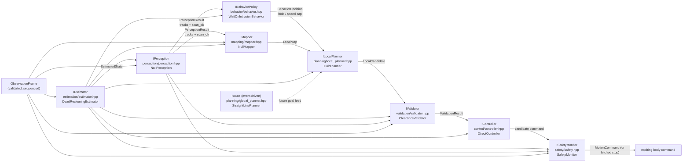

# Algorithm modules (autonomy)

`src/robot/autonomy/` follows one data flow with replaceable typed modules.
The coordinator owns the stack and the per-tick order; SIM never calls a
module directly.

## Module graph

v1 holds position: `HoldPlanner` emits zero motion, `ClearanceValidator`
accepts the hold, `DirectController` emits canonical `kStop`. A DWA/sampling
planner replaces `HoldPlanner`'s body; the validator stays the independent
authority and the controller never invents motion.

## Ownership rules

- Estimation consumes odometry/IMU prediction + scan/map correction only.
  No truth, no map mutation, no command selection.
- Perception owns tracks + free-space evidence. `scan_ok == false` means
  unknown, never free space. No actor IDs cross.
- Mapping owns the rolling local model. It never writes the static
  `MapSnapshot` revision; that is an explicit provider publication.
- Behavior (`IBehaviorPolicy`) is the dynamic-decision layer: tracks +
  estimate in, ONE constraint (hold / speed cap) out. It selects no
  trajectory and emits no command. A hold short-circuits sampling but still
  passes validator + controller, so the evidence chain stays uniform.
  Task-level policy (which goal, return-to-charge) stays in `RobotExecutive`,
  one timescale above behavior; trajectory sampling stays below it.
- Global planning is event-driven (goal/map change), not per-tick. It
  returns a `Route` of `RoutePoint{x, y, yaw}`; heading travels with position.
- Local planning runs at decision rate and returns one feasible
  `LocalCandidate{forward, yaw_rate, cost}`. Score is a preference; only the
  validator decides admissibility.
- Validation is independent: it re-checks the exact candidate against raw
  scan evidence (missing/stale scan rejects motion, hold passes). Admission
  never waives clearance, and a rejection is always a safe stop, never a
  re-planned command.
- Control emits the validated candidate verbatim with a 200 ms watchdog.
  Zero motion is always canonical `kStop`, never zero-valued `kYawRate`.
  Chassis clamping lives one layer out (`DifferentialRobot` + `IChassis`).
- Safety (`ISafetyMonitor`) is the last gate and the ONLY module allowed to
  override a command after the controller. It re-checks RAW evidence only
  (observation freshness, near-field scan range, channel health) — never
  planner state — and can only downgrade to safe stop. Rules: stale obs
  (> 500 ms) latches `STOPPED`; raw min-range inside the near-field envelope
  latches `STOPPED`; fresh channel drops give transient `DEGRADED`
  (auto-recovers); missing scan gives `DEGRADED`. A latch needs deliberate
  recovery (`clear_safety`, or full shutdown -> configure -> activate) and
  never auto-clears on fresh data. Safety state + reason ride in
  `Diagnostics` for ops visibility and offline scoring.

## Cadence (implemented)

| Module | Trigger |
|---|---|
| Estimator predict/correct | every ingested observation (sensor rate) |
| Perception / mapping | scan-bearing observations only (`scan_valid`) |
| Behavior + local planner + validator + controller | decision period, default 10 Hz (`decision_period_ns`), or event wakeup |
| Safety gate | every `update()` tick, on the held or fresh command |
| Global planner | event-driven (goal/map change), outside the per-tick path |

`ingest_observation()` advances estimator always and perception/mapper at
scan rate. `update()` runs the decision branch when due, on
`request_replan()`, or on a `MapSnapshot` revision change; otherwise it holds
the last validated command (inside its watchdog expiry) while safety keeps
gating every tick. Event inputs therefore never wait for the period, and
periodic work never runs on stale data.

## Fail-closed summary

| Input failure | Behavior |
|---|---|
| no observation | safe stop, estimate stays invalid |
| stale/repeated sequence | ignored, state frozen |
| missing scan | motion rejected, hold accepted |
| planner has no plan | safe stop |
| validator rejects | safe stop (not a re-plan) |
| coordinator not Active | safe stop, modules untouched |

Tests: `tests/test_autonomy.cpp` (integration, validator table, straight-line
route, pre-activation hold).
