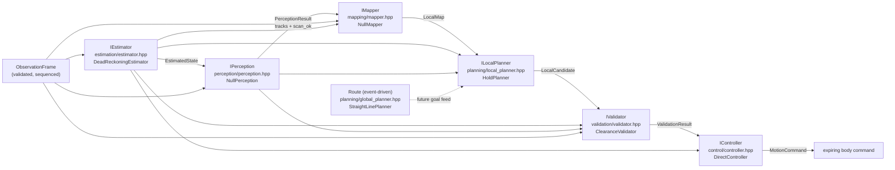

# Algorithm modules (autonomy)

`src/robot/autonomy/` follows one data flow with replaceable typed modules.
The coordinator owns the stack and the per-tick order; SIM never calls a
module directly.

## Module graph

v1 holds position: `HoldPlanner` emits zero motion, `ClearanceValidator`
accepts the hold, `DirectController` emits canonical `kStop`. A DWA/sampling
planner replaces `HoldPlanner`'s body; the validator stays the independent
authority and the controller never invents motion.

## Ownership rules

- Estimation consumes odometry/IMU prediction + scan/map correction only.
  No truth, no map mutation, no command selection.
- Perception owns tracks + free-space evidence. `scan_ok == false` means
  unknown, never free space. No actor IDs cross.
- Mapping owns the rolling local model. It never writes the static
  `MapSnapshot` revision; that is an explicit provider publication.
- Global planning is event-driven (goal/map change), not per-tick. It
  returns a `Route` of `RoutePoint{x, y, yaw}`; heading travels with position.
- Local planning runs at decision rate and returns one feasible
  `LocalCandidate{forward, yaw_rate, cost}`. Score is a preference; only the
  validator decides admissibility.
- Validation is independent: it re-checks the exact candidate against raw
  scan evidence (missing/stale scan rejects motion, hold passes). Admission
  never waives clearance, and a rejection is always a safe stop, never a
  re-planned command.
- Control emits the validated candidate verbatim with a 200 ms watchdog.
  Zero motion is always canonical `kStop`, never zero-valued `kYawRate`.
  Chassis clamping lives one layer out (`DifferentialRobot` + `IChassis`).

## Cadence (target; current = per-tick)

| Module | Trigger |
|---|---|
| Estimator predict | every IMU/encoder observation |
| Estimator correct | every scan (local) / recovery event (global) |
| Perception / mapping | sensor delivery rate |
| Local planner + validator + controller | decision rate (e.g. 10 Hz) |
| Global planner | goal change, map revision, route invalidation |

Today `ingest_observation()` advances estimator/perception/mapper and
`update()` runs plan/validate/control in one tick. Splitting cadences is
scheduler work in `RobotApplication`; module contracts already carry the
timestamps to support it.

## Fail-closed summary

| Input failure | Behavior |
|---|---|
| no observation | safe stop, estimate stays invalid |
| stale/repeated sequence | ignored, state frozen |
| missing scan | motion rejected, hold accepted |
| planner has no plan | safe stop |
| validator rejects | safe stop (not a re-plan) |
| coordinator not Active | safe stop, modules untouched |

Tests: `tests/test_autonomy.cpp` (integration, validator table, straight-line
route, pre-activation hold).
