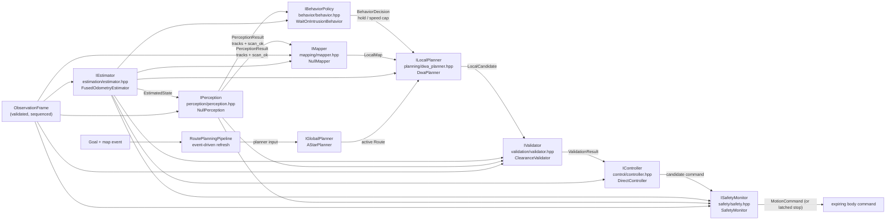

# Algorithm modules (autonomy)

`src/robot/autonomy/` follows one data flow with replaceable typed modules.
The coordinator owns the stack and the per-tick order; SIM never calls a
module directly.

## Module graph

`DwaPlanner` samples the dynamic window from measured twist, rolls out with
response delay, checks static collision on the optimistic map view and
dynamic collision on predicted track frames, and scores goal / heading /
clearance / path / progress / oscillation. It emits one feasible
`LocalCandidate` toward the route lookahead; without a goal there is no
route and the chain holds. Ackermann candidates are bounded by the declared
wheelbase/steering curvature and cannot turn in place; holonomic lateral
commands use a slew-limited command window instead of reopening the full
sideways range on every decision. `ClearanceValidator` accepts the result against
raw scan evidence, `DirectController` emits canonical `kStop`/command, and
the safety gate has the last word. Wheel-space windows and actuator
identification stay out: the `IChassis` wrapper owns the real base.

## Ownership rules

- Estimation consumes odometry/IMU prediction + scan/map correction only.
  No truth, no map mutation, no command selection. `FusedOdometryEstimator`
  blends gyro-led yaw (with a slip gate that trusts the IMU and inflates
  covariance when wheels disagree), integrates a quaternion complementary
  attitude filter (gyro propagation, gravity-tilt correction), dead-reckons
  z from pitch (`dz = forward·sin(pitch)` — no map correction observes it,
  the raster is 2D), and grows sigmas with motion and time. Roll/pitch/z
  ride in `EstimatedState` with an `attitude_valid` flag: planar position +
  z, full 3D attitude (2.5D).
- Perception owns tracks + free-space evidence. `scan_ok == false` means
  unknown, never free space. No actor IDs cross. `LidarPerception` splits
  foreground by disagreeing with a static reference (map raycast or surveyed
  scan); without one, classification is unavailable and no tracks publish,
  while `scan_ok` stays true so raw safety coverage is retained. Foreground
  beams cluster into candidates, nearest-neighbor association keeps
 identities, and velocity is averaged since first sighting (finite
 differences amplify centroid quantization into m/s noise). Tracks carry
 `prediction_ready` once they have history; avoidance consumes unready
 tracks conservatively.
- Mapping owns the rolling local model. It never writes the static
  `MapSnapshot` revision; that is an explicit provider publication.
  `LocalMap` carries real occupancy (`-1` unknown, `0` free, `100`
  occupied) with origin-aware queries: conservative `is_free` /
  `segment_is_free` (unknown counts as blocked) for admission/validation,
 `is_blocked` / `segment_is_traversable` are conservative for planner
 sampling: unknown and out-of-window cells are blocked until a sensor ray
 or ROBOT-side SLAM replay marks them free. Without a static reference,
 lidar endpoints become occupied evidence unless associated with a
 perception track; unmatched returns remain conservative. The map exposes
 sensor-versus-SLAM provenance for diagnostics. Accepted SLAM loop closure
 replays keyframes into the same mapper; simulator terrain and contact
 truth never enter this path.
- Behavior (`IBehaviorPolicy`) is the dynamic-decision layer: tracks +
 estimate in, ONE constraint (hold / speed cap) out. The default policy
 predicts closest relative approach over a short horizon using track
 geometry, velocity, and the declared ego footprint; objects behind or beside
 the base do not cause a global stop. It selects no trajectory and emits no
 command. A hold short-circuits sampling but still passes validator +
 controller + safety, so the evidence chain stays uniform.
  Task-level policy (which goal, return-to-charge) stays in `RobotExecutive`,
  one timescale above behavior; trajectory sampling stays below it.
- Global planning is event-driven (goal/map change), not per-tick. It
  returns a `Route` of `RoutePoint{x, y, yaw}`; heading travels with position.
 `AStarPlanner` searches the static `MapSnapshot` raster (unknown
  traversable with penalty, occupied impassable, no corner cutting) and
  degrades to a straight line when the map has no raster; a walled-in goal
 yields an invalid route (fail closed upstream). `RoutePlanningPipeline`
 refreshes the active route on goal/map change or an explicit replan event;
 the coordinator only wires the event and module inputs. The local planner
 only ever consumes that route, never a raw goal. The static map itself arrives as
  an immutable revision from a provider (`StaticMapProvider` rasterizes
  authored geometry; SLAM/file/remote providers implement the same seam),
  so replans track content revisions, never live sensor frames.
  The static provider publishes surveyed elevation alongside occupancy
  (ramps, decks; NaN where unsurveyed). A* adds a grade cost per meter of
  elevation change and rejects steps steeper than `max_grade` outright, so
  hills are skirted and cliffs fail closed. Sensing is slope-correct: the
  estimate carries roll/pitch/z, `odom->base` publishes the full 3D pose,
  and every deprojection path (perception, rolling mapper, scan matcher,
  global search, SLAM submaps) composes `map<-base` with the full TF mount
  `base<-lidar` before projecting endpoints to the 2D raster. Rolling local
  grade response (DWA descent braking, rollover limits) builds on this;
  the pose graph itself stays SE(2).
- Local planning is DWA at decision rate and returns one feasible
  `LocalCandidate{forward, yaw_rate, cost}`. Score is a preference; only the
  validator decides admissibility. Every outcome (hold, plan, no-plan, veto)
  funnels into one command with no early returns, so the safety gate below
  runs unconditionally.
- Validation is independent: it re-checks the exact candidate against raw
  scan evidence (missing/stale scan rejects motion, hold passes). Motion
  needs footprint plus braking distance (`v^2/2a`) of clearance. Admission
  never waives clearance, and a rejection is always a safe stop, never a
  re-planned command.
- Control emits the validated candidate verbatim with a 200 ms watchdog.
  Zero motion is always canonical `kStop`, never zero-valued `kYawRate`.
  Chassis clamping lives one layer out (`DifferentialRobot` + `IChassis`).
- Safety (`ISafetyMonitor`) is the last gate and the ONLY module allowed to
  override a command after the controller. It re-checks RAW evidence only
  (observation freshness, near-field scan range, channel health) — never
  planner state — and can only downgrade to safe stop. Rules: stale obs
  (> 500 ms) latches `STOPPED`; raw min-range inside the near-field envelope
  latches `STOPPED`; fresh channel drops give transient `DEGRADED`
  (auto-recovers); missing scan gives `DEGRADED`. A latch needs deliberate
  recovery (`clear_safety`, or full shutdown -> configure -> activate) and
  never auto-clears on fresh data. Safety state + reason ride in
  `Diagnostics` for ops visibility and offline scoring.

## Cadence (implemented)

| Module | Trigger |
|---|---|
| Estimator predict/correct | every ingested observation (sensor rate) |
| Perception / mapping | scan-bearing observations only (`scan_valid`) |
| Behavior + local planner + validator + controller | decision period, default 10 Hz (`decision_period_ns`), or event wakeup |
| Safety gate | every `update()` tick, on the held or fresh command |
| RoutePlanningPipeline / global planner | event-driven (goal/map change or explicit replan), outside the per-tick path |

`ingest_observation()` advances estimator always and perception/mapper at
scan rate. `update()` runs the decision branch when due, on
`request_replan()`, or on a `MapSnapshot` revision change; otherwise it holds
the last validated command (inside its watchdog expiry) while safety keeps
gating every tick. Event inputs therefore never wait for the period, and
periodic work never runs on stale data.

## Fail-closed summary

| Input failure | Behavior |
|---|---|
| no observation | safe stop, estimate stays invalid |
| stale/repeated sequence | ignored, state frozen |
| missing scan | motion rejected, hold accepted |
| planner has no plan | safe stop |
| validator rejects | safe stop (not a re-plan) |
| coordinator not Active | safe stop, modules untouched |

Tests: `tests/test_autonomy.cpp` (integration, validator table, straight-line
route, pre-activation hold).

## Deliberation layers (task -> motion -> trajectory)

- `TaskOrderingRegistry` scores candidate tasks (`shortest`,
  `value_density`, plus content-registered scorers); missions never branch
  on policy names.
- Semantic places (`place_id`) resolve through the ROBOT map provider into
  estimated-frame goals; unknown ids return an invalid handle. Goals are
  async: `request_goal` arms only once the executive accepts (rejected
  requests — unknown place, inactive executive, empty request id — arm
  nothing and the coordinator never plans), `goal_status` polls
  (`active/done/failed/canceled`), successful `cancel_goal` withdraws the
  coordinator's route (failed cancels leave it untouched), a new request
  preempts the running goal, and arrival (estimate inside 0.5 m of the
  goal) completes it. SIM submits the same typed intents as an operator.
- `BehaviorPolicy` turns tracks + estimate into one constraint; `DWA`
  samples trajectories (forward/yaw always, lateral only when the chassis
  envelope carries `max_lateral_mps > 0`); the controller emits `kHolonomic`
  iff the winning candidate strafes, else `kYawRate` (ackermann converts
  yaw to steer in the chassis via the bicycle model; `kSteerAngle` stays
  the explicit operator/native space). The validator and the independent
  safety monitor keep their vetoes.

## Localization (scan-matched, supervisor-gated)

- `ScanMatcher` scores a bounded hypothesis grid around the odometric prior
  against the static raster (occupied +1 / free +1-for-clearing / unknown 0
  / outside -0.25), requires overlap and a margin over the next *separated*
  hypothesis, and rejects ambiguity outright instead of dragging the pose
  to a corridor twin. `score_pose` exposes the same scoring per pose so the
  global search and the SLAM submaps cannot diverge from it.
- `LocalizationSupervisor` schedules corrections (cadence + motion/idle
  triggers, sigma/confidence/age gates) and rate-limits global recovery;
  a rejected match is evidence, never an implicit correction.
- `FusedOdometryEstimator::correct_pose` blends accepted corrections by
  Kalman-lite variance weighting and validates the estimate; `seed_pose`
  implements the deliberate deployment/operator initial pose (known dock).
  Both reject non-finite input.
- `observe_slip` reports wheel-vs-body residual + confidence with honesty
  states (Invalid / UnobservableLowSpeed / StaleEstimator / Observable);
  the estimator's gyro-trust gate ORs the fast sensor-level disagreement
  with the observable estimate-level residual, and exposes `last_slip()`
  for diagnostics (consumers read quality/confidence, never thresholds).
- `select_startup_mode` picks the init frontend from map/prior
  availability (seed-and-track / global-search / slam-only); the
  coordinator auto-seeds the odometry origin once when mapless.
- `GlobalSearcher` (kidnap recovery / cold start): coarse pass over free
  raster cells x headings with a downsampled beam subset, top-K survivors
  each refined by the bounded local matcher, then a strict twin check —
  score margin plus an equivalent-support gate (runner-up overlap within
  0.10 means unobservable, e.g. map-edge gradients along a uniform wall).
  The evaluation budget rejects explicitly instead of truncating the map
  silently. First fix after an unknown start snaps (no trustworthy prior
  to blend toward); later fixes blend.

## SLAM (pose-graph sessions with loop closure)

- `PoseGraphBackend` (ported Gauss-Newton over sparse normal equations,
  Eigen headers only, no GTSAM/Ceres): odometry chain + scan-match edges,
  Huber-gated loop factors, first-fixed-node gauge anchor.
- `SlamSession` keyframes on motion thresholds (ring-bounded), detects
  loops against keyframe submaps (endpoint splat renders quantized scan
  samples into raster cells; two-pass rasterize so ray interiors never
  erase another beam's wall), and verifies both directions: the current
  scan must match the old submap AND the old scan must match a submap
  rendered at the forward solution (rendering at the drifted estimate
  would offset the check by the drift being measured).
- `LoopClosureGate` enforces temporal separation, candidate distance, and
  two-way overlap/margin before any constraint reaches the graph.
- An accepted closure snaps the live estimate (rigid delta compose, so a
  robot that moved past the newest keyframe still corrects exactly) and
  rebuilds the rolling map from keyframes at their optimized poses; the
  decision branch refreshes on the corrected estimate.
- Mapless loop missions close the loop in the headless scenario
  (`tests/test_loop_closure.cpp`): a 4x4 m square past landmark boxes,
  keyframed, closures counted in the offline diagnostics; the body returns
  to the start dock with bounded truth miss and zero judge-fired steps.
- SIM sensor honesty: the suite reports the true yaw rate (the estimator's
  slip gate trusts gyro over odometry, so a hard-zero gyro would freeze the
  heading through every turn); S7 adds seeded delivery shaping (whole-tick
  latency with preserved stamps + dropout) and bounded IMU noise/bias.
- Survey interchange (`sim/eval/map_package.hpp`): versioned JSON survey
  (manifest + FNV-1a checksummed raster + places), save->load->save
  byte-identical with fail-closed validation; `StaticMapProvider` serves a
  package from files under the same seam.

## Hardware contract (sim-native parity)

- `DriveProfile` (`robot/platform/drive_profile.hpp`) is the single hardware
  capability contract: geometry + DC force-curve numbers (stall force +
  free speed) + per-wheel equivalent mass + encoder resolution, with
  factory defaults per chassis kind (same numbers `make_chassis` builds
  with; unknown kinds fail closed). Speed lag is emergent
  (tau = m * free / stall), never a fitted constant.
- The hardware contract file (`configs/robot/*.json`) loads on both sides
  (native via `robot::platform::load_robot_config`, SIM via translation),
  so a measured step response can retune the plant without forking
  geometry. Config files carry the hardware contract only;
  ROBOT never reads SIM truth.
- Stops are closed-loop: each chassis holds zero through its wheel loops
  when joints are known (active electrical braking); blind stops stay
  SafeZero. The SIM service brake (`sim/world/service_brake.hpp`) is the
  dissipative counterpart, driven by a SIM-side hook, never a ROBOT channel.
- Rolling contact (`sim/world/contact.hpp`) shares the ROBOT feedforward
  form (`R = rr*load*tanh(v/s) + c*v`) as the tested effort spec (unit
  tests pin the math); the live plant is the MuJoCo engine, where viscous
  drag arrives as native joint damping and truth is read back from engine
  state. Wheel-vs-body slip is reported engine-side
  (`WorldTruth.drive_slipping`, SIM-side offline labels only — never a
  ROBOT channel).
- Rigid coupling (S1–S3 analytic plant, deleted in the M2 cutover): every
  patch force acted on the vehicle mass, split evenly over the driven
  wheels, so symmetric motion integrated exactly ΣF/M with kinematic yaw.
  The effort numbers survive as the tested spec above; the engine owns
  integration now and no exact-zero semantics are pinned on live truth.
- Actors carry a motion policy (`sim/world/actor_behavior.hpp`): constant
  velocity (default, yesterday's straight lines), waypoint follow (loop or
  latched stop), seeded wander (splitmix64 stream per actor — same seed +
  same dt sequence is bit-identical).
- Scenario orchestration (`sim/scenario/`): sim-time multi-rate scheduler
  (scan/record taps run every plant step by default; the decision tap is
  inert — the ROBOT decision branch is gated by the coordinator's own
  10 Hz), objective driver (place list through the operator `request_goal`
  seam; ROBOT Done/Failed advances, truth arrival counted offline only),
  truth-side collision judge (circle-vs-box/actor contact + clearances,
  recorded per step into the episode for scoring — never a ROBOT input).
  `EpisodeScore` counts judge-fired steps. A string registry names the kinds for
  scenario authors; World evaluates the policy before integrating.
- Joint feedback is the encoder view (`SimMotionEndpoint::poll_feedback`):
  angles quantized to `encoder_counts_per_revolution`, velocities
  differentiated over poll-stamp deltas; the ROBOT loop closes on it like
  native. First sample reports zero velocity (no history yet).

## Validation (trajectory verdicts with minimum-risk escape)

- `ClearanceValidator` rolls out the exact candidate twist (constant-twist
  arc integration, 2 s horizon) against raw scan endpoints in the map
  frame and linearly predicted tracks — never planner state, never the
  map it might validate against.
- Verdicts: `Accepted`, `MinimumRiskEscape` (starts inside the margin but
  a slow creep gains clearance where holding strands the base; capped at
  0.3 m/s, needs +0.15 m gain), `StaticCollision` (swept footprint hits
  observed geometry), `DynamicCollision` (rollout meets a predicted
  track), `UnsafeEmergencyStop` (braking tail `v^2/2a` doesn't fit the
  forward opening), `InvalidStructure`. Accepted = first two only.
- Without a valid estimate the validator falls back to the forward-sector
  check (dead-reckoning start, never a silent full validation).
