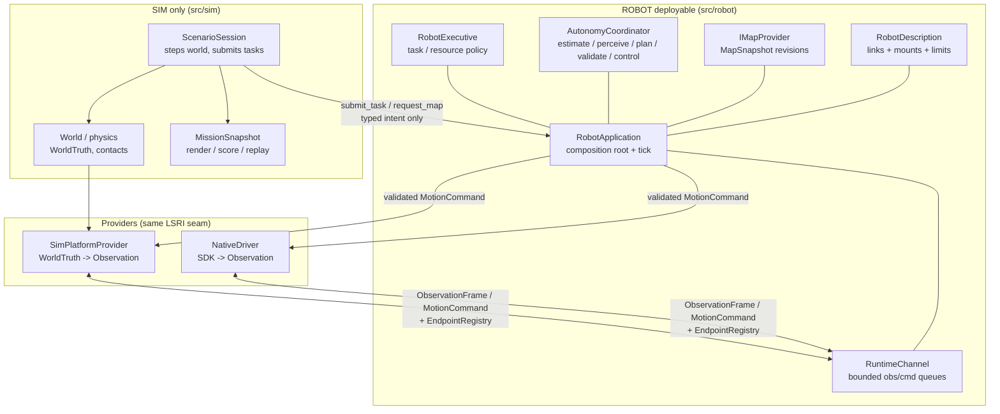

# Architecture (clean rebuild)

ROBOT is the anchor. `src/robot/` builds without any `src/sim/` header,
source, or library. The boundary gate (`tests/check_boundary.py`) enforces it.

## System shape



Rules:

- SIM owns world truth, physics, actors, scenario facts, rendering, scoring,
  replay truth, `MissionSnapshot`.
- ROBOT owns estimation, perception, mapping, prediction, planning,
  validation, control, safety, task policy.
- Truth may be logged as an offline label/score. It must never enter the
  same-cycle decision path.

## Message protocol (LSRI v1)

Versions: `kApiVersion = 1`, `kMessageSchemaVersion = 1`
(`src/robot/iface/version.hpp`). Bump on meaning change, never reinterpret.

### ObservationFrame (`iface/observation.hpp`)

Provider -> ROBOT. One acquisition-time snapshot per endpoint.

| Field | Meaning |
|---|---|
| `sequence` | strictly increasing per `source`, `> 0` |
| `stamp_ns` | acquisition time, monotonic ns; delivery may lag, never rewrites stamp |
| `source` | stable endpoint id, must be registered |
| `frame` | `map / odom / base_link / lidar_link / imu_link` |
| `ranges_m + scan_valid` | planar scan; invalid = unknown, never free |
| `odometry_valid + forward_mps + yaw_rate_radps` | body twist, SI |
| `imu_valid + yaw_rate + ax` | measured, SI |

Validation (`valid_observation_frame`): non-empty source, valid stamp,
`sequence > 0`, at least one valid section. Channel additionally rejects
stale/repeated sequence or timestamp per source.

### MotionCommand (`iface/command.hpp`)

ROBOT -> provider. One command space, explicit units, expiring.

| Field | Meaning |
|---|---|
| `space` | `kStop` or `kYawRate` (new spaces are new enum values) |
| `stamp_ns / expiry_ns` | issue time + watchdog deadline (v1: 200 ms) |
| `forward_mps / yaw_rate_radps` | SI; all zero when `kStop` |

Validation (`valid_motion_command`): ordered timestamps, not expired at
consume time, `kStop` implies zero motion. Anything else -> safe stop.

### Task / Map intent (`iface/task.hpp`, `iface/map.hpp`)

| Call | Payload |
|---|---|
| `submit_task(TaskRequest{request_id, place_id})` | semantic place only, resolved via `IMapProvider` |
| `request_map(map_id)` | map selection, fulfilled at a safe switching point |
| `IMapProvider::active_snapshot()` | immutable `{map_id, revision, raster?, frame_id}` |

No coordinates, actor ids, MuJoCo handles, or renderer state cross here.

## Data transport (SIM <-> ROBOT)

`src/robot/iface/channel.hpp` — `RuntimeChannel`. In-process, bounded,
mutex-protected. No IPC required for the boundary; a future ROS/HTTP bridge
serializes the same typed structs at the App edge.

- Capacity: obs 64, cmd 16 (configurable). Overflow drops oldest obs, counts
  `obs_dropped`, marks degraded.
- Concurrency: many provider threads may `publish_observation`; one thread
  drains in `tick()`.
- Freshness: `take_command(now)` returns newest non-expired command, else
  `SafeStop`. Expired counts `cmd_expired`.
- Health: `ChannelHealth{obs_received/dropped/rejected, cmd_published/expired}`
  is the bring-up and replay signal.
- Ordering: per-source strictly increasing `(sequence, stamp_ns)`. Arrival
  time never replaces acquisition time.

Typical step (SIM, same for native):

```text
world.step(20ms)
  -> SimPlatformProvider.poll_observation()   # truth -> measurement
  -> app.publish_observation(obs)             # registry + channel gate
  -> app.tick(now)                            # drain -> coordinator -> cmd
  -> provider.consume_command(cmd)            # validated -> plant
```

Replay uses the same path: recorded frames are republished through
`publish_observation`, never injected into the coordinator directly.

## RobotApplication: Sim or Real?

Yes — exactly that. `RobotApplication` is the composition root; Sim and Real
are just providers behind `IPlatformProvider` + `EndpointRegistry`.

```cpp
RobotApplication app(std::move(maps), desc);
app.register_provider({"ro1.lidar", kLidar, kSim, "lidar_link"});    // sim
app.register_provider({"ro1.imu", kImu, kNative, "imu_link"});       // real
app.publish_observation(obs);  // either backend, same validation
app.tick(now);                 // same autonomy, same command
app.take_command(now);         // provider pulls, expiry enforced
```

- `lost_signal_robot` links only `lost_signal_robot_stack` (native bring-up).
- `lost_signal_sim` links `lost_signal_sim_scenario` (world + sim provider +
  session driving the same `RobotApplication`).
- Mixed backends are allowed per endpoint; one `(endpoint_id, role)` has
  exactly one owner.

## Robot description (URDF-like)

`src/robot/platform/description.hpp` — `RobotDescription`. Versioned
configuration, not physics:

- `robot_id + version`: bump on any mount/limit change; hash-pinned to logs.
- `links[]`: `{link, parent, xyz_m, rpy_rad}` rooted at `world -> base_link`.
- `sensors[]`: `{sensor_id, link, xyz_m, rpy_rad}` matching
  `EndpointDescriptor.endpoint_id`.
- `limits`: `{max_forward_mps, max_yaw_rate_radps, footprint_radius_m}`.

It answers the same questions as URDF/SDFormat links + joints + sensors
(frames, mounts, limits) in a smaller auditable form. It deliberately holds
no MuJoCo bodies, contacts, motor curves, meshes, or scenario presentation assets:

- SIM physics adapter: `robot_id -> MuJoCo joints/contacts`.
- GAME presentation adapter: `robot_id -> meshes/colors/prices`.
- ROBOT consumes only frames, mounts, and limits.

Changing calibration creates a new `version` and invalidates dependent
estimates; it is never silently mixed into a running session.
