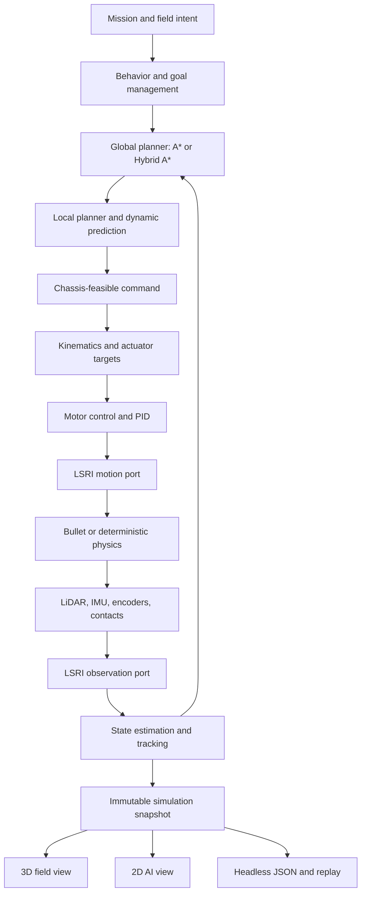

# Architecture

Lost Signal separates authored content, autonomous behavior, physical execution, and presentation so the same mission can support a game, a headless experiment, and future hardware adapters.

## System shape

The player affects `A`. Autonomous code owns `B` through `G`. LSRI carries commands and observations across the platform boundary. Sensors observe `H`, and presentation reads `K` without changing the simulation.

## Layer responsibilities

### Runtime boundary

The [Lost Signal Runtime Interface](runtime-interface.md) is the middleware-neutral robot boundary. Its autonomy port reads validated observations and writes expiring motion commands. Its platform port is implemented by the in-process simulator today and can be implemented by replay, a native hardware driver, or an optional bridge.

LSRI is a project standard rather than a ROS 2 API. Core libraries contain no ROS, DDS, executor, discovery, or ros2_control dependency. A bridge translates at the edge when integration with that ecosystem is useful.

### Content

`assets/` contains missions, maps, scenes, surfaces, robots, components, policies, presentations, story, UI strings, locales, and JSON Schemas. `ContentCatalog` loads and validates these resources into typed runtime definitions.

Locale files are sparse string-only overlays. They cannot change IDs, paths, seeds, physics, scores, or algorithms. English is the default runtime locale; Simplified Chinese remains available as `zh-CN`.

### Hardware and sensors

`src/hw/` models chassis capabilities, inverse kinematics, actuators, motor response, contacts, encoders, LiDAR, and IMU observations. A chassis declares its command space and limits. Algorithms consume the common contracts rather than depending on a graphical representation.

Sensors carry sequence, sample time, declared latency, source, and frame ID. Noise affects the generated measurements; the current in-process simulator records latency as metadata and delivers the packet immediately. World truth remains inside physics and scenario ownership.

Maps are 2.5D: terrain patches carry base height, two-axis grade, and roughness, while surface materials carry
friction, rolling drag, traction, and presentation effects. `PhysicsScene` turns that content into 3D collision
geometry and contact state. The shipped LiDAR is a single-plane scanner mounted in a named 3D frame. In the
production path it raycasts the 3D physics world against terrain, static geometry, and dynamic actors, includes
scan-time robot motion, and synthesizes intensity from hit normal, body class, and distance before applying the
declared bias, noise, quantization, and dropout model. It is not a multi-beam 3D point-cloud sensor, and its three
body-class reflectivities are not calibrated material optics.

### Algorithms

`src/autonomy/` follows the data flow used by compact autonomous systems: localization, mapping, perception, behavior, global and local planning, validation, then control. DWA and chassis-specific rollout samplers live under local planning; path following and PID live under control. The stack uses SI units and explicit configuration.

Global planners share a canonical `RoutePoint` result rather than a geometry-only polyline. Position, nominal body heading,
and arrival direction remain one value from planning through control. Grid A* still performs an eight-connected 2D
search and emits forward segments; its heading is the geometric route tangent and its final point inherits the
incoming edge heading. Hybrid A* remains the Ackermann default and preserves its searched heading and gear, including
at its exact terminal anchor. Ackermann lookahead stops at a forward/reverse cusp instead of inferring gear from point geometry.

The source layout is also a dependency rule. Mission state and simulated actor behavior cannot enter the autonomy layer. `lost_signal_autonomy`, `lost_signal_vehicle`, and `lost_signal_runtime` are separate targets, while `lost_signal_stack` is their small aggregate target.

The planning pipeline produces a feasible body command. The selected chassis converts that command into wheel speed and steering targets. Motor controllers compare targets with quantized feedback and apply actuation to physics.

For Ackermann platforms, the command is an equivalent front-wheel steering angle from the local planner through
LSRI to the steering position loop; no layer reinterprets it as yaw rate. Physical motor type, native drive command
mode, controller placement, and mechanical load are separate platform concerns. The
[platform-fidelity design](platform-fidelity.md) defines how a future native or HIL provider declares those
capabilities without exposing PWM or device protocols to autonomy.

### Mission systems

`src/mission/` owns goals, progression, field dispatch, world activity, scoring, telemetry, replay, and the fixed-step mission loop. `MissionSimulation` composes these systems and publishes an immutable snapshot for consumers.

The field operator, autonomous robot, dynamic actors, weather, and events remain part of one simulation world. Expedition mode reuses the same sensing, planning, control, and physics path as authored missions.

`DecisionEvidence` is the shared explanation boundary. The mission coordinator assembles it only from the
estimator timestamp, anonymous tracker references, prediction horizon, measured and projected separation,
active constraint, selected command, and planner outcome. A new record opens when the constraint, reason,
or action changes; the preceding record closes as `superseded` and names the next sequence. Mission
termination closes the final record. The current record is copied into every immutable replay snapshot,
while the compact transition history is emitted by headless runs. Player prose is a locale mapping over
stable codes, so the field view, AI view, debrief, replay, and tests cannot invent separate explanations.

### Physics

`IPhysicsWorld` is the backend boundary. Bullet is the production and default backend. A deterministic planar backend supports regression and focused algorithm tests. Bullet-shadow mode can compare integration paths without giving the shadow backend authority over gameplay.

`PhysicsScene` maps content geometry, terrain, robot bodies, actors, contacts, and raycasts to the backend. In Bullet authority mode, Bullet owns rigid-body pose. The rendering layer never advances physics.

### Presentation

`src/client/` renders the field and AI views from the same snapshot. UI state may pause or request an intent, but changing camera or visualization layers cannot affect autonomous output. The headless executable uses the same content and mission core and reports English, machine-readable results.

### Experiment evidence

Run Artifact v1 records build and source identity, a SHA-256 content manifest, comparable run inputs, hardware and
algorithm IDs, metrics, events, and the structured decision chain. `--reproduce` restores the declared authored
mission configuration, while `tools/compare_runs.py` rejects undeclared input changes. This compact manifest is
separate from UI snapshot replay and LSRI observation replay; large sensor traces remain external references.

## Stable contracts

The most important extension boundaries are:

- `ContentCatalog` for validated, localized data;
- `IPhysicsWorld` for rigid-body execution and raycasts;
- `IGlobalPlanner` for global planning;
- `IHighLevelPolicy` for behavior selection;
- `ChassisModel` plus `ChassisCaps` for feasible motion and actuator telemetry;
- LSRI v1 ports, sensor packets, transform frames, lifecycle, and watchdog semantics;
- `DecisionEvidence` for observation-to-action explanations and deterministic decision transitions;
- immutable snapshots for rendering, replay, and external observation.

The [autonomy extension guide](extending-autonomy.md) documents the global-planner v1 request/result contract, registry, directory boundaries, and a complete provider example.

These are useful sim-to-real seams because a hardware adapter can replace actuation and observation while keeping high-level logic testable. The seams do not eliminate the need for calibration, timing, safety, and hardware evidence.

## Coordinate and time model

Frames follow the familiar `map → odom → base_footprint → base_link → sensor/wheel link` structure. This aligns with [ROS REP-105](https://www.ros.org/reps/rep-0105.html). Geometry, time, angles, velocity, and acceleration use SI units and conventions consistent with [ROS REP-103](https://www.ros.org/reps/rep-0103.html).

The simulation advances at a fixed step. Sensors have independent sample rates and declared latency. The current in-process provider delivers each generated packet immediately; a real-time or transport provider may schedule delivery from the same metadata. Determinism requires the same content, configuration, seed, backend, and build assumptions; cross-backend numeric identity is not promised.

## Scheduling and concurrency

The current simulator uses one fixed-step, single-threaded scheduler. This is deliberate: identical inputs produce an inspectable execution order, and tests can advance simulated time without depending on host CPU timing. A 20 ms tick does not run every algorithm once. Each subsystem has its own cadence or trigger:

| Work | Current trigger |
|---|---|
| Dynamic world and physics | every 20 ms tick (50 Hz) |
| Encoder and IMU simulation, state-estimator prediction | every 20 ms tick (50 Hz) |
| LiDAR simulation, LiDAR perception, track update | configured LiDAR `scan_hz` |
| High-level policy, local planning, and control | compute component `decision_hz` |
| Global planning | mission start, goal change, or expedition-route change |
| Replay sample | every 40 ms |

Within one due tick, the scheduler updates dynamic actors, captures and processes a due LiDAR scan, runs a due autonomy decision, applies the held command to the chassis and physics, then generates encoder and IMU observations for the resulting motion. A command is therefore held between decision events. Global planning is event driven rather than part of the frame loop.

The in-process LSRI provider publishes and reads through a mutex-protected bounded queue on that same thread. The provider also accepts concurrent platform producers, so later sensor I/O threads do not require a new algorithm API. Sensor packets still carry independent sample times, sequence numbers, frames, and latency metadata; independent metadata does not imply one operating-system thread per sensor.

LSRI does not require this execution model. A hardware provider or out-of-process bridge may receive LiDAR, IMU, and encoder data concurrently and place validated packets in the bounded observation queue. Autonomy must consume timestamped observations and publish expiring commands without sharing mutable mission or simulator state.

If parallel execution is added, the deterministic scheduler remains the reference model. Parallel workers should operate on immutable, timestamped input snapshots and commit outputs at explicit scheduler boundaries. Queue limits, deadlines, stale-data policy, and command expiry belong in the runtime contract; thread ownership stays in the provider or executor. This keeps algorithms portable between deterministic simulation and asynchronous hardware without making their interfaces depend on a particular thread model.

Three execution modes can therefore share the same module contracts:

| Mode | Execution | Transport | Intended use |
|---|---|---|---|
| Deterministic | one fixed-step thread | in-process LSRI | tests, replay, teaching, reproducible experiments |
| Concurrent | sensor I/O threads plus an autonomy worker pool | in-process bounded mailboxes | real-time desktop simulation and embedded computers |
| Distributed | supervised platform, autonomy, and presentation processes | an IPC, shared-memory, or network LSRI provider | hardware deployment and fault isolation |

The concurrent mode should not create one permanent thread for every algorithm. Sensor drivers are naturally asynchronous; estimation and perception can run when observations arrive; global planning belongs on a cancellable low-frequency worker; and control needs a periodic deadline with the newest valid state snapshot. A small executor can map those logical tasks to a bounded worker pool.

The distributed mode needs more than a socket. Before it is considered implemented, LSRI needs a canonical wire encoding, schema compatibility tests, clock-domain conversion, bounded transport queues, peer health and restart behavior, and end-to-end watchdog tests. High-bandwidth scans may use a shared-memory ring while commands use a small reliable channel, but both must preserve the same message semantics.

To move algorithms safely between these modes, each module should own its mutable state and exchange immutable messages. Planned extension contracts are `ISensorSource`, `IEstimator`, `IPerceptionStage`, `ILocalPlanner`, and `IController`, following the existing `IGlobalPlanner` pattern only when a second real implementation justifies the boundary. Each task declaration will name its trigger, input age limit, deadline, queue policy, and failure fallback. Physics remains single-writer authority and publishes timestamped world snapshots to simulated sensor jobs; algorithm workers never read mutable physics or mission state directly.

## Content and algorithm integrity

A new data-driven component may tune declared physical behavior, cost, visuals, and unlock rules. It cannot inject code. A new chassis type or algorithm requires a C++ implementation, registration, build integration, and tests.

Validation checks references, budgets, schema shape, presentation coverage, locale completeness, placeholder preservation, canonical generation, and important gameplay contracts. Content generation scripts are the source of truth where a generated asset has a corresponding generator.

## Current strengths

The architecture already provides several uncommon combinations in a small open project:

- autonomous decisions and wheel-level control in one inspectable loop;
- five motion families behind explicit capability contracts;
- shared physics and sensor state across game, AI visualization, replay, and headless tests;
- observation noise, sampling, frames, and latency separated from world truth;
- deterministic scenario seeds and machine-readable results;
- data-driven educational content with string-only localization overlays;
- a clean path for log comparison and later ROS 2 integration.

The main technical risk is concentration in `MissionSimulation`, which still coordinates many subsystems. Recent extraction of planning, control, goal, dispatch, operator, and world-activity systems reduces that pressure, but continued changes should move ownership behind narrow interfaces rather than add more branches to the central loop.
