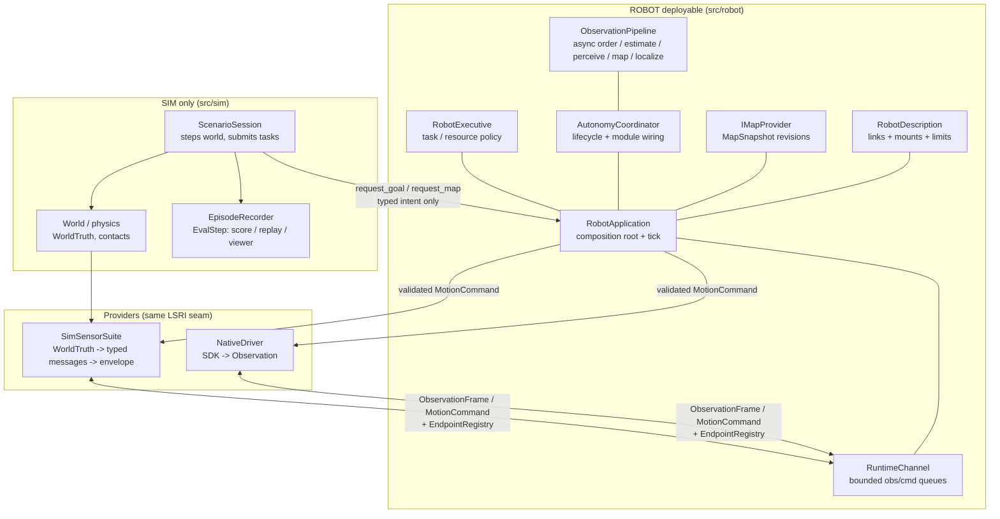

# Architecture (clean rebuild)

ROBOT is the anchor. `src/robot/` builds without any `src/sim/` header,
source, or library. The boundary gate (`tests/check_boundary.py`) enforces it.

## System shape



Rules:

- SIM owns world truth, physics, actors, scenario facts, rendering, scoring,
  replay truth, recorded episodes (`EvalStep` / `EpisodeRecorder`).
- ROBOT owns estimation, perception, mapping, prediction, planning,
  validation, control, safety, task policy.
- Truth may be logged as an offline label/score. It must never enter the
  same-cycle decision path.

## Message protocol (LSRI v1)

Versions: `kApiVersion = 1`, `kMessageSchemaVersion = 1`
(`src/robot/iface/version.hpp`). Bump on meaning change, never reinterpret.

### ObservationFrame (`iface/observation.hpp`)

Provider -> ROBOT. The outer header orders transport envelopes. Each
populated scan/motion/IMU section carries its own `MeasurementHeader`, so one
envelope may safely combine endpoint samples acquired at different rates.

| Field | Meaning |
|---|---|
| envelope `sequence/stamp_ns/source/frame` | bounded-channel ordering only |
| `scan_header` | scan acquisition sequence/time/source/frame |
| `motion_header` | encoder/joint acquisition sequence/time/source/frame |
| `imu_header` | IMU acquisition sequence/time/source/frame |
| `ranges_m + scan_valid` | planar scan; invalid = unknown, never free |
| `odometry_valid + forward_mps + yaw_rate_radps` | body twist, SI |
| `imu_valid + yaw_rate + ax` | measured, SI |

Validation (`valid_observation_frame`): non-empty transport source, valid
transport stamp, `sequence > 0`, at least one valid section, and a complete
header for every populated section in an aggregate envelope. A headerless
legacy frame may contain exactly one endpoint section. Channel rejects
stale/repeated transport sequence or timestamp per source;
`ObservationPipeline` owns the `MeasurementSynchronizer`, rejects
stale/repeated sections independently, orders estimator events by acquisition
time and never rewinds estimator time. It also owns the one-shot localization
and terrain-adaptation views, scan-rate perception/mapping dispatch,
localization state, and perception result. `AutonomyCoordinator` only wires
the subsystem result into planning, validation, control, and safety.

### MotionCommand (`iface/command.hpp`)

ROBOT -> provider. One command space, explicit units, expiring.

| Field | Meaning |
|---|---|
| `space` | `kStop` / `kYawRate` / `kSteerAngle` / `kHolonomic` (new spaces are new enum values) |
| `stamp_ns / expiry_ns` | issue time + watchdog deadline (v1: 200 ms) |
| `forward_mps / yaw_rate_radps` | SI; all zero when `kStop` |

Validation (`valid_motion_command`): ordered timestamps, not expired at
consume time, `kStop` implies zero motion. Anything else -> safe stop.

### Task / Map intent (`iface/task.hpp`, `iface/map.hpp`)

| Call | Payload |
|---|---|
| `request_goal(TaskRequest{request_id, place_id}) -> GoalHandle` | semantic place only, resolved via `IMapProvider`; poll `goal_status`, `cancel_goal` |
| `request_map(map_id)` | map selection, fulfilled at a safe switching point |
| `IMapProvider::active_snapshot()` | immutable `{map_id, revision, raster?, frame_id}` |

No coordinates, actor ids, MuJoCo handles, or renderer state cross here.

## Data transport (SIM <-> ROBOT)

`src/robot/iface/channel.hpp` — `RuntimeChannel`. In-process, bounded,
mutex-protected. No IPC required for the boundary; a future ROS/HTTP bridge
serializes the same typed structs at the App edge.

- Capacity: obs 64, cmd 16 (configurable). Overflow drops oldest obs, counts
  `obs_dropped`, marks degraded.
- Concurrency: many provider threads may `publish_observation`; one thread
  drains in `tick()`.
- Freshness: `take_command(now)` returns newest non-expired command, else
  `SafeStop`. Expired counts `cmd_expired`.
- Health: `ChannelHealth{obs_received/dropped/rejected, cmd_published/expired}`
  is the bring-up and replay signal.
- Ordering: per-source strictly increasing `(sequence, stamp_ns)`. Arrival
  time never replaces acquisition time.

One public SIM transition is 20 ms by default, but it is not a sensor clock.
`ScenarioSession` advances the canonical `World` clock to every sensor and
control deadline inside that transition. A 100 Hz IMU therefore publishes two
distinct measurements during one 50 Hz public transition:

```text
advance world to next scan/motion/IMU/control deadline
  -> poll only endpoints due at that acquisition time
  -> publish one typed envelope per deadline
  -> at decision deadline: app.tick(now) drains all queued measurements
  -> app.take_actuator(now) -> suite.consume(act) # fresh joints -> plant
repeat until the 20 ms public transition is complete
```

Replay uses the same path: recorded frames are republished through
`publish_observation`, never injected into the coordinator directly.

## RobotApplication: Sim or Real?

Yes — exactly that. `RobotApplication` is the composition root; Sim and Real
are all `IProvider`s behind `EndpointRegistry`: sensors poll typed messages, the motion endpoint consumes commands and polls body feedback.

```cpp
RobotApplication app(std::move(maps), desc);
app.register_provider({"ro1.lidar", kLidar, kSim, "lidar_link"});    // sim
app.register_provider({"ro1.imu", kImu, kNative, "imu_link"});       // real
app.publish_observation(obs);  // either backend, same validation
app.tick(now);                 // same autonomy, same command
app.take_command(now);         // provider pulls, expiry enforced
```

- `lost_signal_robot` links only `lost_signal_robot_stack` (native bring-up).
- `lost_signal_sim` links `lost_signal_sim_scenario` (world + sim provider +
  session driving the same `RobotApplication`).
- Mixed backends are allowed per endpoint; one `(endpoint_id, role)` has
  exactly one owner.

## Robot description (URDF-like)

`src/robot/platform/description.hpp` — `RobotDescription`. Versioned
configuration, not physics:

- `robot_id + version`: bump on any mount/limit change; hash-pinned to logs.
- `links[]`: `{link, parent, xyz_m, rpy_rad}`; `world -> base_link` is a
 description root marker and is not inserted into ROBOT static TF.
- `sensors[]`: `{sensor_id, link, xyz_m, rpy_rad}` matching
  `EndpointDescriptor.endpoint_id`.
- `limits`: `{max_forward_mps, max_yaw_rate_radps, footprint_radius_m}`.

It answers the same questions as URDF/SDFormat links + joints + sensors
(frames, mounts, limits) in a smaller auditable form. It deliberately holds
no MuJoCo bodies, contacts, motor curves, meshes, or scenario presentation assets:

- SIM physics adapter: `robot_id -> MuJoCo joints/contacts`.
- GAME presentation adapter: `robot_id -> meshes/colors/prices`.

The rebuilt viewer follows the same boundary. `sim/viewer/frame_builder` is
the only conversion from recorded SIM truth to presentation state; the
raylib frontend may add models, lighting, terrain meshes, wheel articulation,
and deterministic visual particles after that conversion. Those effects are
diagnostic/presentation state and are never placed in `ObservationFrame`,
`MapSnapshot`, task intent, or any ROBOT-owned type. A particle or material
effect can therefore improve visual fidelity without becoming a hidden
truth channel for autonomy.
- ROBOT consumes only frames, mounts, and limits.

Runtime pose frames follow REP-105. The estimator publishes two ROBOT-owned
states from the same wheel/IMU prediction: `odom -> base_link` is continuous
and may drift, while the navigation estimate is in `map` and may jump after a
validated localization or loop-closure correction. Localization never writes
the odom state. `map -> odom` is recomputed from those two persistent states;
it absorbs map corrections instead of resetting to identity on the next tick.
The TF graph therefore contains no static `world -> base_link` edge or other
cycle that could anchor the moving robot.

Changing calibration creates a new `version` and invalidates dependent
estimates; it is never silently mixed into a running session.
