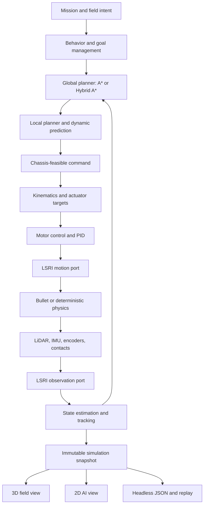

# Architecture

Lost Signal separates authored content, autonomous behavior, physical execution, and presentation so the same mission can support a game, a headless experiment, and future hardware adapters.

## System shape

The player affects `A`. Autonomous code owns `B` through `G`. LSRI carries commands and observations across the platform boundary. Sensors observe `H`, and presentation reads `K` without changing the simulation.

## Layer responsibilities

### Runtime boundary

The [Lost Signal Runtime Interface](runtime-interface.md) is the middleware-neutral robot boundary. Its autonomy port reads validated observations and writes expiring motion commands. Its platform port is implemented by the in-process simulator today and can be implemented by replay, a native hardware driver, or an optional bridge.

LSRI is a project standard rather than a ROS 2 API. Core libraries contain no ROS, DDS, executor, discovery, or ros2_control dependency. A bridge translates at the edge when integration with that ecosystem is useful.

### Content

`assets/` contains missions, maps, scenes, surfaces, robots, components, policies, presentations, story, UI strings, locales, and JSON Schemas. `ContentCatalog` loads and validates these resources into typed runtime definitions.

Locale files are sparse string-only overlays. They cannot change IDs, paths, seeds, physics, scores, or algorithms. English is the default runtime locale; Simplified Chinese remains available as `zh-CN`.

### Hardware and sensors

`src/hw/` models chassis capabilities, inverse kinematics, actuators, motor response, contacts, encoders, LiDAR, and IMU observations. A chassis declares its command space and limits. Algorithms consume the common contracts rather than depending on a graphical representation.

Sensors carry sequence, sample time, delivery time, frame ID, and validity. Noise and latency affect observations. World truth remains inside physics and scenario ownership.

### Algorithms

`src/algo/` implements grid planning, Hybrid A*, DWA-style local evaluation, holonomic local control, path following, dynamic prediction, state estimation, terrain cost, and PID control. The stack uses SI units and explicit configuration.

The planning pipeline produces a feasible body command. The selected chassis converts that command into wheel speed and steering targets. Motor controllers compare targets with quantized feedback and apply actuation to physics.

### Mission systems

`src/game/` owns goals, progression, field dispatch, world activity, scoring, telemetry, replay, and the fixed-step mission loop. `MissionSimulation` composes these systems and publishes an immutable snapshot for consumers.

The field operator, autonomous robot, dynamic actors, weather, and events remain part of one simulation world. Expedition mode reuses the same sensing, planning, control, and physics path as authored missions.

### Physics

`IPhysicsWorld` is the backend boundary. Bullet is the production and default backend. A deterministic planar backend supports regression and focused algorithm tests. Bullet-shadow mode can compare integration paths without giving the shadow backend authority over gameplay.

`PhysicsScene` maps content geometry, terrain, robot bodies, actors, contacts, and raycasts to the backend. In Bullet authority mode, Bullet owns rigid-body pose. The rendering layer never advances physics.

### Presentation

`src/client/` renders the field and AI views from the same snapshot. UI state may pause or request an intent, but changing camera or visualization layers cannot affect autonomous output. The headless executable uses the same content and mission core and reports English, machine-readable results.

## Stable contracts

The most important extension boundaries are:

- `ContentCatalog` for validated, localized data;
- `IPhysicsWorld` for rigid-body execution and raycasts;
- `IPathPlanner` for global planning;
- `IHighLevelPolicy` for behavior selection;
- `ChassisModel` plus `ChassisCaps` for feasible motion and actuator telemetry;
- LSRI v1 ports, sensor packets, transform frames, lifecycle, and watchdog semantics;
- immutable snapshots for rendering, replay, and external observation.

These are useful sim-to-real seams because a hardware adapter can replace actuation and observation while keeping high-level logic testable. The seams do not eliminate the need for calibration, timing, safety, and hardware evidence.

## Coordinate and time model

Frames follow the familiar `map → odom → base_footprint → base_link → sensor/wheel link` structure. This aligns with [ROS REP-105](https://www.ros.org/reps/rep-0105.html). Geometry, time, angles, velocity, and acceleration use SI units and conventions consistent with [ROS REP-103](https://www.ros.org/reps/rep-0103.html).

The simulation advances at a fixed step. Sensor sampling and delivery are separate events, allowing different rates and latency. Determinism requires the same content, configuration, seed, backend, and build assumptions; cross-backend numeric identity is not promised.

## Content and algorithm integrity

A new data-driven component may tune declared physical behavior, cost, visuals, and unlock rules. It cannot inject code. A new chassis type or algorithm requires a C++ implementation, registration, build integration, and tests.

Validation checks references, budgets, schema shape, presentation coverage, locale completeness, placeholder preservation, canonical generation, and important gameplay contracts. Content generation scripts are the source of truth where a generated asset has a corresponding generator.

## Current strengths

The architecture already provides several uncommon combinations in a small open project:

- autonomous decisions and wheel-level control in one inspectable loop;
- five motion families behind explicit capability contracts;
- shared physics and sensor state across game, AI visualization, replay, and headless tests;
- observation noise, sampling, frames, and latency separated from world truth;
- deterministic scenario seeds and machine-readable results;
- data-driven educational content with string-only localization overlays;
- a clean path for log comparison and later ROS 2 integration.

The main technical risk is concentration in `MissionSimulation`, which still coordinates many subsystems. Recent extraction of planning, control, goal, dispatch, operator, and world-activity systems reduces that pressure, but continued changes should move ownership behind narrow interfaces rather than add more branches to the central loop.
