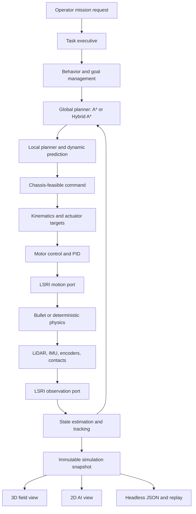

# Architecture

Lost Signal separates authored content, autonomous behavior, physical execution, and presentation so the same mission can support a game, a headless experiment, and future hardware adapters.

## System shape



The player or a real operator affects `A`. The deployable executive owns task lifecycle and supplies goals to
autonomy; autonomous code owns `B` through `G`. LSRI carries commands and observations across the platform
boundary. Sensors observe `H`, and presentation reads `K` without changing the simulation.

## Layer responsibilities

### Runtime boundary

The [Lost Signal Runtime Interface](runtime-interface.md) is the project-owned robot boundary. Its autonomy port reads validated observations and writes expiring motion commands. Its platform port is implemented by the in-process simulator today and can be implemented by replay or a native hardware driver.

LSRI remains a small project standard with no external middleware, executor, discovery, or device-SDK dependency.

### Content

`assets/` contains missions, maps, scenes, surfaces, robots, components, policies, presentations, story, UI strings, locales, and JSON Schemas. `ContentCatalog` loads and validates these resources into typed runtime definitions.

Locale files are sparse string-only overlays. They cannot change IDs, paths, seeds, physics, scores, or algorithms. English is the default runtime locale; Simplified Chinese remains available as `zh-CN`.

### Hardware and sensors

`src/hw/` models chassis capabilities, inverse kinematics, actuators, motor response, contacts, encoders, LiDAR, and IMU observations. A chassis declares its command space and limits. Algorithms consume the common contracts rather than depending on a graphical representation.

Sensors carry sequence, sample time, declared latency, source, and frame ID. Noise affects the generated measurements; the current in-process simulator records latency as metadata and delivers the packet immediately. World truth remains inside physics and scenario ownership.

Maps are 2.5D: terrain patches carry base height, two-axis grade, and roughness, while surface materials carry
friction, rolling drag, traction, and presentation effects. `SimulatedPlatform` turns that content into 3D collision
geometry and contact state. The shipped LiDAR is a single-plane scanner mounted in a named 3D frame. In the
production path it raycasts the 3D physics world against terrain, static geometry, and dynamic actors, includes
scan-time robot motion, and synthesizes intensity from hit normal, body class, and distance before applying the
declared bias, noise, quantization, and dropout model. It is not a multi-beam 3D point-cloud sensor, and its three
body-class reflectivities are not calibrated material optics.

### Algorithms

`src/autonomy/` follows the data flow used by compact autonomous systems: localization, mapping, perception, behavior, global and local planning, validation, then control. DWA and chassis-specific rollout samplers live under local planning; path following and PID live under control. The stack uses SI units and explicit configuration.

`PerceptionPipeline` is the observation boundary for planar LiDAR. It consumes timestamped raw and static-reference
scans after LSRI delivery, then owns projection and deskew, foreground extraction, transient ray-cleared occupancy,
anonymous tracking, and prediction state. Neither mission code nor simulated hardware classifies obstacles. A replay
or hardware source can feed the same scan contract without changing mapping or planning.

Global planners share a canonical `RoutePoint` result rather than a geometry-only polyline. Position, nominal body heading,
and arrival direction remain one value from planning through control. Grid A* still performs an eight-connected 2D
search and emits forward segments; its heading is the geometric route tangent and its final point inherits the
incoming edge heading. Hybrid A* remains the Ackermann default and preserves its searched heading and gear, including
at its exact terminal anchor. Ackermann lookahead stops at a forward/reverse cusp instead of inferring gear from point geometry.

The source layout is also a dependency rule. Mission state and simulated actor behavior cannot enter the autonomy
layer. Route following, waypoint progress, heading PID state, crossing behavior, prediction, and trajectory
validation all live in `src/autonomy`; mission code only supplies task intent and world semantics. The
`deployable_boundary` test rejects includes from `mission`, `sim`, `physics`, or `client` in `core`, `runtime`, or
`autonomy`, and rejects world-layer sources or libraries in the autonomy target. `lost_signal_autonomy`,
`lost_signal_vehicle`, and `lost_signal_runtime` remain separate targets, while `lost_signal_stack` is their
simulation aggregate.

Each local planner produces one `ExecutableTrajectory`: an explicit command space, the body command, and strictly
time-ordered pose, velocity, yaw-rate, and steering samples. The runtime validates the exact selected samples
against the inflated map, terrain feasibility, prediction coverage, and swept same-time dynamic clearance before
publishing the command. For RO-1 it also follows the candidate through the declared decision/actuator response
delay and validates a tire-limited emergency-braking tail. Once a conflict-zone transit is committed, a nominal
trajectory that still satisfies full static and dynamic clearance may continue when braking would strand the body
inside the conflict; this is reported separately as `CommittedTransit` and never waives nominal collision
validation. The selected chassis then converts that command into wheel speed and steering targets.
Motor controllers compare targets with quantized feedback and apply actuation to physics.

For Ackermann platforms, the command is an equivalent front-wheel steering angle from the local planner through
LSRI to the steering position loop; no layer reinterprets it as yaw rate. Physical motor type, native drive command
mode, controller placement, and mechanical load are separate platform concerns. The
[platform-fidelity design](platform-fidelity.md) defines how a future native or HIL provider declares those
capabilities without exposing PWM or device protocols to autonomy.

### Mission systems

The word *mission* has two distinct meanings and the codebase must not merge them:

- a **Mission Request** is deployable operator intent such as navigate, inspect, collect, return, cancel, pause, or
 resume. A **Task Executive** validates that request, expands it into ordered goals, tracks lifecycle and outcomes,
 and supplies intent to autonomy. It never reads simulator truth and never emits wheel or steering commands;
 planning, safety and control remain in autonomy;
- a **Scenario Definition / Game Session** is simulation-only content: world actors, faults, scripted events,
 scoring, story progression and presentation. It may observe mission progress, but it cannot choose a stop pose,
 rewrite a trajectory, or grant a collision exception.

The target deployable set therefore includes a small `lost_signal_executive` library above
`lost_signal_autonomy`, with operator/API adapters above it and LSRI platform adapters below autonomy. That library
will depend only on `core`, `runtime` and autonomy contracts. The current `src/mission/` directory predates this
terminology and still combines task intent with the game session. Until it is split, `lost_signal_mission` remains
simulation-only and must not be presented as a real-robot Mission Executive.

`src/mission/` owns goals, progression, field dispatch, world activity, scoring, telemetry, replay, and the fixed-step mission loop. `MissionSimulation` composes these systems and publishes an immutable snapshot for consumers.
`DynamicTrafficSystem` is a stateless world-content adapter for authored conflict zones: it filters level activation
and translates authority into a neutral autonomy contract. `CrossingBehaviorSystem` in `autonomy/behavior` owns
the per-run crossing state, derives stop and exit poses from the current route and vehicle envelope, evaluates
tracked-object predictions, and controls the hold/commit/clear transitions. Content never supplies a parking
coordinate, and actor truth and physics objects never cross the autonomy boundary. `TrajectoryTrackingSystem` owns the last
accepted local trajectory between decision ticks and reports position, heading, and speed errors against its
interpolated expected state. Tracking is currently evidence only; it does not silently modify control authority.
Dynamic-object perception publishes timestamped constant-velocity track estimates rather than raw LiDAR cluster
centroids. Prediction may retain two motion modes while a shuttle pauses at a learned endpoint. Behavior consumes
that conservative view. Motion regression uses measurement-time samples so a smooth position filter cannot turn an
endpoint dwell into false outbound motion. An empty or stale prediction is explicit unknown evidence and can never
release a controlled crossing. A separate physical-collision validator retains final veto authority.

Task orchestration is moving toward a small data-driven Behavior Graph, while continuous commitments use focused
deterministic state machines. The project does not embed a general-purpose behavior-tree runtime. The detailed
contract and the incremental decomposition of the current composition root are recorded in
[Behavior architecture](behavior-architecture.md).

Conflict-zone content carries `shadow` or `control` authority. Shadow evaluation can compare a route-level
hypothesis without changing commands. Control authority supplies a stop, hold, or commit constraint. The
route-level crossing schedule is admission evidence, while the local planner independently validates the exact DWA
trajectory at every decision tick. Admission never acts as a collision waiver and cannot lower static clearance,
dynamic clearance, prediction coverage, or braking requirements for an uncommitted motion.

The field operator, autonomous robot, dynamic actors, weather, and events remain part of one simulation world. Expedition mode reuses the same sensing, planning, control, and physics path as authored missions.

`DecisionEvidence` is the shared explanation boundary. The mission coordinator assembles it only from the
estimator timestamp, anonymous tracker references, prediction horizon, measured and projected separation,
active constraint, selected command, and planner outcome. A new record opens when the constraint, reason,
or action changes; the preceding record closes as `superseded` and names the next sequence. Mission
termination closes the final record. The current record is copied into every immutable replay snapshot,
while the compact transition history is emitted by headless runs. Player prose is a locale mapping over
stable codes, so the field view, AI view, debrief, replay, and tests cannot invent separate explanations.

### Physics

`IPhysicsWorld` is the backend boundary. Bullet is the production and default backend. A deterministic planar backend supports regression and focused algorithm tests. Bullet-shadow mode can compare integration paths without giving the shadow backend authority over gameplay.

`SimulatedPlatform` maps content geometry, terrain, robot bodies, actors, contacts, and raycasts to the backend. In Bullet authority mode, Bullet owns rigid-body pose. The rendering layer never advances physics.

`sim::platform::SimulatedPlatform` in `src/sim/` is the in-process simulation-platform adapter; mission code only
schedules it and combines its published result with goals and autonomy diagnostics. Wheel motors, encoders, IMU and LiDAR device behavior belong
to `src/hw/`; rigid bodies, joints, contacts and raycasts belong to `src/physics/`; binding authored devices to
physics joints and links belongs to `src/sim/`. No wheel, caster or sensor model belongs in a renderer.

The deployable algorithm set is `lost_signal_core + lost_signal_runtime + lost_signal_autonomy` plus a native
platform adapter. Those targets do not include or link `mission`, `sim`, `physics`, or `client`. Neutral observation
messages live under `runtime/`; simulator truth remains under `sim/`. A real deployment therefore replaces the
LSRI provider and platform adapter and omits all game, world, Bullet, and rendering targets.

`mission_autonomy.cpp` is the current simulation composition adapter: it translates loaded task/configuration data
into neutral autonomy inputs and copies diagnostics into the game snapshot. It is not an algorithm provider. A
native product still needs its own lifecycle/configuration entry point around the same autonomy classes; the
repository does not yet ship a turnkey real-robot executable.

Robot geometry has three independent meanings:

- the circular planning footprint is an orientation-independent conservative envelope for grid and local planners;
- the rigid hull is an authored flat collision primitive used by Bullet;
- the support polygon comes from wheel, track, and caster contact mounts and governs stability geometry.

Robot schema v4 forbids deriving one of these from another. In particular, a support triangle is not a hull and a
planning circle is not a vehicle contact shape. This follows the link semantics used by
[URDF](https://docs.ros.org/en/rolling/Tutorials/Intermediate/URDF/Adding-Physical-and-Collision-Properties-to-a-URDF-Model.html)
and [SDFormat](http://sdformat.org/spec?ver=1.12&elem=link): visual, collision, and inertial properties have separate
representations and origins. Lost Signal keeps a smaller native format rather than importing either middleware
format into the runtime.

The current dynamic profile uses one flat sprung-hull proxy and chassis-resolved wheel forces. It applies the
resolved force at the hull centre and the wheel-force difference as a yaw moment; applying traction below a hull
with no suspension constraints produces artificial pitch and visible ground penetration. The higher-fidelity
identified profile will represent a chassis body plus per-wheel connection, axle, radius, contact, and suspension
parameters. Those are the same physical roles exposed by Bullet's `btRaycastVehicle`; they remain behind the
platform boundary rather than changing planner commands.

### Presentation

`src/client/` renders the field and AI views from the same immutable, timestamped presentation snapshot. The
snapshot combines platform state (body/link poses, contacts and device telemetry), mission state (goals, actors and
environment), and autonomy diagnostics (routes, candidates and decisions). A hardware provider alone cannot
publish the complete game view because goals and explanatory overlays are not hardware state.

In-process code passes a `PresentationFrameView` with read-only access for the duration of one main-loop frame. A
future threaded or multi-process provider may materialize and deliver
the same value through a bounded queue or shared memory. This is subscription semantics without requiring a
middleware today. The renderer cannot step the runtime and never reads Bullet bodies, motor objects or sensor
internals; it also never derives physical wheel or caster motion. UI state may pause or submit player intent, but
changing camera or visualization layers cannot affect autonomous output. The headless executable consumes the same
mission/platform results and reports English, machine-readable output.

The update order follows the read/write split used by mature simulators:

```text
command snapshot
 -> hardware controller/device commands
 -> simulation-platform binding
 -> one authoritative physics step
 -> platform snapshot + ideal sensor truth
 -> hardware sensor/encoder models
 -> mission/autonomy presentation snapshot
 -> zero or more read-only consumers (3D, AI view, headless, replay)
```

[Gazebo's system lifecycle](https://gazebosim.org/api/sim/9/createsystemplugins.html) applies commands before the
physics update and gives sensors, graphics and rendering read-only post-update access. CARLA similarly sends a
timestamped [`WorldSnapshot`](https://carla.readthedocs.io/en/latest/python_api/#carla.WorldSnapshot) to clients on
each tick. Lost Signal uses this ownership pattern while keeping its smaller native LSRI and snapshot contracts.

### Experiment evidence

Run Artifact v2 records build and source identity, a SHA-256 content manifest, comparable run inputs, hardware and
algorithm IDs, metrics, events, and the structured decision chain. `--reproduce` restores the declared authored
mission configuration, while `tools/compare_runs.py` rejects undeclared input changes. This compact manifest is
separate from UI snapshot replay and LSRI observation replay; large sensor traces remain external references.

## Stable contracts

The most important extension boundaries are:

- `ContentCatalog` for validated, localized data;
- `IPhysicsWorld` for rigid-body execution and raycasts;
- `IGlobalPlanner` for global planning;
- `IHighLevelPolicy` for behavior selection;
- `ChassisModel` plus `ChassisCaps` for feasible motion and actuator telemetry;
- LSRI v1 ports, sensor packets, transform frames, lifecycle, and watchdog semantics;
- `DecisionEvidence` for observation-to-action explanations and deterministic decision transitions;
- immutable snapshots for rendering, replay, and external observation.

The [autonomy extension guide](extending-autonomy.md) documents the global-planner v1 request/result contract, registry, directory boundaries, and a complete provider example.

These are useful sim-to-real seams because a hardware adapter can replace actuation and observation while keeping high-level logic testable. The seams do not eliminate the need for calibration, timing, safety, and hardware evidence.

## Coordinate and time model

Frames follow the familiar `map → odom → base_footprint → base_link → sensor/wheel link` structure. This aligns with [ROS REP-105](https://www.ros.org/reps/rep-0105.html). Geometry, time, angles, velocity, and acceleration use SI units and conventions consistent with [ROS REP-103](https://www.ros.org/reps/rep-0103.html).

`odom → base_footprint` is the continuous dead-reckoned motion and is never reset by a global correction.
Localization updates change `map → odom`; the composed state in `map` is the fused pose consumed by planning.
Headless artifacts therefore report raw odometry drift and fused map-pose error separately. Safety scoring uses the
estimate that actually drives navigation, while the raw metric remains available for wheel-slip and odometry lessons.

`base_footprint` is the terrain projection; `base_link` is the physical root-body origin. Robot `mounts` are always
calibrated in `base_link`. Physics owns centre-of-mass motion, then the shared transform tree evaluates each sensor
origin. In particular, the simulated IMU lives in `src/hw/sensors`: it receives ideal six-axis truth at `imu_link`
and owns bias, random walk, white noise, timestamps, latency, and sequence numbers. Mission code only schedules the
device and publishes its observation.

The simulation advances at a fixed step. Sensors have independent sample rates and declared latency. The current in-process provider delivers each generated packet immediately; a real-time or transport provider may schedule delivery from the same metadata. Determinism requires the same content, configuration, seed, backend, and build assumptions; cross-backend numeric identity is not promised.

## Scheduling and concurrency

The current simulator uses one fixed-step, single-threaded scheduler. This is deliberate: identical inputs produce an inspectable execution order, and tests can advance simulated time without depending on host CPU timing. A 20 ms tick does not run every algorithm once. Each subsystem has its own cadence or trigger:

| Work | Current trigger |
|---|---|
| Dynamic world and physics | every 20 ms tick (50 Hz) |
| Encoder and IMU simulation, state-estimator prediction | every 20 ms tick (50 Hz) |
| LiDAR simulation, LiDAR perception, track update | configured LiDAR `scan_hz` |
| High-level policy, local planning, and control | compute component `decision_hz` |
| Global planning | mission start, goal change, or expedition-route change |
| Replay sample | every 40 ms |

Within one due tick, the scheduler updates dynamic actors, captures and processes a due LiDAR scan, runs a due autonomy decision, applies the held command to the chassis and physics, then generates encoder and IMU observations for the resulting motion. A command is therefore held between decision events. Global planning is event driven rather than part of the frame loop.

The in-process LSRI provider publishes and reads through a mutex-protected bounded queue on that same thread. The provider also accepts concurrent platform producers, so later sensor I/O threads do not require a new algorithm API. Sensor packets still carry independent sample times, sequence numbers, frames, and latency metadata; independent metadata does not imply one operating-system thread per sensor.

LSRI does not require this execution model. A hardware provider or out-of-process bridge may receive LiDAR, IMU, and encoder data concurrently and place validated packets in the bounded observation queue. Autonomy must consume timestamped observations and publish expiring commands without sharing mutable mission or simulator state.

If parallel execution is added, the deterministic scheduler remains the reference model. Parallel workers should operate on immutable, timestamped input snapshots and commit outputs at explicit scheduler boundaries. Queue limits, deadlines, stale-data policy, and command expiry belong in the runtime contract; thread ownership stays in the provider or executor. This keeps algorithms portable between deterministic simulation and asynchronous hardware without making their interfaces depend on a particular thread model.

Three execution modes can therefore share the same module contracts:

| Mode | Execution | Transport | Intended use |
|---|---|---|---|
| Deterministic | one fixed-step thread | in-process LSRI | tests, replay, teaching, reproducible experiments |
| Concurrent | sensor I/O threads plus an autonomy worker pool | in-process bounded mailboxes | real-time desktop simulation and embedded computers |
| Distributed | supervised platform, autonomy, and presentation processes | an IPC, shared-memory, or network LSRI provider | hardware deployment and fault isolation |

The concurrent mode should not create one permanent thread for every algorithm. Sensor drivers are naturally asynchronous; estimation and perception can run when observations arrive; global planning belongs on a cancellable low-frequency worker; and control needs a periodic deadline with the newest valid state snapshot. A small executor can map those logical tasks to a bounded worker pool.

The distributed mode needs more than a socket. Before it is considered implemented, LSRI needs a canonical wire encoding, schema compatibility tests, clock-domain conversion, bounded transport queues, peer health and restart behavior, and end-to-end watchdog tests. High-bandwidth scans may use a shared-memory ring while commands use a small reliable channel, but both must preserve the same message semantics.

To move algorithms safely between these modes, each module should own its mutable state and exchange immutable messages. Planned extension contracts are `ISensorSource`, `IEstimator`, `IPerceptionStage`, `ILocalPlanner`, and `IController`, following the existing `IGlobalPlanner` pattern only when a second real implementation justifies the boundary. Each task declaration will name its trigger, input age limit, deadline, queue policy, and failure fallback. Physics remains single-writer authority and publishes timestamped world snapshots to simulated sensor jobs; algorithm workers never read mutable physics or mission state directly.

## Content and algorithm integrity

A new data-driven component may tune declared physical behavior, cost, visuals, and unlock rules. It cannot inject code. A new chassis type or algorithm requires a C++ implementation, registration, build integration, and tests.

Validation checks references, budgets, schema shape, presentation coverage, locale completeness, placeholder preservation, canonical generation, and important gameplay contracts. Content generation scripts are the source of truth where a generated asset has a corresponding generator.

## Current strengths

The architecture already provides several uncommon combinations in a small open project:

- autonomous decisions and wheel-level control in one inspectable loop;
- five motion families behind explicit capability contracts;
- shared physics and sensor state across game, AI visualization, replay, and headless tests;
- observation noise, sampling, frames, and latency separated from world truth;
- deterministic scenario seeds and machine-readable results;
- data-driven educational content with string-only localization overlays;
- a clean path for log comparison, native hardware providers, and measured HIL work.

The main technical risk is concentration in `MissionSimulation`, which still coordinates many subsystems. Recent
extraction of planning, control, goal, dispatch, operator, world activity, dynamic traffic, and trajectory tracking
reduces that pressure. Sensor scheduling, decision evidence, mission progress, and snapshot assembly remain the
next ownership boundaries.
