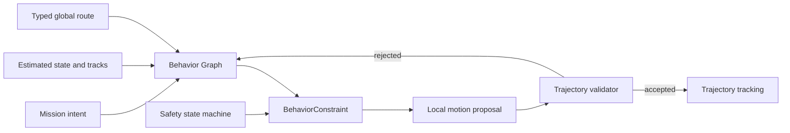

# Behavior architecture

Lost Signal separates task intent, behavior decisions, motion planning, and control. A behavior decision may
constrain motion, but it cannot claim that a maneuver is safe unless it evaluates the same time-parameterized
trajectory that the motion layer will execute.

## Decision model

The project does not need a general-purpose behavior-tree runtime today. The compact design has two parts:

1. A data-driven **Behavior Graph** is the planned composition model for discrete intent such as navigate,
 collect, recover, and complete. Content selects task intent; autonomy providers implement reusable behavior.
 Content does not author the stop pose or a mandatory wait for a dynamic encounter.
2. A deterministic **safety state machine** owns each continuous commitment. A crossing, for example, progresses
 through `Inactive -> Holding -> Committed -> Cleared` and never jumps back to `Holding` while the
 physical body still occupies the conflict region.

The graph provides authoring, explanation, and replay. The state machine provides small, exhaustively testable
transition rules. Introducing BehaviorTree.CPP or another large runtime would add plugin, executor, blackboard,
and lifecycle machinery before Lost Signal has enough distinct behavior nodes to justify it. Revisit that choice
only when parallel nodes, reusable subtree tooling, or external tree interchange solve a demonstrated content
problem.

## Behavior and motion contract

Behavior consumes estimated state, the typed global route, map semantics, tracked-object predictions, mission
intent, and the latest validated motion proposal. It emits a `BehaviorConstraint` rather than wheel commands:

- hold point or allowed route corridor;
- speed range and direction;
- commitment identifier and phase;
- validity and expiry time;
- stable reason and evidence codes.

The motion planner turns that constraint into a timestamped trajectory. A separate validator checks static
geometry, chassis feasibility, prediction coverage, same-time dynamic clearance, and RO-1 emergency stopping. The
behavior latch enters `Committed` only after the route occupancy and intent contract remains safe for its
confirmation interval. The route-level crossing schedule decides whether departure is permitted; it does not claim
that a different DWA rollout is safe. Every local rollout remains independently validated on every decision tick.



## Conflict-zone rollout gate

Map conflict zones declare an explicit `authority`:

- `shadow` evaluates the route-level crossing hypothesis without constraining the vehicle;
- `control` may apply the hold/commit state machine.

Each zone also declares `participant_radius_m`, a conservative envelope around the traffic reference point. It
combines the largest expected participant footprint with the site's tracking reserve, so behavior can derive a safe
stop before a live track matures without reading simulator actor truth. The stop is solved continuously on the
global route; grid vertices provide route topology but do not quantize the final behavior constraint. Prediction
then checks that fixed hold pose and the complete crossing trajectory at matching times.

`shadow` remains available for experiments. The research-base forklift encounter is a bounded `control` slice in
every level that traverses it; sensing configuration changes evidence quality, never whether safety behavior exists.
Focused tests cover stable stop geometry, physical body occupancy, prediction ambiguity, commit hysteresis, and
complete exit. The first runtime experiment exposed a missing contract: the assessor proved a constant-speed route
while DWA executed a different trajectory. A new promotion to `control` therefore requires all of the following:

1. the local planner returns a time-parameterized, owned trajectory;
2. local validation evaluates that exact trajectory independently of behavior permission;
3. the controller reports whether tracking remains inside the accepted envelope;
4. a minimum-risk response exists for an envelope violation after commitment;
5. deterministic mission tests cover arrival at the stop line, safe release, complete physical clearance,
 prediction reversal, packet loss, and an actor approaching the waiting point;
6. the controlled scenario succeeds without relaxing collision geometry or the declared safety margin.

The controlled slice holds before the mapped conflict region, requires a continuously safe release interval, fixes
the exit target after commitment, forbids ordinary reverse recovery while crossing, and retains an independent
physical-collision veto. Its selected local rollout is validated against static geometry, terrain, prediction
coverage, swept same-time dynamic clearance, and a braking tail. If braking after commitment would stop the body in
the conflict, a fully margin-compliant forward rollout is the named `CommittedTransit` response. It still must pass
the nominal static and dynamic checks. Trajectory tracking error remains evidence until a closed-loop recovery for
tracking-envelope violations is implemented.

## DWA safety evidence

DWA is retained as the deterministic teaching baseline. Its score only orders candidates after hard feasibility
checks; no weight can make a colliding trajectory executable. The dedicated `dwa_dynamic` contract suite covers:

- inter-frame crossing with ego and obstacle compared at the same future time;
- a crossing actor that rejects fast straight motion while retaining a safe deceleration;
- target reversal and sudden slowdown inside the prediction horizon;
- an actor entering the waiting pose after the robot has stopped;
- physical footprint separated from forecast uncertainty;
- physical overlap producing no valid command;
- explicit stop-pose heading overriding the ordinary path-tangent critic;
- deterministic candidate order, command, and score under identical inputs.

`trajectory_validator` separately covers continuous swept collision, prediction coverage, behavior stop planes,
unsafe high-score rejection, minimum-risk escape from an existing soft-margin incursion, and emergency-braking
tails. Mission regression then verifies the complete sensor-to-actuator loop. These layers answer different
questions; a successful level cannot replace the algorithm or contract tests.

## Dynamic actor estimation and crossing policy

Dynamic behavior uses five explicit stages:

```text
timestamped LiDAR observations
 -> constant-velocity track estimate
 -> bounded, possibly multi-modal prediction
 -> conflict-zone occupancy decision
 -> validated local trajectory
 -> control, with an independent emergency veto
```

The tracker uses a deterministic alpha-beta predictor/corrector over position and velocity. It predicts to the
observation sample time, applies the position innovation with separate position and velocity gains, rejects stale
timestamps, limits impossible speed, and learns shuttle corridors from filtered states. Repeated endpoint samples
make current velocity converge toward zero while prediction retains continuation and reversal hypotheses until
sustained motion resolves intent. This small constant-velocity filter fits the present single-LiDAR teaching scope.
A covariance-aware Kalman filter or interacting multiple-model tracker becomes justified when the simulator adds
association uncertainty, acceleration models, or fused radar/camera observations; replacing the current filter must
preserve the same timestamped track and prediction contracts.

Crossing relevance follows the route point nearest the physical body, never the controller lookahead index. The map
zone represents the geometric overlap of the two motion corridors. Release requires the ego body to settle at a
fixed stop line and one of two positive evidence paths. Fresh tracked-object evidence must show every relevant
prediction mode leaving the zone with outward observed motion and a clear complete traversal interval. When no fresh
track exists, current LiDAR rays must cover every point of each map-semantic traffic approach, and the conservative
arrival bound for anything beyond the observed corridor must exceed traversal time plus margin. Physical returns
occlude the space behind them; participant radius and scan age reduce that bound. Consecutive confirmation counts
distinct sensor timestamps, so a faster behavior loop cannot reuse one scan. Empty frames, stale tracks, short range,
partial coverage and unconfirmed motion remain unknown and keep the hold active. Passing the commit line latches the
exit maneuver so ordinary soft-margin changes do not stop or reverse the robot inside the conflict area.

This design follows the compact parts of established stacks rather than importing their runtime:

- [Autoware intersection behavior](https://autowarefoundation.github.io/autoware_universe/main/planning/behavior_velocity_planner/autoware_behavior_velocity_intersection_module/)
  derives attention/conflicting areas, collision intervals, stop lines, and a pass-judge line from route geometry.
- [Autoware occlusion behavior](https://autowarefoundation.github.io/autoware_universe/main/planning/behavior_velocity_planner/autoware_behavior_velocity_occlusion_spot_module/)
  separates visibility risk and safe approach constraints from ordinary path following.
- [CARLA Traffic Manager](https://carla.readthedocs.io/en/latest/adv_traffic_manager/) separates localization and
  path overlap, collision decisions, motion planning, and actuation, and documents deterministic synchronous runs.

The reusable idea is the semantic boundary between stages. Lost Signal keeps its small deterministic scheduler and
LSRI contracts instead of taking a dependency on ROS 2, Autoware, or CARLA internals.

## Mission runtime decomposition

`mission_simulation.cpp` is currently too large. It mixes composition, world construction, scheduling, sensor
delivery, autonomy, payload rules, result accounting, replay, and snapshot assembly. The target is a thin fixed-step
coordinator with this dependency direction:

```text
Content -> MissionRuntime -> AutonomyPipeline -> SimulatedPlatform -> Snapshot
```

Extraction proceeds by owned state and testable contracts:

| Component | Owns | Must not own |
| --- | --- | --- |
| `SensorScheduleSystem` | sampling phase, sequence, sample and delivery time | device measurement math |
| `AutonomyPipeline` | localization-to-control scheduling and immutable inputs | mission goals or actor truth |
| `RouteTrackingSystem` | route progress, travel direction and heading-loop state | goals, scoring, physics, or actor truth |
| `DynamicTrafficSystem` | stateless filtering and translation of authored conflict regions | stop poses, behavior state, predictions, or commands |
| `CrossingBehaviorSystem` | route-derived stop/exit poses and hold/commit/clear state | mission goals, actor truth, MuJoCo bodies, or game collision flags |
| `TrajectoryTrackingSystem` | accepted local trajectory and tracking-envelope evidence | command arbitration or physics stepping |
| `MissionProgressSystem` | goals, payload actions, success and failure | planner internals |
| `DecisionEvidenceSystem` | transition records and stable evidence codes | localized player prose |
| `SnapshotAssembler` | immutable presentation and replay value | physics stepping or control decisions |

`ScenarioSession` should retain construction, reset, fixed-step ordering, lifecycle, and accessors. Each
extraction must preserve deterministic output and pass its focused contract tests before the next responsibility
moves. File size is a symptom; ownership and dependency direction are the acceptance criteria.

The first executable-contract slice is now present: differential, Ackermann, and holonomic local planners return
`ExecutableTrajectory`; the validator checks the selected rollout continuously between static samples and at the
same time as predicted actors; `TrajectoryTrackingSystem` reports the next estimate against that accepted rollout.
These reports remain evidence until minimum-risk handling for an envelope violation is implemented and tested.

The first autonomy-pipeline slice is also extracted: `PerceptionPipeline` owns LiDAR projection, foreground
classification, transient occupancy, tracks, and predictions. `ScenarioSession` schedules the simulated device and
moves the delivered message across LSRI, but it cannot update perception state directly. Behavior stop constraints
are now executable geometry as well: an uncommitted crossing supplies a latched stop point and one-sided plane to
the local trajectory validator, so a high-scoring rollout cannot cross the virtual wall.

