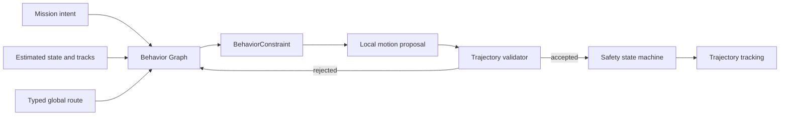

# Behavior architecture

Lost Signal separates task intent, behavior decisions, motion planning, and control. A behavior decision may
constrain motion, but it cannot claim that a maneuver is safe unless it evaluates the same time-parameterized
trajectory that the motion layer will execute.

## Decision model

The project does not need a general-purpose behavior-tree runtime today. The compact design has two parts:

1. A data-driven **Behavior Graph** composes discrete mission actions such as navigate, observe, collect, wait,
 cross, recover, and complete. Content selects and parameterizes nodes; C++ providers implement reusable node
 types.
2. A deterministic **safety state machine** owns each continuous commitment. A crossing, for example, progresses
 through `Inactive -> Holding -> Scheduled -> Committed -> Cleared` and never jumps back to `Holding` while the
 physical body still occupies the conflict region.

The graph provides authoring, explanation, and replay. The state machine provides small, exhaustively testable
transition rules. Introducing BehaviorTree.CPP or another large runtime would add plugin, executor, blackboard,
and lifecycle machinery before Lost Signal has enough distinct behavior nodes to justify it. Revisit that choice
only when parallel nodes, reusable subtree tooling, or external tree interchange solve a demonstrated content
problem.

## Behavior and motion contract

Behavior consumes estimated state, the typed global route, map semantics, tracked-object predictions, mission
intent, and the latest validated motion proposal. It emits a `BehaviorConstraint` rather than wheel commands:

- hold point or allowed route corridor;
- speed range and direction;
- commitment identifier and phase;
- validity and expiry time;
- stable reason and evidence codes.

The motion planner turns that constraint into a timestamped trajectory. A separate validator checks static
geometry, chassis feasibility, prediction coverage, and same-time dynamic clearance. Control tracks only the
validated trajectory. A crossing can enter `Committed` only after the validator accepts that executable
trajectory, including its expected speed envelope and clearance time. A constant-speed traversal of the global
route is useful shadow evidence, but it is not authority for a DWA trajectory that can slow, reverse, or detour.



## Conflict-zone rollout gate

Map conflict zones declare an explicit `authority`:

- `shadow` evaluates the route-level crossing hypothesis without constraining the vehicle;
- `control` may apply the hold/commit state machine.

All current authored zones remain `shadow`. Focused tests already cover stable stop geometry, body occupancy,
prediction ambiguity, and commit hysteresis, but the runtime experiment exposed a missing contract: the assessor
proved a constant-speed route while DWA executed a different trajectory. Promotion to `control` therefore
requires all of the following:

1. the local planner returns a time-parameterized, owned trajectory;
2. behavior validation evaluates that exact trajectory and its speed tolerance;
3. the controller reports whether tracking remains inside the accepted envelope;
4. a minimum-risk response exists for an envelope violation after commitment;
5. deterministic mission tests cover arrival at the stop line, safe release, complete physical clearance,
 prediction reversal, packet loss, and an actor approaching the waiting point;
6. the controlled scenario succeeds without relaxing collision geometry or the declared safety margin.

Until those gates pass, DWA remains responsible for short-horizon dynamic avoidance and conflict-zone results are
evidence rather than authority.

## Mission runtime decomposition

`mission_simulation.cpp` is currently too large. It mixes composition, world construction, scheduling, sensor
delivery, autonomy, payload rules, result accounting, replay, and snapshot assembly. The target is a thin fixed-step
coordinator with this dependency direction:

```text
Content -> MissionRuntime -> AutonomyPipeline -> SimulatedPlatform -> Snapshot
```

Extraction proceeds by owned state and testable contracts:

| Component | Owns | Must not own |
| --- | --- | --- |
| `SensorScheduleSystem` | sampling phase, sequence, sample and delivery time | device measurement math |
| `AutonomyPipeline` | localization-to-control scheduling and immutable inputs | mission goals or actor truth |
| `DynamicTrafficSystem` | conflict semantics and commitment state | Bullet bodies or game collision flags |
| `MissionProgressSystem` | goals, payload actions, success and failure | planner internals |
| `DecisionEvidenceSystem` | transition records and stable evidence codes | localized player prose |
| `SnapshotAssembler` | immutable presentation and replay value | physics stepping or control decisions |

`MissionSimulation` should retain construction, reset, fixed-step ordering, lifecycle, and accessors. Each
extraction must preserve deterministic output and pass its focused contract tests before the next responsibility
moves. File size is a symptom; ownership and dependency direction are the acceptance criteria.

