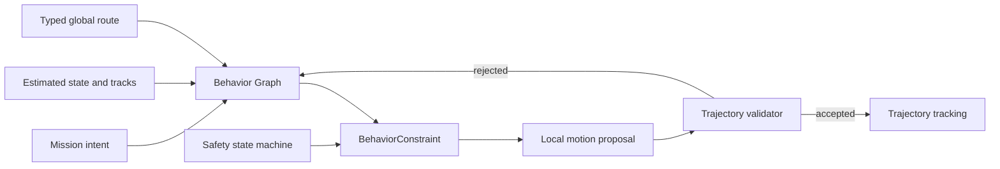

# Behavior architecture

Lost Signal separates task intent, behavior decisions, motion planning, and control. A behavior decision may
constrain motion, but it cannot claim that a maneuver is safe unless it evaluates the same time-parameterized
trajectory that the motion layer will execute.

## Decision model

The project does not need a general-purpose behavior-tree runtime today. The compact design has two parts:

1. A data-driven **Behavior Graph** is the planned composition model for discrete intent such as navigate,
 collect, recover, and complete. Content selects task intent; autonomy providers implement reusable behavior.
 Content does not author the stop pose or a mandatory wait for a dynamic encounter.
2. A deterministic **safety state machine** owns each continuous commitment. A crossing, for example, progresses
 through `Inactive -> Holding -> Committed -> Cleared` and never jumps back to `Holding` while the
 physical body still occupies the conflict region.

The graph provides authoring, explanation, and replay. The state machine provides small, exhaustively testable
transition rules. Introducing BehaviorTree.CPP or another large runtime would add plugin, executor, blackboard,
and lifecycle machinery before Lost Signal has enough distinct behavior nodes to justify it. Revisit that choice
only when parallel nodes, reusable subtree tooling, or external tree interchange solve a demonstrated content
problem.

## Behavior and motion contract

Behavior consumes estimated state, the typed global route, map semantics, tracked-object predictions, mission
intent, and the latest validated motion proposal. It emits a `BehaviorConstraint` rather than wheel commands:

- hold point or allowed route corridor;
- speed range and direction;
- commitment identifier and phase;
- validity and expiry time;
- stable reason and evidence codes.

The motion planner turns that constraint into a timestamped trajectory. A separate validator checks static
geometry, chassis feasibility, prediction coverage, same-time dynamic clearance, and RO-1 emergency stopping. The
behavior latch enters `Committed` only after the route occupancy and intent contract remains safe for its
confirmation interval. The route-level crossing schedule decides whether departure is permitted; it does not claim
that a different DWA rollout is safe. Every local rollout remains independently validated on every decision tick.

### Clearance and result semantics

Distance has three separate meanings and they must not share one threshold:

1. **Physical clearance** is signed footprint-to-footprint separation. A negative value is geometric overlap and is
 a collision. Zero is the physical boundary, not a useful normal-driving target.
2. **Hard operational reserve** covers represented observation age, sensor motion during acquisition, localization
 and tracking uncertainty, controller response, and reachable braking or escape motion. Normal candidates must pass
 the complete time-indexed reserve. A minimum-risk response may enter the normal reserve only when every normal
 action fails, it improves risk relative to brake-and-hold, and its complete physical trajectory remains free.
3. **Preferred clearance** is a policy or score target such as 0.5 m or 0.6 m. It ranks already feasible candidates
 and awards a debrief result. Missing it cannot by itself turn a completed collision-free task into failure.

The current rotating-LiDAR reserve includes a deterministic scan-motion term derived from scan cadence, ego speed,
yaw rate and footprint radius. This is a conservative baseline, not a calibrated uncertainty model; P1 still needs
relative target motion, data age, estimator covariance and tracking/control error to enter the reserve explicitly.
`score.safe_min_clearance_m` remains GAME-owned and never enters a ROBOT permission calculation or map-validity test.

A gameplay mission succeeds when its objectives and hard mission constraints are satisfied. Clearance, time,
energy, smoothness and estimation quality remain optimization evidence and badge/leaderboard axes. Physics and
algorithm acceptance scenes retain quantitative pass/fail envelopes because their purpose is model verification,
not campaign progression.



## Conflict-zone rollout gate

Map conflict zones declare an explicit `authority`:

- `shadow` evaluates the route-level crossing hypothesis without constraining the vehicle;
- `control` may apply the hold/commit state machine.

Mapped zones are optional context for route rules and early approach control. The stop is solved continuously on the
global route; grid vertices provide route topology but do not quantize the final behavior constraint. An unmapped
temporary participant must still produce an online conflict through the same time-occupancy pipeline. Map geometry
never supplies actor identity, authored motion or physical capability.

Visibility sampling records where current rays provide free-space evidence. Scanner angular resolution enters
through the actual ray set, so a sparse scan leaves gaps instead of receiving a fixed behavior-layer beam width.
Even complete geometric coverage is diagnostic only: without an enforced traffic interlock it cannot bound how soon
an unseen real participant may enter and cannot independently authorize a crossing.

`shadow` remains available for experiments. The research-base forklift encounter is a bounded `control` slice in
every level that traverses it; sensing configuration changes evidence quality, never whether safety behavior exists.
Focused tests cover stable stop geometry, physical body occupancy, prediction ambiguity, commit hysteresis, and
complete exit. The first runtime experiment exposed a missing contract: the assessor proved a constant-speed route
while DWA executed a different trajectory. A new promotion to `control` therefore requires all of the following:

1. the local planner returns a time-parameterized, owned trajectory;
2. local validation evaluates that exact trajectory independently of behavior permission;
3. the controller reports whether tracking remains inside the accepted envelope;
4. a minimum-risk response exists for an envelope violation after commitment;
5. deterministic mission tests cover arrival at the stop line, safe release, complete physical clearance,
 prediction reversal, packet loss, and an actor approaching the waiting point;
6. the controlled scenario succeeds without relaxing collision geometry or the declared safety margin.

The controlled slice holds before the mapped conflict region, requires a continuously safe release interval, fixes
the exit target after commitment, forbids ordinary reverse recovery while crossing, and retains an independent
physical-collision veto. Its selected local rollout is validated against static geometry, terrain, prediction
coverage, swept same-time dynamic clearance, and a braking tail. If braking after commitment would stop the body in
the conflict or its unsafe approach envelope, a validated forward rollout is the named `CommittedTransit` response.
The no-return latch starts when the body enters that safety envelope, before physical overlap with the map box; a
vehicle may not stop at the edge of moving traffic and then reverse toward an old stop pose whose recovery was never
proved. Static collision, terrain and physical-overlap checks remain hard vetoes.

The canonical global polyline and every map-validated shortcut are parallel candidates. Static line-of-sight never
overwrites the canonical route because a shorter chord can have worse same-time clearance from moving traffic. A
differential candidate may replace fitting raster corners with tangent circular fillets from the shared ROBOT-side
path-smoothing module. The module publishes constructed curvature, and behavior time-parameterizes it with linear
acceleration, braking, yaw-rate and yaw-acceleration caps. Every fillet chord is rechecked through the deployable map
callback. A corner that lacks space or fails that check retains the explicit stop-turn-go contract. The crossing exit
is a non-zero-speed control handoff boundary rather than an artificial docking stop. The executor receives an
explicit continuous/stop-turn execution flag, follows continuous curves with a rolling lookahead, and never
reinterprets dense arc samples as stop points.

## DWA safety evidence

DWA is retained as the deterministic teaching baseline. Its score only orders candidates after hard feasibility
checks; no weight can make a colliding trajectory executable. The dedicated `dwa_dynamic` contract suite covers:

- inter-frame crossing with ego and obstacle compared at the same future time;
- a crossing actor that rejects fast straight motion while retaining a safe deceleration;
- target reversal and sudden slowdown inside the prediction horizon;
- an actor entering the waiting pose after the robot has stopped;
- physical footprint separated from forecast uncertainty;
- physical overlap producing no valid command;
- explicit stop-pose heading overriding the ordinary path-tangent critic;
- deterministic candidate order, command, and score under identical inputs.

`trajectory_validator` separately covers continuous swept collision, prediction coverage, behavior stop planes,
unsafe high-score rejection, minimum-risk escape from an existing soft-margin incursion, and emergency-braking
tails. Mission regression then verifies the complete sensor-to-actuator loop. These layers answer different
questions; a successful level cannot replace the algorithm or contract tests.

## Dynamic actor estimation and crossing policy

Dynamic behavior uses five explicit stages:

```text
timestamped LiDAR observations
 -> constant-velocity track estimate
 -> bounded, possibly multi-modal prediction
 -> conflict-zone occupancy decision
 -> validated local trajectory
 -> control, with an independent emergency veto
```

The map-independent entry-window assessor now lives in ROBOT. It clips the
ego route to the current prediction horizon, checks the continuous same-time
sweep including between-frame crossings, and derives a temporary hold point
from braking distance plus predicted occupancy. SIM supplies no stop
position. Mapped crossing behavior may add route rules and commitment state;
the generic detector remains available when mapped semantics are absent or
irrelevant.

Dynamic conflict does not imply that stopping is always the safest action.
ROBOT treats proceed, bounded slowdown, brake-and-hold, and kinematically
feasible avoidance as different candidate trajectories. Holding is admissible
only when the predicted target occupancy does not invade the hold trajectory.
An avoidance or escape is admissible only after the same static geometry,
terrain, actuator, stability, full-footprint dynamic-clearance and braking-tail
checks used for ordinary motion. If every collision-free candidate fails, the
result is explicitly no collision-free action; a separately named
minimum-risk motion may be selected only when it has lower predicted impact
risk than brake-and-hold and does not introduce a physical collision. This is
an operational risk response, not a safety-rated guarantee about another
participant.

The final collision monitor has a narrower role. It consumes fresh sensor
evidence with minimum latency and may limit speed or demand braking; it never
invents an unvalidated steering maneuver. This follows the separation used by
Nav2 Collision Monitor and Autoware AEB. Autoware's dynamic obstacle avoidance
similarly modifies the drivable area only when the motion satisfies lateral
acceleration and jerk constraints, and declines aggressive avoidance for a
target that is too close or moving laterally too fast. Lost Signal therefore
keeps normal interaction planning, independent trajectory validation and
last-line braking as three distinct contracts.

The current tracker uses a deterministic alpha-beta predictor/corrector over position and velocity. It predicts to
the observation sample time, applies the position innovation with separate position and velocity gains, rejects stale
timestamps and limits impossible speed. It can retain continuation and reversal hypotheses around an observed
endpoint and can use bounded-motion hypotheses to associate a target after a short occlusion. Alternate hypotheses
with one object ID are association gates for one physical entity, never duplicate actors.
Stationary targets remain prediction inputs after sufficient timestamped observations; a pallet or stopped vehicle
is not dropped merely because the tracker has never initialized a non-zero motion velocity. `prediction_ready`
means the estimator has enough time history for behavior use. It does not mean a periodic cycle or physical
capability has been proved.

That implementation is a limited teaching baseline, not the final general traffic contract. A direction change does
not create a new object: identity lifecycle and motion-mode inference are separate. Likewise, two observed reversal
points support a periodic-motion hypothesis but do not prove that an ordinary vehicle must reflect there again. P1
therefore replaces `bounded corridor = mature safety proof` with covariance-aware tracking, global gated association,
an explicit motion-model bank and uncertainty-aware time occupancy. Stationary, constant-velocity,
acceleration/turn and map-constrained modes remain distinguishable. Rail or shuttle periodicity is enabled only as an
additional hypothesis when map or history evidence supports it. The safety consumer retains every plausible conflict
mode supported by the current evidence; hypothesis confidence may rank progress but cannot waive a collision. This is
a receding-horizon risk contract, not a claim that an unknown object has a map-declared physical bound.

Prediction now first publishes a typed `PredictionBatch`: every hypothesis
keeps its perception-owned `track_id`, a deterministic `hypothesis_id`, its
model type, the common timestamp/frame clock, and its complete state sequence.
The current DWA and trajectory validators consume a deterministic flattened
compatibility view, while new behavior code must consume the typed batch and
must not reconstruct identity from vector position. The represented models are
currently stationary, constant velocity, reflected corridor and alternate
intent. Acceleration/deceleration, turning, covariance and calibrated
probability remain open; absence of a confidence field is intentional until
those values can be validated.

Crossing relevance follows the route point nearest the physical body, never the controller lookahead index. A mapped
zone may name the geometric overlap of motion corridors; without one, ROBOT derives a temporary conflict from the
intersection of its planned motion and tracked time occupancy. Fresh tracked evidence must show every retained motion
hypothesis has a clear complete traversal interval. A route-relative label such as `outbound` belongs to crossing
evaluation, not to the generic tracker. Empty frames, stale tracks, short range, occlusion, partial visibility and
unconfirmed motion remain uncertain and cannot become positive clearance evidence. Consecutive GO confirmation counts
distinct sensor timestamps, so a faster behavior loop cannot reuse one scan. Before the no-return point, every cycle
must retain a braking-feasible safe action; after it, the independently validated minimum-risk continuation owns the
exit rather than an unsafe stop or reverse inside traffic.

This design follows the compact parts of established stacks rather than importing their runtime:

- [Autoware multi-object tracking](https://autowarefoundation.github.io/autoware_universe/main/perception/autoware_multi_object_tracker/)
 separates global data association from EKF models, gates association by geometry and Mahalanobis/maximum distance,
 and can run multiple class models concurrently for stability.
- [Autoware map-based prediction](https://autowarefoundation.github.io/autoware_universe/main/perception/autoware_map_based_prediction/)
 stores time-series object history, associates objects with reachable map paths, produces multiple maneuvers with
 probabilities and refines them with motion constraints.
- [Autoware intersection behavior](https://autowarefoundation.github.io/autoware_universe/main/planning/behavior_velocity_planner/autoware_behavior_velocity_intersection_module/)
 derives attention/conflicting areas, collision intervals, stop lines, and a pass-judge line from route geometry;
 unsafe evidence stops immediately while GO uses a hold time to prevent chattering.
- [Autoware occlusion behavior](https://autowarefoundation.github.io/autoware_universe/main/planning/behavior_velocity_planner/autoware_behavior_velocity_occlusion_spot_module/)
  separates visibility risk and safe approach constraints from ordinary path following.
- [Apollo prediction](https://apollo.baidu.com/docs/apollo/latest/md_modules_2prediction_2README.html)
 consumes obstacle position, heading, velocity and acceleration and separates scenario analysis, trajectory
 evaluation/probability and free/map/interaction predictors.
- [Autoware dynamic obstacle avoidance](https://autowarefoundation.github.io/autoware_universe/main/planning/behavior_path_planner/autoware_behavior_path_dynamic_obstacle_avoidance_module/)
 uses object state and predicted paths to restrict drivable space, while
 retaining lateral-acceleration and jerk feasibility as a prerequisite for an
 avoidance maneuver.
- [Autoware autonomous emergency braking](https://autowarefoundation.github.io/autoware_universe/main/control/autoware_autonomous_emergency_braking/)
 independently checks predicted ego footprints against fresh point clouds and
 predicted objects, then emits an emergency-stop signal rather than planning
 a new steering path.
- [Nav2 Collision Monitor](https://docs.nav2.org/rolling/configuration_and_development/configuration_guide/core_servers/collision_monitor/)
 bypasses the costmap for low-latency sensor checks and provides stop,
 slowdown, velocity-limit and time-to-collision approach models.
- [CARLA Traffic Manager](https://carla.readthedocs.io/en/latest/adv_traffic_manager/) separates localization and
  path overlap, collision decisions, motion planning, and actuation, and documents deterministic synchronous runs.

The reusable idea is the semantic boundary between stages. Lost Signal keeps its small deterministic scheduler and
LSRI contracts instead of taking a dependency on ROS 2, Autoware, or CARLA internals.

## Mission runtime decomposition

`mission_simulation.cpp` is currently too large. It mixes composition, world construction, scheduling, sensor
delivery, autonomy, payload rules, result accounting, replay, and snapshot assembly. The target is a thin fixed-step
coordinator with this dependency direction:

```text
Content -> MissionRuntime -> AutonomyPipeline -> SimulatedPlatform -> Snapshot
```

Extraction proceeds by owned state and testable contracts:

| Component | Owns | Must not own |
| --- | --- | --- |
| `SensorScheduleSystem` | sampling phase, sequence, sample and delivery time | device measurement math |
| `AutonomyPipeline` | localization-to-control scheduling and immutable inputs | mission goals or actor truth |
| `RouteTrackingSystem` | route progress, travel direction and heading-loop state | goals, scoring, physics, or actor truth |
| `DynamicTrafficSystem` | stateless filtering and translation of authored conflict regions | stop poses, behavior state, predictions, or commands |
| `CrossingBehaviorSystem` | route-derived stop/exit poses and hold/commit/clear state | mission goals, actor truth, MuJoCo bodies, or game collision flags |
| `TrajectoryTrackingSystem` | accepted local trajectory and tracking-envelope evidence | command arbitration or physics stepping |
| `MissionProgressSystem` | goals, payload actions, success and failure | planner internals |
| `DecisionEvidenceSystem` | transition records and stable evidence codes | localized player prose |
| `SnapshotAssembler` | immutable presentation and replay value | physics stepping or control decisions |

`ScenarioSession` should retain construction, reset, fixed-step ordering, lifecycle, and accessors. Each
extraction must preserve deterministic output and pass its focused contract tests before the next responsibility
moves. File size is a symptom; ownership and dependency direction are the acceptance criteria.

The first executable-contract slice is now present: differential, Ackermann, and holonomic local planners return
`ExecutableTrajectory`; the validator checks the selected rollout continuously between static samples and at the
same time as predicted actors; `TrajectoryTrackingSystem` reports the next estimate against that accepted rollout.
These reports remain evidence until minimum-risk handling for an envelope violation is implemented and tested.

The first autonomy-pipeline slice is also extracted: `PerceptionPipeline` owns LiDAR projection, foreground
classification, transient occupancy, tracks, and predictions. `ScenarioSession` schedules the simulated device and
moves the delivered message across LSRI, but it cannot update perception state directly. Behavior stop constraints
are now executable geometry as well: an uncommitted crossing supplies a latched stop point and one-sided plane to
the local trajectory validator, so a high-scoring rollout cannot cross the virtual wall.

