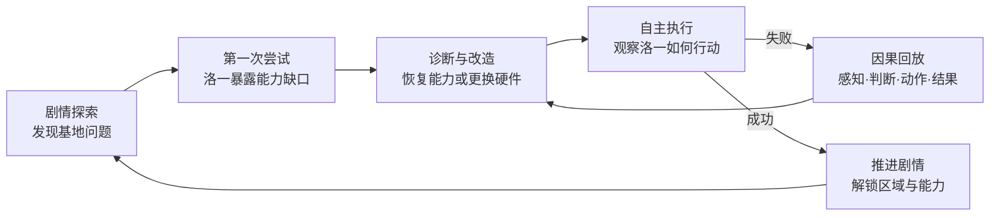
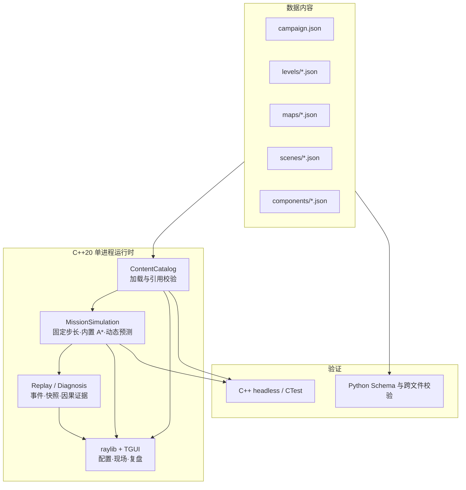
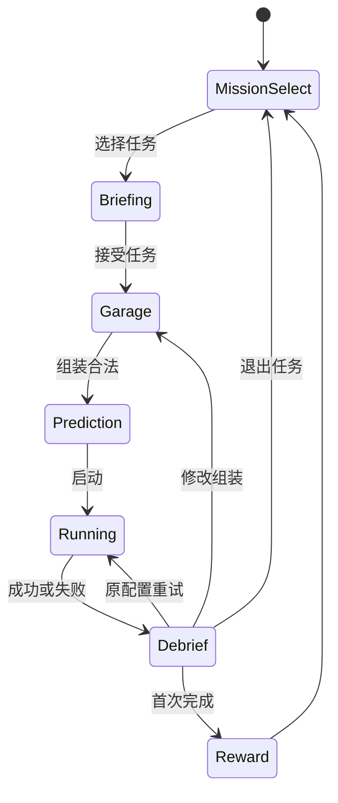

# 设计: 机器人 AI 剧情冒险游戏 MVP

> 类型: 需求设计
> 来源: 本次产品策划讨论（无 Jira 工单）
> 需求文档: 本文“需求”章节
> 需求结论: 交付一款以机器人伙伴成长、剧情任务、能力改造和因果回放为核心循环的桌面冒险游戏 MVP
> 架构结论: 采用 C++20、raylib、TGUI 与权威 JSON 内容；游戏运行不依赖闭源引擎、账号或许可证服务
> 交付范围: 产品策划、第一章任务、UI 信息架构、内容格式、C++ 仿真与表现、回放和验证方案
> 首要风险: 如果失败原因不能通过画面直接理解，产品会退化成参数调试器和教学文本阅读器
> 创建时间: 2026-10-12
> 更新时间: 2026-10-13
> 代码位置: src, assets, tests, tools

## 需求

本需求交付一款面向普通玩家的机器人 AI 剧情冒险游戏 MVP。玩家不需要编程基础，通过修复机器人伙伴、推进基地探索、改造真实能力、观看自主执行和分析失败回放，理解机器人“感知、定位、建图、规划、避障、控制”的基本闭环。

产品工作名为 **《失落的信号》**。机器人机体编号为 **RO-1**，伙伴名为“洛一”。名称用于内部验证，不作为正式发行名称。目标用户为 12 岁以上、对机器人或 AI 感兴趣但没有专业背景的玩家。首发语言为简体中文，首发平台为 Windows 与 Linux 桌面端。单个任务从剧情触发到重试完成控制在 3～8 分钟，第一章完整体验控制在 30～45 分钟。

### 产品定位

一句话介绍：

> 唤醒一台能力残缺的机器人，陪它找回感知、定位和自主行动能力，并查明研究基地失联的原因。

玩家来到一座停止运转的自动化研究基地，发现一台只保留基础运动能力的移动机器人。玩家通过恢复基地、寻找能源和追踪异常信号，逐步修复洛一的自主能力。洛一的成长体现为能够看见以前看不见的东西、理解自己的位置、独立寻找道路并处理陌生情况，不使用“速度增加 20%”代替能力成长。

产品遵循一个首要策划判断：**玩家为了推进冒险而理解机器人 AI，而不是为了学习机器人 AI 才被迫玩游戏。** 剧情提供继续前进的理由，任务制造具体问题，改造和诊断构成主要玩法，知识是玩家解决问题后自然获得的结果。

本产品教授“机器人自主系统与 AI 基础”。PID、A*、DWA 等技术在知识卡和复盘中使用准确名称；主流程先展示行为和因果，再引入术语。经典控制与规划不包装成机器学习。图像分类、学习型决策和强化学习属于 MVP 后的 AI 章节。

### 剧情结构

世界采用有限规模的近未来研究基地，不建设开放世界。基地由维修间、仓库、能源区和信号塔组成，同一空间会因供电、障碍和机器人能力变化产生新的通路与任务。

| 章节 | 剧情目标 | 机器人能力主题 | 交付阶段 |
|---|---|---|---|
| 第一章：醒来 | 唤醒洛一并恢复基地仓库供电 | 距离感知、定位与地图、路径规划 | MVP |
| 第二章：选择身体 | 修复不同区域并为任务选择底盘 | 差速、阿克曼、履带与地形适配 | MVP 后 |
| 第三章：学会工作 | 辨认、搬运和分配关键物资 | 视觉感知、机械操作、任务分解与协作 | MVP 后 |
| 第四章：未知信号 | 离开已知基地，查明失联原因 | 数据、置信度、泛化、奖励目标与 AI 局限 | 完整版候选 |

完整版规划为每章 5 关、共 20 关。阿克曼和履带底盘随第二章剧情逐步加入车库，并分别使用驱动电机＋转向舵机、左右履带电机的执行器模型。这些后续章节只定义叙事和技术路线，不在 MVP 中预建视觉模型、训练系统、机械臂或通用智能体。

### 竞品与机会证据

2026-10-12 查询的 Steam 公开评测表明，相邻玩法已经分别得到市场验证：

| 产品 | 已验证的核心乐趣 | 公开评测信号 |
|---|---|---|
| [RoboCo](https://store.steampowered.com/app/1067220/RoboCo/) | 组装机器人并用意外方案完成任务 | 222 条，87.8% 好评 |
| [Mars First Logistics](https://store.steampowered.com/app/1532200/Mars_First_Logistics/) | 拼装载具、处理形状各异的货物 | 3814 条，94.9% 好评 |
| [Gladiabots](https://store.steampowered.com/app/871930/Gladiabots/) | 设计 AI、观看执行、持续改进 | 918 条，87.7% 好评 |
| [while True: learn()](https://store.steampowered.com/app/619150/while_True_learn/) | 用可视化谜题介绍机器学习概念 | 8264 条，91.3% 好评 |
| [JOY OF PROGRAMMING](https://store.steampowered.com/app/2216770/JOY_OF_PROGRAMMING__Software_Engineering_Simulator/) | 使用真实代码控制机器人与设备 | 400 条，77.0% 好评 |

公开评价同时暴露了主要风险：长距离手动运输会产生重复劳动；建造工具、坐标系和隐藏规则不清会让实验变成盲试；教学文字与玩法脱节时，玩家通关后仍无法解释概念；真实代码会显著提高入门门槛。

本产品占据“硬件组装 + 自主执行 + 可解释回放”的交集。当前 `src/hw` 已实现差速底盘/阿克曼执行器、电机力模型、编码器/IMU/雷达传感器模型，`src/algo` 已实现 A*、DWA、PID、路径跟随、占据图与动态障碍跟踪；`assets` 负责关卡、地图、组件、策略、剧情和玩家文案，`src/client` 使用玩家能够理解的选择与因果反馈呈现这些系统。

### 核心体验原则

1. **先关心伙伴，再关心技术。** 洛一有持续的行为、记忆和表达，玩家恢复的是它做事的能力。
2. **选择必须改变行为。** 每个可装备组件都改变传感范围、噪声、抓地、算力、能耗或可靠性。
3. **失败必须值得观看。** 碰撞、迷路和急停都要形成短小、有戏剧性且可诊断的现场。
4. **知识必须长在玩法里。** 玩家先看到现象，再通过回放理解原因，最后获得术语。
5. **任务允许多解。** 组合任务至少存在两套可通关配置，评价分别奖励安全、效率和节能。
6. **重试必须迅速。** 从失败画面返回改造界面不超过一次点击，重新运行不超过 5 秒。
7. **复杂度逐章开放。** 每关只引入一个主要概念，不同时暴露多组工程参数。

### 玩家操作边界

玩家直接操作以下内容：

| 类型 | MVP 内容 | 产生的实际影响 |
|---|---|---|
| 轮胎 | 标准胎、防滑胎、节能胎 | 滑移、能耗、制动距离 |
| 传感器 | 短距高频雷达、标准雷达、长距低频雷达 | 探测距离、刷新率、噪声、功耗 |
| 计算单元 | 轻量、均衡、性能计算单元 | 重规划周期、动态预测频率、功耗 |
| 电机（第四关起） | 标准、扭矩、高效电机 | 堵转力、自由转速、功耗比 |
| IMU（第六关起） | 基础、高精度 | 陀螺噪声、零偏、功耗：打滑时按滑移加权融合航向 |
| 驾驶风格 | 无极条（温柔 0～激进 1，普通居中） | 安全距离、巡航速度、前视距离、加速度 |
| 出发判断 | 对风险、感知与路线结果做预测 | 运行后用现场证据验证理解，不修改算法实现 |

MVP 固定使用一台差速底盘机器人。底盘结构、自由几何拼装、机械臂和第二机器人不进入首版。地图、定位与规划能力随剧情被修复，它们是洛一恢复的内置能力，不占物理组件插槽。

玩家不在主线中直接选择或装备 A*、PID、DWA、占据栅格，也看不到 `Kp` 等参数：轮速与航向 PID 增益由装配物理参数自适应整定（同装配必得同增益，确定性天然成立），DIY 新硬件无需手调。算法属于内置自主系统。高级实验室可以在完整第一章验证成功后开放算法对照和原始参数，训练系统不进入 MVP。

实时驾驶只用于序章中的底盘体验，以及开发调试。正式计分任务由机器人自动执行。MVP 不加入任务中的随时接管，避免玩家通过驾驶绕过需要学习的自主能力。

### 核心循环



### 第一章 MVP

一张连通的小型基地仓库、两台机器人（差速 RO-1、转向 RO-2）、两章十关。第一章只认识部件（零失败压力，先预测再观看），
第二章才真上路（湿滑、封路、叉车）。地图通过恢复供电、打开门和移动货架改变状态，
不为每个概念制作独立场景。

| 任务 | 剧情目标 | 玩家操作 | 核心概念 | 失败证据 | 能力成长 |
|---|---|---|---|---|---|
| 1：醒来 | 把洛一移出维修架并找到备用电池 | 发出前进、转向、停止等简单指令 | 运动、惯性、制动距离 | 指令与实际速度并排显示 | 恢复语音与基础运动 |
| 2：换双鞋 | 同一段路换三种轮胎各跑一次 | 选择轮胎并对比成绩 | 抓地、制动距离、能耗 | 制动距离与能耗差异 | 认识轮胎 |
| 3：第一次看见 | 穿过维修间并停在损坏的玻璃门前 | 安装一种距离雷达 | 探测距离、刷新率 | 雷达首次发现障碍的时刻与剩余制动距离 | 恢复距离感知 |
| 4：认识电机 | 同一段路换两种电机各跑一次 | 选择电机并对比用时与能耗 | 扭矩、能耗 | 用时与电表读数 | 认识电机 |
| 5：集结 | 携带能源模块前往信号塔（无叉车） | 组合轮胎、雷达、电机和驾驶风格 | 配合、短板定位 | 三项评分哪项先丢 | 认全零件，结束第一章 |
| 6：我在哪里 | 经过湿滑地面抵达仓库校准点 | 选择轮胎、IMU 并完成地标校准 | 里程计漂移、真实与估计位置 | 两条轨迹逐渐分离 | 恢复定位与地图 |
| 7：门被堵住了 | 货架封路后寻找能源室 | 配置感知、计算资源和驾驶风格 | 地图、路径规划、路线取舍 | 搜索区域、计划路线与实际净空 | 恢复自主导航 |
| 8：把信号送出去 | 携带能源模块经过叉车通道并启动信号塔 | 组合雷达、轮胎、计算单元和驾驶风格 | 感知、定位、规划、控制协同 | 完整因果时间轴 | 发出第一段未知信号，结束第二章 |
| 9：信号回响（挑战） | 同一通道、更紧的尺度再走一次 | 自由组合已解锁的全部零件 | 动力与感知组合 | 与推荐方案的成绩对比 | 章节外加分题 |

每关包含一个主目标和三个独立评价：

- **安全**：无碰撞、最小净空达标。
- **效率**：在目标时间内完成。
- **节能**：能耗低于目标值。

完成主目标即可推进，不要求三项同时达成。玩家可以用不同组装追求不同评价，避免唯一答案。

### 乐趣设计

乐趣来自可预测的工程选择与不可预先完全掌握的现场组合：

- 货物具有外形和性格，例如会滚动的球形包裹、怕急刹的咖啡、挡住雷达的高纸箱。
- 动态角色遵守确定性规则，但在玩家第一次进入关卡时形成意外。
- 机器人通过灯光、头部朝向和短语音表达“看见了”“不确定”“正在重算”“无路可走”。
- 失败后立即冻结关键一帧，用一条因果句解释问题，而不是只显示错误代码。
- 上一次运行以淡色幽灵或路线保留，玩家能直接看出改装后的差异。
- 评价奖励不同风格，不把最快方案定义为唯一正确方案。

### 教学模型

每个概念使用四步闭环：

1. **预测**：执行前询问玩家“最可能出现什么问题”。
2. **观察**：现场只显示当前需要学习的一个信息层。
3. **解释**：回放用“输入 → 判断 → 动作 → 结果”展示因果。
4. **命名**：结算知识卡给出准确术语和一句可迁移的规则。

示例：规划章节不要求玩家选择 A*。玩家选择“温柔”或“激进”，运行时看到搜索区域逐步展开，结算时说明“内置规划器使用 A* 启发式搜索；激进风格减少了安全余量，但路线更接近货架”。

知识卡属于可选深读层。主线结算只给出一句因果规则；展开知识卡后才显示算法名、示意图、公式和适用边界。前两个任务由洛一明确指出关键证据，后续任务先让玩家在时间轴中选择“哪里开始出错”，再提供分级提示。证据层始终保留，不通过隐藏信息制造难度。

### MVP 验收指标

纵向切片（终关任务）已验证核心循环。再邀请至少 8 名没有机器人专业背景的目标玩家完成第二章四关。达到以下标准后才扩展第二章之外的内容：

| 指标 | 成功标准 |
|---|---|
| 情感动机 | 6/8 玩家能描述洛一恢复了什么能力，并愿意继续追查信号 |
| 首次理解 | 6/8 玩家不看外部说明即可完成第一次组件选择与启动 |
| 因果理解 | 6/8 玩家能用自己的话解释至少一次失败原因 |
| 主动迭代 | 6/8 玩家失败后主动修改配置并再次运行 |
| 教学迁移 | 5/8 玩家能在新场景中正确选择更合适的传感器或轮胎 |
| 节奏 | 第一章中位完成时间为 15～25 分钟，第二章为 30～45 分钟 |
| 乐趣信号 | 6/8 玩家愿意继续追查下一章，而非仅表示“学到了” |

## 架构设计

发行原型统一使用 C++20。raylib 绘制 3D 探索场景、2D AI 认知层和特效，TGUI 提供菜单、配置、预测和复盘控件；二者与仿真核心编译进同一个桌面程序。地图、关卡、组件、驾驶风格、剧情和玩家文案以 JSON 为权威来源，运行时根据内容文件生成选择项和任务现场。



### 模块职责

| 模块 | 职责 | 不负责 |
|---|---|---|
| `assets` | 关卡、地图、3D 场景、组件、驾驶风格、文案和奖励的权威数据 | 仿真代码、界面布局 |
| `src/game/content_catalog.*` | 读取 JSON、解析引用、检查可用组装 | 在代码中复制关卡和组件默认值 |
| `src/hw` | 底盘执行器、电机/轮胎/地面接触动力学、传感器 transducers 与 HAL 接口 | 玩家流程和界面文案 |
| `src/algo` | A*、DWA、PID、跟随、占据图、动态跟踪与预测 | 玩家流程和界面文案 |
| `src/game/mission_simulation.*` | 固定步长运动、感知、预测、评分、事件、诊断和回放 | 控件布局和绘制 |
| `src/client` | raylib 世界表现、TGUI 配置与复盘流程 | 判定任务结果 |
| `tests/new` | 内容加载、推荐/默认配置、确定性与回放回归 | 依赖人工判断画面正确性 |

### 运行边界

游戏逻辑和表现位于同一个 C++ 工程和进程，不使用跨语言绑定。`MissionSimulation` 以 0.02 秒固定步长推进并输出只读快照；`SceneRenderer3D`、`WorldRenderer` 和 `GameUi` 读取位置、路线、感知和意图。倍速只改变一帧推进多少个固定步，不改变结果。地图单位统一为米；仿真 XY 平面分别映射到 3D 的 X 和负 Z，仿真 Z 轴映射到 3D 的 Y 轴。

`assets/maps/*.json` 定义可通行区域、碰撞障碍、表面、任务标记和动态角色路径；地图通过 `scene_3d` 引用 `assets/scenes/*.json`。场景文件定义镜头构图、灯光、雾、地面风格、环境 Prefab 及其实例。调整围墙、植物、碎石、灯具、镜头或色调不需要修改 C++，场景视觉也不会改变 headless 仿真结果。

A*、路径跟随和动态预测是洛一恢复后的内置自主能力。玩家选择硬件和驾驶风格，这些选择改变制动、扫描频率、预测频率、速度与安全空间；玩家不装备 A*，也不直接调算法参数。

差速底盘的执行链为真实级联控制：上层路径跟随或 DWA 产生 `v/ω`，根据 JSON 中的轮距换算左右轮目标速度；编码器分辨率对实际轮速进行量化，左右轮各自的速度 PID 输出 PWM 占空比（限幅来自 JSON），PWM 经电机扭矩曲线（高转低扭）产生轮上纵向力，牵引力受轮胎×地面综合摩擦钳制，合力与横摆力矩再经车体质量与转动惯量加速车体。轮半径、轮距、电机极限与扭矩曲线、质量/惯量、编码器 CPR、能量系数均来自 `assets/robots/ro1.json`，轮胎摩擦与滚阻、地面材质摩擦由组件与地图 JSON 给出；轮速与航向 PID 增益由上述物理自适应整定。航向 PID 是上层转向控制，其输出是目标角速度，不冒充电机 PWM。

动态叉车不写入 A* 使用的静态占据地图。雷达对静态栅格和动态圆形碰撞体执行同一次最近命中查询，因此货架会遮挡后方叉车；命中的射线经过简化聚类后形成带噪中心观测。`DynamicObstacleMap` 从连续观测估计速度、让陈旧轨迹失效，并用已观测到的运动边界处理重复掉头，最后向 DWA 提供按时间分帧的动态障碍预测。DWA 不读取地图 JSON 中的巡逻路径；该路径只负责生成关卡世界里的叉车真值。2D 认知层显示动态跟踪结果，3D 探索层显示真实叉车并将同一跟踪结果叠加为感知连线和预测轨迹。

### 机器人资产与装配

机器人采用“模型负责外观、JSON 负责装配、C++ 负责行为”的三层结构。底盘、轮胎、雷达和计算单元分别提供 glTF 2.0/GLB 模型；`assets/robots/ro1.json` 定义机体坐标系、安装点、底盘运动参数、独立碰撞体和可装配槽位；组件文件同时定义 2D 表现、3D 模型引用与仿真参数。

项目坐标约定为米制右手系：`+X` 向前、`+Y` 向左、`+Z` 向上，角度使用度。安装位姿以 JSON 为权威，GLB 内部节点名不参与仿真判定。视觉尺寸、碰撞几何和传感器参数互相独立，程序不会从模型三角形或外观看起来的大小推导量程、质量或碰撞范围。

2D 认知层和 3D 探索层读取同一份机器人装配。认知层根据 `primitive_2d`、颜色、尺寸和安装点组合洛一；探索层在相同安装点加载 `model_3d`。运动学、传感器、A*、DWA、PID、任务判定和回放不随渲染维度改变。

组件系统使用数据组合和独立运行系统，不要求所有部件继承统一的 `IRobotComponent`。轮胎、传感器和计算单元属于可装配硬件；导航算法仍是内置自主系统。新增现有类别的部件只需添加 GLB 与 JSON，只有增加新的仿真能力时才修改 C++。

## 详细设计

核心实现先建立数据驱动内容与稳定仿真快照，再由 raylib 和 TGUI 制作剧情探索、改造、任务现场和回放。图形客户端不得复制任务规则或仿真判定。

### 内容目录与格式

```text
assets/
  campaign.json
  levels/
 boot.json
 first_sight.json
 localization.json
 blocked_route.json
 lost_signal.json
  maps/
 research_base.json
 scenes/
 research_base.json
  components/
    tires.json
    sensors.json
    computers.json
  policies.json
 robots/
 ro1.json
 models/robots/ro1/
 *.glb
 models/environment/research_base/
 *.glb
 presentation/
 *.json
 schema/
 *.schema.json
 story/
 chapter_01.json
```

所有可持久化对象使用稳定字符串 ID。数组位置和整数关卡号只用于显示，不参与存档引用。

关卡文件示例：

```json
{
  "schema_version": 1,
 "id": "lost_signal",
 "order": 5,
 "title": "把信号送出去",
 "map": "research_base",
 "control_mode": "autonomous",
 "localization_mode": "fused",
  "objective": {
    "type": "deliver_via",
    "spawn": "robot_bay",
    "via": "supply_station",
 "via_label": "能源模块",
 "goal": "signal_tower",
 "goal_label": "信号塔",
 "goal_visual": "signal_tower",
 "time_limit_s": 150,
    "max_collisions": 0
  },
  "loadout_rules": {
 "budget": 6,
 "required_slots": ["tires", "sensor", "computer"]
  },
  "teaching": {
    "concept": "dynamic_obstacle_prediction",
    "prediction_prompt": "叉车接近路口时，机器人最需要提前知道什么？",
    "knowledge_card": "动态物体需要用位置和速度预测未来，而不只是写进静态地图。"
  },
 "rewards": ["story.chapter_02_signal"]
}
```

地图文件以米为单位，描述会影响仿真的空间实体，并通过 ID 引用独立的 3D 场景表现：

```json
{
  "schema_version": 1,
 "id": "research_base",
 "scene_3d": "scene.research_base",
  "size_m": [20.0, 14.0],
  "grid_resolution_m": 0.5,
  "obstacles": [
 {"id": "west_shelf", "type": "box", "min": [8.0, 0.0], "max": [9.0, 11.0]},
 {"id": "east_shelf", "type": "box", "min": [12.0, 3.0], "max": [13.0, 14.0]}
  ],
 "surfaces": [],
  "markers": {
    "robot_bay": [1.0, 1.0, 0.0],
    "supply_station": [10.5, 12.5, 0.0],
 "signal_tower": [17.0, 10.0, 0.0]
  },
  "actors": [
    {
      "id": "forklift_a",
      "type": "patrol",
 "path": [[17.5, 6.0], [14.0, 6.0]],
 "speed_mps": 0.55,
 "radius_m": 0.45,
 "active_in": ["lost_signal"]
    }
  ]
}
```

场景文件描述镜头和环境表现。Prefab 可以由基础几何或 GLB 模型组成，实例位置与关卡逻辑分离：

```json
{
 "schema_version": 1,
 "id": "scene.research_base",
 "camera": {
 "offset_m": [-7.0, -8.1, 8.8],
 "target_height_m": 0.45,
 "fov_degrees": 41.0,
 "focus_weights": {"robot": 0.52, "actor": 0.30, "goal": 0.18}
 },
 "lighting": {
 "direction": [-0.48, 0.32, -1.0],
 "directional_color": "#FFF0D1",
 "directional_intensity": 1.08,
 "ambient_color": "#3D4A47",
 "fog_color": "#090E0D",
 "fog_start_m": 12.0,
 "fog_end_m": 31.0,
 "robot_active_color": "#15947A",
 "robot_waiting_color": "#B85C14",
 "goal_color": "#0D8580"
 },
 "floor": {
 "base_color": "#181C1B",
 "tile_color": "#42433E",
 "boundary_color": "#2E302E",
 "tile_size_m": 4.0,
 "seam_m": 0.015,
 "color_variation": 9,
 "boundary_height_m": 0.24,
 "boundary_width_m": 0.22
 },
 "prefabs": [
 {
 "id": "prefab.wall_panel",
 "parts": [
 {"primitive": "box", "position_m": [0, 0, 0.5], "size_m": [3.45, 0.34, 1.0], "color": "#2B302D"}
 ]
 }
 ],
 "instances": [
 {"id": "north_wall_01", "prefab": "prefab.wall_panel", "position_m": [1.8, 14.18, 0]}
 ]
}
```

组件文件保存玩家可理解的属性和核心使用的物理参数。算法名称不作为组件：

```json
{
  "schema_version": 1,
  "components": [
    {
      "id": "sensor.short_fast_lidar",
      "slot": "sensor",
      "title": "近距快扫雷达",
      "description": "看得近，但更新快，适合狭窄而忙碌的区域。",
      "cost": 2,
      "behavior": {
        "range_m": 5.0,
        "rays": 48,
        "scan_hz": 20.0,
        "noise_sigma_m": 0.04,
        "power_w": 18.0
      }
    }
  ]
}
```

加载器对以下条件做启动期校验：

- `schema_version` 受支持。
- ID 全局唯一，所有引用存在。
- 数值有限并位于定义范围内。
- 地图 marker 位于边界内且不落在障碍中。
- 地图引用的 3D 场景存在，Prefab、实例、模型和关卡条件引用有效。
- 镜头权重、雾范围、地面接缝和场景尺寸参数有效。
- 巡逻路径有效，速度和半径为正。
- 关卡解锁图无环。
- 每关必需插槽至少存在一个已定义组件。
- 自动全通测试中至少一套官方配置能完成每关。

校验失败时开发版本显示文件路径、JSON Pointer 和错误原因并中止加载，不使用硬编码关卡静默回退。

### 游戏状态



`GameSession` 是任务状态的唯一所有者。界面不能直接标记任务完成、发放组件或修改分数。首次完成发放奖励具有幂等性，重复播放只更新最佳评价与回放。

### 固定步长与确定性

- 仿真使用固定 `0.02s` 步长。
- 关卡文件提供种子，所有随机噪声由会话内 RNG 产生。
- 表现层可以低于仿真频率读取快照，不能用渲染帧间隔推进规则。
- 同一内容版本、种子、组装和命令序列必须产生相同任务结果。
- 平衡测试在无图模式运行全部官方配置、反例配置和存档迁移。

### 快照与回放

表现层每帧读取 `MissionSnapshot`，其中包含：

| 数据 | 任务现场 | 失败回放 |
|---|---|---|
| 机器人真实姿态 | 用于模型位置，不显示数值 | 可与估计姿态叠加 |
| 估计姿态 | 仅在教学层开启时显示 | 始终可查看 |
| 雷达射线与命中 | 当前关卡需要时显示 | 可逐帧查看 |
| 已知占据地图 | 当前关卡需要时显示 | 可逐帧查看 |
| 当前路线 | 默认简化显示 | 显示历史版本和重规划点 |
| DWA 局部规划 | 认知层显示代表性安全/碰撞候选与选中轨迹 | 保留选中轨迹 |
| 动态障碍跟踪 | 动态避障章节显示 | 显示雷达观测形成的估计位置、速度与预测轨迹 |
| 执行器闭环 | 显示左右轮目标/编码器实测 RPM 和 PWM | 保留控制输出与选中局部轨迹 |
| 当前意图 | 使用“前往、减速、等待、重算”等自然语言 | 与事件时间轴对齐 |
| 评价指标 | 只显示本关三项 | 显示阈值和变化原因 |

回放以 20Hz 记录教学快照，并保存关键事件的完整证据。MVP 任务最长 180 秒，单次回放目标大小低于 10MB。结算只保留最近一次和个人最佳一次回放。

诊断规则输出结构化因果链：

```text
观察：11.4 秒检测到叉车，距离 11.5 米
判断：25.0 秒时，1.2 秒预测范围仍未及早覆盖交叉点
动作：机器人已经进入叉车通道，并停在冲突区域内
结果：25.1 秒安全距离降到 0，发生碰撞
改进方向：更快的计算单元或更温柔的风格；只提高感知刷新率未必足够
```

诊断只引用真实快照和事件，不根据失败类型生成与现场无关的固定文案。

### UI 信息架构

#### 目标美术方向：场景化科幻探索 + AI 认知视图

游戏默认呈现具有三分之四视角、空间层次、环境叙事和角色表演的科幻探索场景。玩家先看到废弃研究站、洛一、任务目标和正在发生的危险，再按需进入 AI 认知视图，观察地图、感知、路线和预测。AI 可视化是短暂的观察能力，不是永久覆盖游戏世界的监控台。

两个显示层承担不同职责：

1. **探索层**：使用 2.5D/3D 场景、真实遮挡、局部光源、材质磨损、植物侵入、废弃设备和尺度对比建立世界；HUD 只放在屏幕边缘。
2. **认知层**：按键切换或在关键教学事件中短暂出现，以半透明方式显示栅格、可通行区域、雷达命中、未来轨迹和决策依据；退出后立即恢复纯净场景。

这两个层读取同一份仿真快照。认知层不能改变 A*、DWA、PID、传感器或任务结果，只负责把真实内部状态解释给玩家。

现场画面的视觉规则如下：

- 场景占据完整窗口，洛一、动态障碍和任务目标构成第一视觉焦点；现场不保留永久右侧面板。
- 镜头采用三分之四视角并保留适度透视，角色、设备、墙体和地形必须具有高度、投影和前后遮挡。
- 环境使用旧金属、混凝土、积水、植物、碎石、灯具和失效设备讲述基地停摆后的状态。
- 洛一具有远距离仍可辨认的轮廓、状态灯和动作；大型废弃机器人或设备用于制造尺度感和剧情悬念。
- 默认隐藏栅格、雷达线、路径和算法术语。玩家主动观察 AI 思考时，认知层才显示这些信息。
- 任务目标尽量由世界中的信号塔、能源模块、门禁和灯光表达；文字标记只补充不能从场景读出的信息。
- 普通 HUD 面积控制在屏幕的 15% 内，只保留任务状态、洛一状态和必要操作；解释卡在事件发生时出现并自动收起。
- 探索层以暖灰、锈橙、植物绿和局部灯光建立环境；认知层统一使用青蓝色半透明材质；红色只用于真实危险。

MVP 已完成 raylib 3D 探索层：固定三分之四镜头、GLB 机器人装配、立体货架与叉车、基础环境、方向光、局部灯光和雾效组成场景；原有俯视画面作为可随时切换的认知层保留。P1 光影链路使用 GLB 顶点法线、法线矩阵、单方向光 Shadow Map 与 3×3 PCF、半精度 HDR 场景缓冲、ACES 色调映射和克制的 Bloom，并用短距离雷达扫描扇面、等待制动灯和信号塔启动环表达关键状态。阴影分辨率与覆盖范围、阴影强度、曝光、Bloom 阈值和强度、暗角均由场景 JSON 配置；将阴影分辨率设为 0 或 Bloom 强度设为 0 即可形成低配表现。P2 环境层加入项目自有的可平铺混凝土纹理、破损控制台、电缆卷盘、维护箱和磨损警戒带；叉车通道因此在现场画面里具有明确边界，环境道具也开始讲述基地停摆后的状态。P3 角色表现使用真实状态驱动洛一眼灯、运动尾迹、雷达扫描、感知连线、动态预测和成功能量环，并在发现叉车和完成任务时切换由 JSON 定义的事件镜头。地面纹理路径、所有 Prefab、实例、镜头与特效参数继续由场景 JSON 定义。参考图只用于分析构图与体验，不把来源不明的图片或资产提交到开源仓库。

MVP 包含五个主要界面：

1. **基地探索**：在同一研究基地中发现剧情目标、已恢复区域和洛一当前能力。
2. **任务简报**：用场景动画说明目标、限制和新变量。
3. **车库**：插槽式组装、预算、驾驶风格和风险预测。
4. **任务现场**：世界为主，按需叠加感知、认知地图与路线。
5. **结果回放**：时间轴、因果链、前后方案对比和重试入口。

洛一的角色表达贯穿五个界面，但不另建宠物养成菜单。它通过头部朝向、状态灯、两到三秒的动作和短句表达“看见了”“不确定”“正在重新判断”。这些表达必须由真实 `MissionSnapshot` 状态触发；表现层不能让洛一说“我没看见”而仿真实际已经检测到目标。剧情对白可以表达性格，技术解释必须引用真实证据。

P0 纵向切片把一次任务压缩为四个连续阶段，避免将所有配置、预测和诊断同时铺在一张工程面板上：

1. **机库装配**：左侧以洛一和维修机库为主视觉，右侧只显示预算、部件和驾驶风格；部件选择会改变轮胎、雷达波纹和计算核心外观。
2. **出发判断**：保留洛一主视觉，单独询问动态叉车问题；玩家必须先留下判断，才能启动任务。
3. **现场执行**：左侧切换为基地场景、剩余路线、洛一和叉车；右侧只保留当前意图及“看见、判断、动作”的玩家语言，时间、路程和能耗缩成场景角落的一行次级信息。
4. **事故复盘**：结果徽章、因果时间线、回放滑块、改进建议和知识卡按阅读顺序排列，底部始终保留返回改造和再次尝试。

全局结构采用“主视觉 + 决策卡 + 固定操作栏”。主要按钮不放在长滚动内容的末尾；切换阶段时立即清除上一阶段控件，避免一帧内重叠。顶部只显示作品名、章节和当前目标，底部使用玩家语义“观察现场 · 理解原因 · 改变洛一”，不暴露内容文件和算法实现说明。

#### 车库

```text
┌──────────────────────────────────────────────────────────────────────┐
│ 第一章 05 把信号送出去 预算 4/6 [开始任务] │
├──────────────┬─────────────────────────────┬─────────────────────────┤
│ 组件库        │                             │ 本次组装                │
│ │ 洛一预览 │ 底盘 差速底盘 固定 │
│ 轮胎 3 │ │ 轮胎 防滑胎 2 │
│ 轮胎  3       │   点击插槽查看可选组件      │ 雷达  标准雷达   1      │
│ 雷达  3       │                             │ 算力  性能单元   1      │
│ 算力  2       │                             │                         │
│              │                             │ 风格：温柔 — 普通 — 激进（无极）│
├──────────────┴─────────────────────────────┴─────────────────────────┤
│ 风险预测：□ 看见叉车太晚  □ 转弯空间不足  □ 计算反应不够快          │
└──────────────────────────────────────────────────────────────────────┘
```

车库使用固定插槽和点击替换，不在 MVP 中提供自由几何拼装。组件卡只显示三个最有意义的属性，详细工程参数放在知识页。

#### 任务现场

```text
┌──────────────────────────────────────────────────────────────────────┐
│ 经停补给站后前往信号塔 安全 ● 用时 00:42 能耗 63% [暂停] │
│                                                                      │
│                         二维任务现场                                 │
│       青色=雷达       紫色=计划路线       琥珀=预测风险               │
│                                                                      │
│                                      当前意图                        │
│                                      “等待叉车通过”                  │
│ 依据：叉车预计 1.8 秒后通过路口 │
├──────────────────────────────────────────────────────────────────────┤
│  感知 [开]   估计地图 [关]   路线 [开]        事件：检测到移动物体    │
└──────────────────────────────────────────────────────────────────────┘
```

现场不保留永久左右调试面板。信息层由关卡逐步解锁，默认只显示完成当前教学目标所需的信息。

#### 结果回放

```text
┌──────────────────────────────────────────────────────────────────────┐
│ 任务失败：洛一看见了叉车，但反应太晚 [修改组装] │
├──────────────────────────────────────────┬───────────────────────────┤
│                                          │ 11.4s  看见叉车           │
│              关键帧回放                  │ 25.0s  预测未覆盖交叉点       │
│       实际轨迹 ──  估计轨迹 ···          │ 25.1s  安全距离归零       │
│                                          │                           │
│                                          │ 改进方向                  │
│                                          │ · 感知与判断速度匹配          │
│                                          │ · 更快的计算单元          │
│                                          │ · 选择温柔风格            │
├──────────────────────────────────────────┴───────────────────────────┤
│ 0s ━━━━━━━━━━━━━━━━━━━━━━━━━━━━━━━━━━━━━━━●━━━━━━━━━━ 26s          │
│                     [原配置重试]  [与上次运行对比]                   │
└──────────────────────────────────────────────────────────────────────┘
```

### 视觉设计

视觉采用温暖的工业实验室风格。深海军蓝背景承载机库和仓库空间，暖白机体与信号橙提供角色焦点，薄荷绿只表达感知、连接和成功状态。界面不模拟 IDE、终端或工程后台。

| 语义 | 颜色 | 用途 |
|---|---|---|
| 主背景 | `#060C12` | 任务现场和主要底色 |
| 表面 | `#0B141D` | 决策卡和信息面板 |
| 次级表面 | `#111E28` | 部件、指标和事件卡 |
| 正文 | `#F1EEE6` | 标题、主要文字和洛一机体 |
| 次要文字 | `#8FA0A8` | 解释、单位和未激活状态 |
| 感知与成功 | `#67E0C4` | 雷达、连接、计划路线和有效状态 |
| 信号与主操作 | `#FFB45C` | 主按钮、任务目标和风险提醒 |
| 失败 | `#FF6B70` | 碰撞和已确认错误 |

中文使用 Noto Sans CJK SC，数值使用等宽数字。状态不能只依赖颜色，必须同时使用图标、线型或文字。危险色只用于已经需要行动的状态，普通技术信息不使用红色。

动画遵循以下规则：

- 雷达以真实扫描频率刷新，不制作与数据无关的装饰扫描。
- 重规划时旧路线淡出、新路线从机器人位置展开。
- 估计位置使用虚线轮廓，真实位置使用实体模型。
- 碰撞发生后保留 0.5 秒现场，再进入关键帧回放。
- UI 过渡控制在 150～250ms，重试不播放长转场。

当前图形客户端用于验证四阶段界面和地图信息层级，最终美术资产仍需在玩家测试后迭代。

### 存档

存档改为版本化 JSON：

```json
{
  "schema_version": 2,
  "content_version": "mvp-1",
 "completed_levels": ["boot", "first_sight"],
 "inventory": ["tires.standard", "sensor.standard_lidar", "computer.light"],
  "best_scores": {
 "first_sight": {"safe": true, "fast": false, "efficient": true}
  }
}
```

原型尚未发布过用户存档，因此不制造虚假的旧格式迁移路径。读取到未知 `schema_version` 或损坏 JSON 时，客户端保留原文件、输出警告并以空进度启动；正常保存先写临时文件，再替换正式文件。

### 实施顺序与验证

1. **内容外置**：维护 JSON Schema 与跨文件引用校验；地图、任务、组件、策略、故事和界面文案不得回写到 C++ 常量中。
2. **建立 C++ 运行时**：用 `ContentCatalog` 加载内容，以固定 0.02 秒步长实现运动、感知、内置 A*、DWA、PID、预测和评分。
3. **制作 P0 纵向切片**：已完成“把信号送出去”的装配、预测、自主执行、可信失败、因果回放、改造和成功结算。
4. **无窗口回归**：已验证十关推荐配置全通、动态关默认配置以 2.5 厘米贴身通过但丢安全分、大马力配慢算力发生动态碰撞、同输入结果确定、进度存档可往返读取且回放可查询。
5. **8 人验证**：验证玩家是否关心洛一、能解释失败并愿意主动再试。未达到情感动机、因果理解或主动迭代指标时，先修改任务与反馈，不扩展内容。
6. **完整两章 MVP**：十关配置、章节解锁、序章驾驶、剧情节点、知识卡、版本化存档和章节结尾已经接入；玩家测试后继续调整节奏与表现。
7. **挑战关管线**：终关后挑战关由 `tools/generate_levels.py` 从模板生成（参数表即内容），`tools/level_report.py` 输出全关平衡表；首批“信号回响”已接入（同路线、预算 6、迅速与节能待探索）。训练、机械臂、视觉识别与社区内容保持在范围外。

### 动力学与 PID 自整定公式

执行器按固定步推进（`src/hw/chassis/motor_drive.cpp`），符号与代码一致：

```text
单轮纵向力：  F = PWM · F_stall · max(0, 1 − |v_w| / v_free)   # 高转低扭
轮上阻力：    F_res = (rr_tire + rr_ground) · m·g/2 · tanh(v_w/0.05) + 0.6 · v_w
牵引钳制：    |F| ≤ μ_eff · m·g/2，超限记打滑（里程计与制动买单）
车体：        a = ΣF / m，α = (F_r − F_l) · base/2 / I_zz
摩擦合成：    μ_eff = μ_tyre × μ_ground / 0.8
```

轮速环按单轮一阶模型极点配置（`tune_wheel_pid`）：线性化增益
`K_lin = F_stall·(1 − v_0/v_free)`（`v_0 = max_wheel_speed/2`），闭环带宽
`ωc = 6 rad/s`，`Kp = m_w·ωc/K_lin`，`Ki = Kp·ωc/30`（慢积分防 windup），
`Kd = Kp·0.005`。航向环按速度与轮距归一化：
`Kp_h = w_max/(2·cruise·base)`，`Ki = Kp/125`，`Kd = Kp·0.05`。
增益是装配的纯函数：同装配必得同增益，确定性天然成立，DIY 新硬件无需手调。

转向车（RO-2，阿克曼）共享同一接触模块，几何单独表达：

```text
最小转弯半径：R_min = base / tan(δ_max)      # 0.62/0.544 ≈ 1.01 米（认知层画左右两圆）
横摆能力：    w_cap = v_drive_max · tan(δ_max) / base   # DWA/手动/钳制的统一上限
舵机外环：    kp = 1 / (τ_servo · rate_max)   # P 环目标一阶 settled ≈ τ（内环舵机自闭环）
航向 PID 输出单位跟底盘走（follow.hpp 约定）：差速=横摆角速度，转向=前轮转角
里程计（转向）：v_enc = 驱动轮实测，w_enc = v_enc · tan(δ_实测) / base（静止零横摆）
停靠半径：    转向关 arrive_tolerance 1.0 米（差速 0.62）——不会原地打转的车，停靠规则让路
```

## 影响评估

本设计将发行版统一到 C++20、raylib 和 TGUI，并把内容所有权交给 JSON 文件。最高风险是配置、画面和真实仿真结果出现分歧，或剧情包装掩盖机器人行为的实际因果关系。

| 影响对象 | 当前状态 | 目标状态 | 处理结论 |
|---|---|---|---|
| 关卡 | 代码硬编码 | `assets/levels/*.json` | 已迁移并校验 |
| 地图 | 代码构造 | `assets/maps/*.json` | 已迁移并校验 |
| 官方配置 | 按关卡分支 | 关卡和组件数据组合 | 已删除关卡号分支 |
| 仿真核心 | 多份实验实现 | `src/hw`、`src/algo` 与 `src/game` | 单一 C++ 固定步长运行时 |
| 图形与 UI | 引擎原型 | `src/client` | raylib 与 TGUI 编译进同一程序 |
| 构建 | 手工准备第三方库 | CMake `FetchContent` | 固定版本自动下载和编译 |
| 存档 | 无玩家进度 | 稳定 ID 的版本化 JSON | 已实现通关与最佳评价持久化 |
| 测试 | 按硬编码顺序断言 | 内容校验、全通、确定性、存档往返测试 | 保留原算法覆盖并补充内容测试 |

内容变更按“Schema 校验 → 引用校验 → C++ headless 全通 → 图形场景验收”的顺序进入主线。发生以下任一情况时先修正实现：推荐配置无法完成、失败配置不再产生可解释结果、同输入回放不稳定、UI 与快照不一致。仓库只保留一套 C++ 玩家运行路径。

交付负责人为 robot_simu 项目维护者，目标环境为桌面 MVP。验证证据回填到本目录的 `validation.md`；完成全部无头测试、内容校验、存档往返测试和 8 人垂直切片验证后，MVP 设计项关闭。
