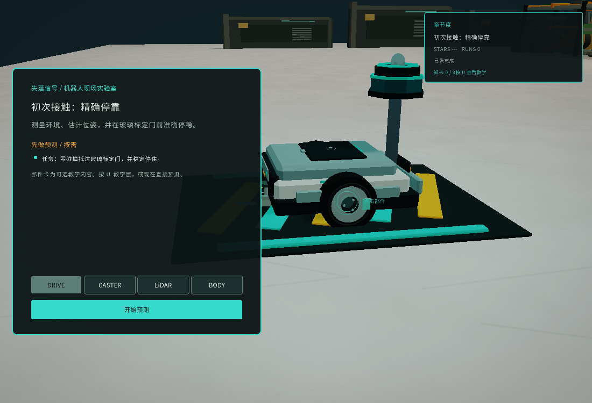

# First Contact 交付包

First Contact 是 Robot Simu 的首个 10 分钟纵向体验：用户先观察真实的驱动轮、caster 和 LiDAR，再预测 LiDAR 扫描周期变慢后的结果，运行同一套 ROBOT runtime，最后用 ROBOT/SIM 分开的证据复盘结论。



截图为 1100×750、zh-CN、3D、空 profile；任务卡、可选部件入口和章节进度均可见。

英雄镜头的第一帧现在直接显示真实 MuJoCo 画面和一个单问题钩子：先看“雷达更新变慢会怎样”，再进入运行。开场不再使用覆盖整帧的黑场；问题、`测量 → 估计 → 停车` 因果链和跳过提示都来自同一个 experience manifest。首屏只消费准备态姿势，不推进仿真时间或 ROBOT 观测。

## 启动

在仓库根目录执行：

```sh
cmake --build build -j6
xvfb-run -a -s "-screen 0 1100x750x24" \
  ./build/sim_viewer --experience configs/experiences/first_contact.json \
  --locale zh-CN --3d --mute
```

英文体验只需将 `--locale zh-CN` 改为 `--locale en`。启动后按 Enter、Space 或点击跳过英雄镜头；完成简报中的可选 3D 检查后选择预测，再运行 baseline 和 variant。

## 发布包

在仓库根目录完成 Release 构建后执行：

```sh
cmake --build build-release -j6
tools/package_first_contact.sh
```

生成 `build/first-contact-package/lost-signal-first-contact.tar.gz`。包内包含 Release Viewer、MuJoCo/raylib 运行库、配置、资产、中英文课件、许可证和 `SHA256SUMS`。解压后执行 `./run-first-contact.sh`；可用 `LOCALE=en ./run-first-contact.sh` 切换英文。`BUILD-INFO.txt` 记录分支、HEAD 和工作区状态。目标 Linux 机器仍需提供 Mesa/OpenGL、X11 或 XWayland；无显示环境可用 `xvfb-run` 做截图验证。

## 可复现截图

截图不改变仿真步长或 ROBOT 输入。下面的命令生成首屏、预测和复盘帧：

```sh
mkdir -p build/first-contact
xvfb-run -a -s "-screen 0 1100x750x24" \
  ./build/sim_viewer --play --locale zh-CN --3d --mute \
  --profile build/first-contact/profile.json --shot 1 first-contact-hero-hook.png
xvfb-run -a -s "-screen 0 1100x750x24" \
  ./build/sim_viewer --play --locale zh-CN --3d --mute \
  --profile build/first-contact/profile.json --shot 400 first-contact-briefing.png
xvfb-run -a -s "-screen 0 1100x750x24" \
  ./build/sim_viewer --play --locale zh-CN --3d --mute \
  --profile build/first-contact/profile.json --shot 15 first-contact-intro.png
mv first-contact-hero-hook.png first-contact-briefing.png first-contact-intro.png build/first-contact/
```

Raylib 对截图参数只使用文件名，截图会写到当前目录，因此上面在生成后移入 `build/first-contact/`。`--shot N FILE` 只保存第 N 帧并退出；它适合视觉回归，不代替完整 A/B 证据。

## A/B 证据包

完整 baseline/variant 运行结束后，在 variant 复盘阶段使用：

```sh
./build/sim_viewer --experience configs/experiences/first_contact.json \
  --locale zh-CN --3d --experiment-out build/first-contact/report.json
```

报告会同时写出：

- `report.json`：Experience spec、代码版本、`invariant_digest`、baseline/variant 分数、关键帧和四项 verdict（evidence、ROBOT、SIM safety、mission/experiment）。
- `report.json.baseline.observations.jsonl` 与 `report.json.variant.observations.jsonl`：可由普通 ROBOT provider 回放的 v4 observation 流。

报告中的 `invariant_match` 必须为 `true`；`experiment_passed` 只有在两次运行有效且受控变量是唯一差异时才成立。碰撞、超时、证据缺失和 ROBOT/SIM 结论不一致都保留原始失败状态。

## 中英文内容清单

| 内容 | English | 简体中文 |
|---|---|---|
| 章节 | `FIRST CONTACT: PRECISE DOCKING` | `初次接触：精确停靠` |
| 任务 | Stop at the glass calibration gate with zero collisions. | 零碰撞抵达玻璃标定门并稳定停住。 |
| 预测变量 | `lidar.scan_period_s`: 20 ms → 100 ms | `lidar.scan_period_s`：20 ms → 100 ms |
| 预测题 | Slower scans: safe tradeoff, equivalent, or unsafe variant? | 慢扫描：安全取舍、基本相同，还是未通过安全验收？ |
| 必看部件 | Drive wheel, caster, LiDAR | 驱动轮、万向轮、激光雷达 |
| 复盘知识 | Measurements → estimates; ROBOT arrival and SIM acceptance are independent; collision is a hard failure. | 测量 → 估计；机器人到达与仿真验收独立；碰撞是硬失败。 |

权威内容仍在 `configs/experiences/first_contact.json` 和 `configs/experiences/zh-CN/first_contact.json`；本表是交付检查单，不是第二份运行时配置。

## 验收记录

交付前保存以下信息：

1. `git rev-parse HEAD` 和构建目录（Debug/Release）。
2. `ctest --test-dir build -R 'experience|viewer_frame|keyframe_review|player_profile|ab_experiment' --output-on-failure` 的完整输出。
3. 截图尺寸、locale、命令行和生成时间。
4. `report.json` 及两个 observation JSONL 的 SHA-256。
5. 目标用户试用记录：完成时长、预测选择、variant 完成率、复盘完成率和前后知识题；不要用星级或游玩时长替代理解结果。

试用表见 [user-trial-form.md](user-trial-form.md)。

真实 MCU/HIL、急停、制动距离、负载、通信延迟、LiDAR profile 和 calibration artifact 仍属于实机门禁，不能由本包的仿真证据代替。
