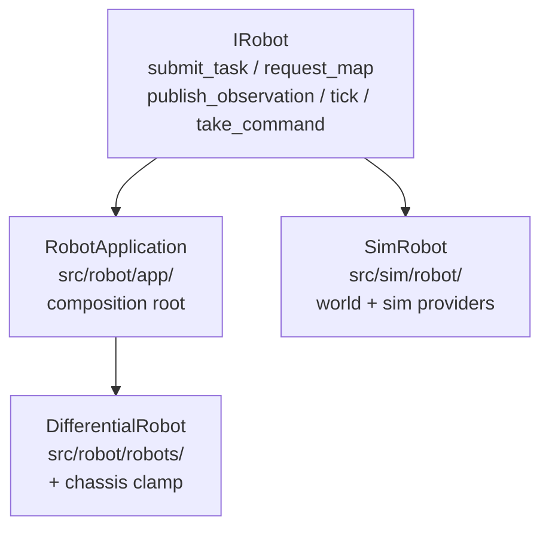
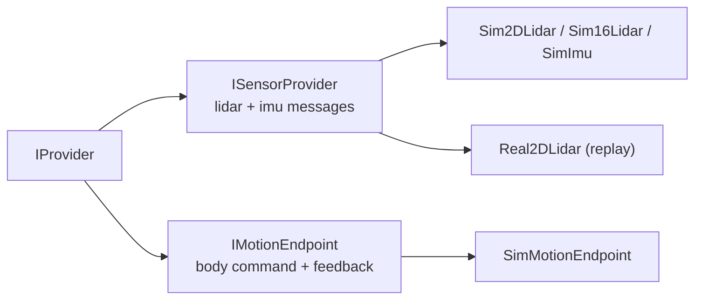

# Interfaces: IRobot / IMessage / IProvider

Three independent axes. Each has one deployable interface in `src/robot/`
and deployment-specific implementations. Tests program against the
interfaces, never the concrete classes.

## IRobot — robot facade

`src/robot/app/robot.hpp`. Task/map intent in, validated command out.

- `RobotApplication`: owns Executive + Coordinator + channel + map + description.
- `DifferentialRobot`: wraps any `IRobot`, clamps every tick through
  `DifferentialChassis` (`src/robot/platform/chassis.hpp`). Ackermann and
  holonomic robots follow the same wrapper pattern.
- `SimRobot`: sim harness implementing the same facade (world-stepping tick,
  `src/sim/robot/sim_robot.hpp`). Truth stays inside; only LSRI crosses.

## IMessage — typed sensor messages

`src/robot/iface/message.hpp`. Every message carries
`schema_version / stamp_ns / source / sequence / frame` and `valid()`.

- `Lidar2DScan`: planar ranges + angular spacing. Absent return, never
  max-range fill.
- `Lidar3DCloud`: one rotation, `ring_count` rings, per-point
  `time_offset_s` in `[-scan_period, 0]`.

Wire-agnostic: in-process struct today, serialized form tomorrow. Version
bump on meaning change (`version.hpp`).

## IProvider — one provider story

`src/robot/iface/provider.hpp` + `motion.hpp`. Non-template `IProvider` base
(`descriptor() + is_ready()`), then exactly two typed roles:

- `ISensorProvider<T>::poll(T&)`: `Sim2DLidar`, `Sim16Lidar`, `SimImu`
  (`src/sim/providers/`), `Real2DLidar`
  (`src/robot/providers/`, replay/native, no SDK);
- `IMotionEndpoint`: `consume_command(cmd)` + `poll_feedback(MotionFeedback)`
  (`SimMotionEndpoint`, body twist only — per-joint modes are future work).

Same seam, backend flag differs (`kSim` vs `kNative`). `SimSensorSuite`
(`src/sim/providers/sensor_suite.hpp`) owns the three sim providers and packs
their typed messages into ONE envelope through the canonical robot-owned
helpers (`iface/envelope.hpp`: `make_envelope/set_scan/set_imu`) — no
hand-packing in harnesses. The old whole-observation `IPlatformProvider` is
gone: sensors are messages, motion is a twist, the envelope is packed once.

## IChassis — chassis kinematics (bonus axis)

`src/robot/platform/chassis.hpp`. `DifferentialChassis` implements
`inverse()` / `forward()` wheel kinematics and `clamp_command()` envelope.
`DifferentialRobot` applies the clamp; a planner can never publish what the
base cannot track.
