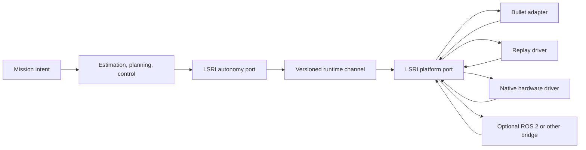

# Lost Signal Runtime Interface v1

The Lost Signal Runtime Interface (LSRI) is the small, middleware-neutral boundary between autonomy and a robot platform. The core does not depend on ROS 2, DDS, a device SDK, or a simulator API. Bullet, deterministic replay, native hardware drivers, and optional middleware bridges all meet the same contract.

LSRI v1 is implemented by `src/runtime/runtime_channel.*`. Its public constants are `kApiVersion == 1` and `kMessageSchemaVersion == 1`.

## Boundary



The autonomy port reads observations and writes motion commands. The platform port publishes observations and consumes commands. Neither port exposes world truth, Bullet bodies, game state, UI types, ROS messages, or transport handles.

The simulator owns both ends of an in-process channel because simulation and autonomy currently run in one process. Its bounded queue is safe for concurrent sensor producers. A physical deployment gives the platform end to a native driver. A bridge is just another platform adapter.

## Required conventions

LSRI uses the following normative rules:

- Physical quantities use SI units. Unit-bearing fields include suffixes such as `_m`, `_mps`, `_rad`, and `_radps`.
- All timestamps use one monotonic clock. Command timestamps are signed 64-bit nanoseconds. Existing observation packets use SI seconds in v1; a transport converts them once at its provider boundary and must not substitute wall-clock time.
- Every command has a schema version, sample time, receive time, sequence, frame, source, and expiry time.
- Every measurement has a schema version, sample time, sequence, frame, source, and declared latency.
- Sequence numbers are strictly increasing per source. A channel rejects stale or repeated input.
- Frames follow the project's `map → odom → base_footprint → base_link → sensor/wheel link` convention.
- A platform declares its chassis command space and physical limits before activation.
- Invalid, out-of-order, expired, or incompatible commands never reach an actuator.

These conventions align with SI and common mobile-robot frame practice, but they belong to LSRI and do not require a ROS installation.

## Lifecycle and health

A runtime channel has three states:

```text
unconfigured → inactive → active → inactive
```

Configuration validates the instance name, queue capacity, motion capabilities, and maximum command lifetime. Activation opens data flow. Deactivation clears pending observations and actuator commands.

`RuntimeHealth` exposes dropped and rejected observations, rejected commands, and watchdog stops. Queue overflow drops the oldest observation and marks the channel degraded. A missing or expired motion command produces a zero-motion `safe_stop`; it never repeats the previous command indefinitely.

Safety-critical physical deployments still require an independent emergency stop, drive-level limits, and a hardware watchdog. LSRI supplies the software contract and evidence counters; it is not a safety certification.

## Observations

The v1 observation frame carries one or more of the existing transport-neutral measurements:

| Measurement | Required frame | Main fields |
|---|---|---|
| Planar LiDAR | calibrated sensor frame | ranges, hits, optional intensity, scan timing |
| Encoder odometry | `base_link` | linear velocity, angular velocity, slip scale |
| IMU | `imu_link` | yaw rate, planar acceleration, noise description |
| Absolute pose | `map` | position, heading, uncertainty |

LiDAR array sizes, ranges, headers, timestamps, sources, and schema versions are validated before delivery. Simulation publishes `sim.lidar`, `sim.encoder`, `sim.imu`, and `sim.localization` sources. Hardware drivers must use stable names of their own.

World truth is not an LSRI observation. A simulator may use truth internally to generate sensor packets, but autonomy receives only the resulting measurements.

## Motion command

`MotionCommand` names each quantity instead of changing a field's meaning silently:

| Command space | Active fields |
|---|---|
| `YawRate` | `forward_mps`, `yaw_rate_radps` |
| `SteeringAngle` | `forward_mps`, `steering_angle_rad` |
| `HolonomicTwist` | `forward_mps`, `lateral_mps`, `yaw_rate_radps` |

The channel rejects the wrong command space, non-finite values, values outside declared limits, non-`base_link` commands, commands already expired on receipt, excessive TTLs, and non-monotonic sequences. `safe_stop` is valid only when every motion field is zero.

## Providers and replay

`RuntimeRegistry` maps a stable provider ID to a factory. Registration is explicit so static builds behave the same on Linux, macOS, and Windows.

```cpp
auto registry = sim::runtime::RuntimeRegistry::with_builtins();
registry.register_channel("channel.my-ipc", make_my_ipc_channel);

auto channel = registry.create("channel.my-ipc", config);
channel->configure();
channel->activate();
```

The shipped provider is `channel.in-process`. `ReplayDriver` publishes ordered recorded observations through the same platform port, so replay does not bypass validation or the autonomy boundary.

Third-party providers should be compiled against the versioned LSRI headers and registered at the application composition root. LSRI v1 does not promise a C++ shared-library ABI across compilers. A separately distributed binary plugin should use a versioned C ABI or an out-of-process transport and place the conversion behind a provider.

The provider boundary permits multi-threaded and multi-process execution, but v1 ships only the in-process provider. A production out-of-process provider still needs a canonical wire encoding, clock-domain conversion, bounded backpressure, peer supervision, and compatibility tests. The [architecture guide](architecture.md#scheduling-and-concurrency) defines how deterministic, concurrent, and distributed executors share this contract.

## Optional ROS 2 bridge

ROS 2 is an adapter target, not the project runtime. A bridge may translate:

| LSRI | ROS 2 bridge target |
|---|---|
| LiDAR observation | `sensor_msgs/msg/LaserScan` |
| IMU observation | `sensor_msgs/msg/Imu` |
| Encoder/pose state | `nav_msgs/msg/Odometry` |
| Frame relationships | TF2 |
| Yaw-rate motion | `geometry_msgs/msg/TwistStamped` |
| Steering motion | an Ackermann command adapter |
| Actuator state/command | ros2_control state and command interfaces |

The bridge owns QoS, executors, discovery, DDS, and ROS lifecycle mapping. None of those types enter `lost_signal_stack` or `lost_signal_mission`. Another bridge can target a serial protocol, CAN gateway, Zenoh, shared memory, or a classroom microcontroller without changing autonomy.

LSRI's motion command stops at the chassis-intent boundary. A platform provider may satisfy a wheel-velocity or
steering-position target through native position, velocity, torque/current, voltage, or duty-cycle interfaces, but
it must declare the selected controller and units rather than reinterpret a motion field. The planned capability
and feedback model is documented in [platform fidelity and hardware adaptation](platform-fidelity.md).

## Current evidence and limit

The production mission loop now sends LiDAR, encoder, IMU, and localization observations through LSRI and sends every autonomous chassis command through its watchdog-protected command path. Interface tests cover lifecycle, capability validation, sequence rejection, bounded queues, timeout stops, all three command spaces, provider registration, and replay delivery.

This completes the in-process standard and its simulation integration. A real robot driver, calibration data, independent stop system, and hardware tests are still required before making a sim-to-real claim.
