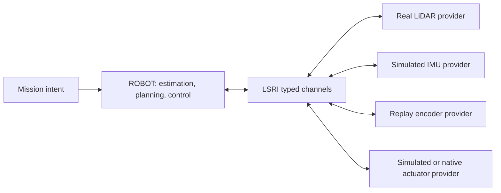

# Lost Signal Robot Interface v2

The Lost Signal Robot Interface (LSRI) is the small, project-owned boundary between the deployable ROBOT stack and platform providers. The core does not depend on external robotics middleware, a device SDK, or a simulator API. MuJoCo, deterministic replay, and native hardware drivers all meet the same contract.

LSRI v2 is implemented by `src/robot/runtime/runtime_channel.*` and `endpoint_registry.*`. Its public constants are `kApiVersion == 2` and `kMessageSchemaVersion == 5`. API v2 adds per-device endpoint ownership and typed actuator command transport. Measurement schema 2 added named actuator-joint position and velocity feedback; schema 3 added timed, ring-indexed 3D LiDAR point clouds; schema 4 makes wheel odometry a complete body-frame planar twist so holonomic motion is not discarded; schema 5 adds an optional gravity-referenced per-ray height for scans projected while a valid ROBOT attitude estimate is available.

## Boundary



The ROBOT port reads observations and writes body-motion or typed actuator commands. Platform providers publish observations and consume commands. Neither side exposes world truth, MuJoCo bodies, game state, UI types, device SDK types, or transport handles.

The LSRI channel is below `RobotExecutive`. The executive receives generic task requests and publishes lifecycle/status
events; it does not need to consume raw LiDAR or encoder packets. Estimation, mapping and perception providers may read
the typed observations they own from LSRI, publish immutable state/perception products, and feed those products to PNC,
behavior and control. This allows one real sensor to be mixed with simulated or replayed providers without changing the
brain API. A SIM game adapter therefore sends a normal task request and supplies a provider; it never imports a game
command into ROBOT.

LSRI is the platform/provider contract, not a requirement that every ROBOT algorithm call another algorithm through a
serialized wire packet. Inside ROBOT, replaceable modules use typed provider interfaces with the same semantic rules:
timestamped SI values, explicit frames, covariance or quality, lifecycle and rejection reasons, immutable snapshots, and
no SIM or world-truth types. `ILocalizationProvider`, `IMapProvider`, `IMapBuilder`, `IGlobalPlanner` and the perception,
control and executive boundaries are the internal contracts. A module can therefore be replaced when it implements the
same contract, while high-rate in-process calls avoid needless serialization and preserve deterministic ownership.

The conformance rule is: platform data and commands cross through LSRI; algorithm products cross through their typed ROBOT
interface; no module reaches around its interface to read a provider's private state. If a module must run out of process,
its typed product is adapted to a versioned LSRI or wire representation at that boundary.

### Chassis control and motor ownership

The word “motor control” covers two different responsibilities and they must not be
collapsed at the boundary:

| Responsibility | Owner | Boundary |
|---|---|---|
| chassis kinematics, velocity/steering targets, PID/feedforward, rate limits, and trajectory/safety decisions | ROBOT | consumes LSRI encoder/joint feedback; produces `MotionCommand` or `ActuatorCommand` |
| motor driver, PWM/current/torque application, gearbox, joint mechanics, tire/track contact, and rigid-body integration | platform provider | consumes the command through LSRI; publishes measured feedback through LSRI |

The default articulated SIM path is therefore:

```text
SIM MuJoCo joints -> simulated actuator provider -> LSRI actuator feedback
  -> ROBOT chassis controller -> LSRI actuator command
  -> simulated actuator/motor plant -> MuJoCo joints and contact
```

The encoder position and velocity used by a ROBOT controller are the
`ActuatorFeedbackObservation` delivered through LSRI. Body odometry, IMU, LiDAR,
power and other hardware state follow the same observation path. A simulation
adapter may read its own provider state in order to construct those observations,
but that adapter is below the LSRI boundary; ROBOT code must never call a
MuJoCo, `SimulatedPlatform`, or game API to obtain truth.

There is one intentional alternative. A platform may declare a smart-drive
capability and accept a body-level `MotionCommand`; its embedded drive then owns
the low-level velocity/current loop. In that mode ROBOT still owns planning,
feasibility and safety, while the provider owns the declared embedded loop and
must return measured feedback. The composition root chooses exactly one command
level from the negotiated capabilities; a provider must never reinterpret a body
velocity as duty, torque or a joint target.

The request boundary is deliberately separate from the sensor boundary. A request can be serialized over an operator
API, submitted by a test harness, or created by a simulation adapter, but it contains no scenario actor, story, level,
MuJoCo or renderer field. Completion and failure are reported as stable lifecycle results, while detailed sensor and
decision evidence remains available through the ROBOT diagnostics/replay interfaces.

The simulator owns both ends of an in-process channel because simulation and ROBOT currently run in one process. Its bounded queue is safe for concurrent sensor producers. A physical deployment gives platform endpoints to native drivers. `EndpointRegistry` assigns ownership per `(endpoint_id, role)`, so a real LiDAR can coexist with a simulated IMU and actuator plant while two providers cannot command the same actuator endpoint.

## Required conventions

LSRI uses the following normative rules:

- Physical quantities use SI units. Unit-bearing fields include suffixes such as `_m`, `_mps`, `_rad`, and `_radps`.
- All timestamps use one monotonic clock. Command timestamps are signed 64-bit nanoseconds. Observation packets use SI seconds; a transport converts them once at its provider boundary and must not substitute wall-clock time.
- Every command has a schema version, sample time, receive time, sequence, frame, source, and expiry time.
- Every measurement has a schema version, sample time, sequence, frame, source, and declared latency.
- `stamp_s` is acquisition time. A provider may publish the packet only when its delivery clock reaches
 `stamp_s + latency_s`; fixed-step simulation rounds that availability up to the next simulation tick without
 changing the stamp. Consumers must never replace acquisition time with arrival time.
- Sequence numbers are strictly increasing per source. A channel rejects stale or repeated input.
- Frames follow the project's `map → odom → base_footprint → base_link → sensor/wheel link` convention.
- A platform declares its chassis command space, accepted command level, actuator channels, modes, and physical limits before activation.
- Invalid, out-of-order, expired, or incompatible commands never reach an actuator.

These conventions align with SI and common mobile-robot frame practice, but they belong to LSRI and do not require an external middleware installation.

## Lifecycle and health

A runtime channel has three states:

```text
unconfigured → inactive → active → inactive
```

Configuration validates the instance name, queue capacity, motion capabilities, and maximum command lifetime. Activation opens data flow. Deactivation clears pending observations and actuator commands.

`RuntimeHealth` exposes dropped and rejected observations, rejected commands, and watchdog stops. Queue overflow drops the oldest observation and marks the channel degraded. A missing or expired motion command produces a zero-motion `safe_stop`; it never repeats the previous command indefinitely.

Safety-critical physical deployments still require an independent emergency stop, drive-level limits, and a hardware watchdog. LSRI supplies the software contract and evidence counters; it is not a safety certification.

## Observations

The observation frame carries one or more transport-neutral measurements:

| Measurement | Required frame | Main fields |
|---|---|---|
| Planar LiDAR | calibrated sensor frame | ranges, hits, optional intensity, scan timing |
| Multi-line LiDAR | calibrated sensor frame | XYZ, intensity, ring, return index, per-point timing |
| Wheel odometry | `base_link` | body-frame forward velocity, left velocity, yaw rate, slip scale |
| Actuator feedback | `base_link` | named joint position and velocity channels |
| Power telemetry | platform power frame | voltage, signed current, state of charge, remaining energy, temperature and charging/fault state |
| IMU | `imu_link` | yaw rate, planar acceleration, noise description |
| Absolute pose | `map` | position, heading, uncertainty |

LiDAR array sizes, ranges, headers, timestamps, sources, and schema versions are validated before delivery. Simulation publishes `sim.lidar`, `sim.encoder`, `sim.imu`, and `sim.localization` sources. Hardware drivers must use stable names of their own.

Schema 3 represents one multi-line rotation as one cloud. `ring` identifies the calibrated beam, while
`time_offset_s` locates each firing in `[-scan_period_s, 0]` relative to the acquisition-end stamp. Ring order is a
device firing order and is not assumed to be sorted by elevation. Missing rays are absent returns; a provider does
not invent maximum-range points. The planar obstacle view derived from a cloud remains a separate measurement in
the same observation frame and acquisition timestamp, so existing 2D autonomy can consume an explicit projection
without losing the raw 3D evidence.

World truth is not an LSRI observation. A simulator may use truth internally to generate sensor packets, but autonomy receives only the resulting measurements.

Power telemetry is optional at the channel level so a minimal replay or teaching provider can omit it. A
`RobotExecutive` that must enforce an energy reserve treats missing or stale power data as an explicit degraded
condition; it must not turn GAME's relative `energy_scale` into a battery state. The provider owns battery, charger and
current-sensor behavior, while the executive owns mission admission, return-to-charge and degraded-mode decisions.

## Commands

`MotionCommand` names each quantity instead of changing a field's meaning silently:

| Command space | Active fields |
|---|---|
| `YawRate` | `forward_mps`, `yaw_rate_radps` |
| `SteeringAngle` | `forward_mps`, `steering_angle_rad` |
| `HolonomicTwist` | `forward_mps`, `lateral_mps`, `yaw_rate_radps` |

The channel rejects the wrong command space, non-finite values, values outside declared limits, non-`base_link` commands, commands already expired on receipt, excessive TTLs, and non-monotonic sequences. `safe_stop` is valid only when every motion field is zero.

`ActuatorCommand` is the lower-level alternative when the deployable ROBOT stack owns PID, feedforward, and actuator mapping. Each platform capability declares one unambiguous mode and numeric range for every named channel:

| Mode | Meaning |
|---|---|
| `NormalizedDuty` | normalized voltage or PWM authority in the declared range |
| `EffortNm` | shaft effort in newton-metres |
| `VelocityRadps` | joint angular-velocity target |
| `PositionRad` | joint angular-position target |

An actuator command must set every declared channel exactly once, with the declared mode and units. Its watchdog emits each channel's declared safe value. This permits two valid deployments: a smart motor provider can accept body motion and own its embedded loops, or the ROBOT stack can run those loops and send actuator setpoints to a passive SIM plant or native driver.

## Providers and replay

`RuntimeRegistry` maps a stable provider ID to a factory. Registration is explicit so static builds behave the same on Linux, macOS, and Windows.

```cpp
auto registry = sim::runtime::RuntimeRegistry::with_builtins();
registry.register_channel("channel.my-ipc", make_my_ipc_channel);

auto channel = registry.create("channel.my-ipc", config);
channel->configure();
channel->activate();
```

The shipped provider is `channel.in-process`. `ReplayDriver` publishes ordered recorded observations through the same platform port, so replay does not bypass validation or the autonomy boundary.

Third-party providers should be compiled against the versioned LSRI headers and registered at the application composition root. LSRI v2 does not promise a C++ shared-library ABI across compilers. A separately distributed binary plugin should use a versioned C ABI or an out-of-process transport and place the conversion behind a provider.

Every native adapter should run `ProviderConformanceMonitor` during bring-up and replay. Register each expected
`EndpointDescriptor`, feed the resulting `ObservationFrame` with the ROBOT monotonic receive time, call
`check_liveness()` from the runtime tick, and keep the `ProviderConformanceReport` with the calibration record. The
monitor verifies payload structure, endpoint source/frame identity, strictly increasing sample timestamps and sequence
numbers, sample freshness/future skew, declared-vs-observed rate, and source silence. It rejects an absolute map pose
unless the provider explicitly declares that capability. This is a stream-level gate in addition to
`valid_observation_frame()`, not a replacement for device-specific calibration or the independent emergency stop.

`RobotApplication` is the composition-root convenience for this sequence: deployment
configuration supplies an `EndpointRegistry` and conformance policy, the application
registers observation-source expectations before activation, provider adapters call
`publish_observation()`, and the application performs liveness checks from its
runtime tick. A SIM provider and a native provider therefore share the same bring-up
checks. They differ only in backend implementation and calibration/profile; ROBOT
does not branch on `ProviderBackend` while making motion decisions.

`RobotApplication::tick()` is the provider-neutral cycle entry point for a native process
and for an in-process SIM composition. It advances the optional executive task observation,
runs the autonomy/coordinator transaction, reports motion capability, and then accepts an autonomy
observation/safety input,
an optional `DiffCmd` produced by the local planner, and explicit time validity. It runs
the ROBOT policy transaction, then publishes either a body-motion command or the typed
actuator command selected by negotiated capability. It reads actuator feedback only from
LSRI. A simulator may wrap its MuJoCo provider with
`SimulatedPlatformProviderAdapter`, but that adapter is outside ROBOT and is not visible
to the cycle or controller.

### Native robot bring-up

Moving from SIM to a real robot changes the provider backend and instance configuration, not the ROBOT algorithm
contracts. A native bring-up must register the same endpoint kinds (`Lidar`, `Imu`, `Encoder`, `JointState`,
`Actuator`, `Power`) with `ProviderBackend::Native`, stable source IDs, calibrated frame IDs and the robot clock. The
provider converts the device SDK's packets into LSRI observations and owns device reconnects, queueing, timestamp
translation, packet loss and hardware fault reporting.

The robot profile must provide the measured values that simulation previously supplied from assets: `base_link` to
sensor and wheel extrinsics, axis/sign conventions, LiDAR per-return timing and range limits, IMU bias/noise and axis
mapping, wheel radius/track or steering geometry, encoder resolution and gear ratio, actuator modes and limits,
command latency, watchdog safe values, mass/inertia and chassis capabilities. Calibration is versioned and hashed; a
missing or incompatible calibration keeps the endpoint degraded rather than silently using a simulator default.

The normal migration therefore consists of selecting native provider IDs, loading the real calibration/profile, checking
capability negotiation and running the provider-conformance/replay tests. LSRI schema changes are needed only when the
real device exposes a measurement that the current contract cannot represent; a device-specific field must not leak
into planner or controller code.

The provider boundary permits multi-threaded and multi-process execution, but v2 ships only the in-process channel transport. A production out-of-process provider still needs a canonical wire encoding, clock-domain conversion, bounded backpressure, peer supervision, and compatibility tests. The [architecture guide](architecture.md#scheduling-and-concurrency) defines how deterministic, concurrent, and distributed executors share this contract.

Controller placement is therefore explicit. A provider never reinterprets a body-motion number as torque, PWM, or joint position. Future wire encodings must preserve the same command mode, units, expiry, and channel identity. The capability and feedback model is documented in [platform fidelity and hardware adaptation](platform-fidelity.md).

## Current evidence and limit

The production mission loop sends LiDAR, encoder, IMU, localization, and physical joint observations through LSRI.
In the default RO-1 MuJoCo path, the deployable ROBOT wheel controller consumes named left/right joint feedback,
computes normalized duty, and sends both channels through the watchdog-protected actuator path. Articulated RO-2 uses
the same placement with four channels: `rear_left_drive`, `rear_right_drive`, `front_left_steer`, and
`front_right_steer`. Its ROBOT controller maps equivalent centre steering to distinct Ackermann knuckle targets and
closes rear-wheel velocity and steering position/velocity loops. The SIM provider applies delivered duty to motor
and servo torque-speed curves, physical joints, tire contact, and rigid bodies. External platforms that explicitly
declare a smart-drive capability may instead own their low-level loops and accept the body-motion path.

Interface tests cover lifecycle, capability validation, actuator-feedback validation, sequence rejection, bounded
queues, motion and actuator timeout stops, all three body command spaces, the RO-2 four-channel safe-zero watchdog,
per-device mixed-provider ownership, provider registration, and replay delivery. A real robot driver, calibration
data, independent stop system, and hardware tests are still required before making a sim-to-real claim.
