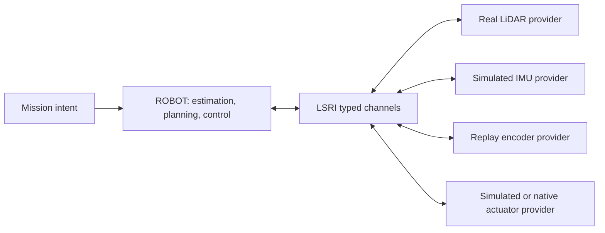

# Lost Signal Robot Interface v2

The Lost Signal Robot Interface (LSRI) is the small, project-owned boundary between the deployable ROBOT stack and platform providers. The core does not depend on external robotics middleware, a device SDK, or a simulator API. Bullet, deterministic replay, and native hardware drivers all meet the same contract.

LSRI v2 is implemented by `src/robot/runtime/runtime_channel.*` and `endpoint_registry.*`. Its public constants are `kApiVersion == 2` and `kMessageSchemaVersion == 2`. API v2 adds per-device endpoint ownership and typed actuator command transport. Measurement schema 2 adds named actuator-joint position and velocity feedback.

## Boundary



The ROBOT port reads observations and writes body-motion or typed actuator commands. Platform providers publish observations and consume commands. Neither side exposes world truth, Bullet bodies, game state, UI types, device SDK types, or transport handles.

The simulator owns both ends of an in-process channel because simulation and ROBOT currently run in one process. Its bounded queue is safe for concurrent sensor producers. A physical deployment gives platform endpoints to native drivers. `EndpointRegistry` assigns ownership per `(endpoint_id, role)`, so a real LiDAR can coexist with a simulated IMU and actuator plant while two providers cannot command the same actuator endpoint.

## Required conventions

LSRI uses the following normative rules:

- Physical quantities use SI units. Unit-bearing fields include suffixes such as `_m`, `_mps`, `_rad`, and `_radps`.
- All timestamps use one monotonic clock. Command timestamps are signed 64-bit nanoseconds. Observation packets use SI seconds; a transport converts them once at its provider boundary and must not substitute wall-clock time.
- Every command has a schema version, sample time, receive time, sequence, frame, source, and expiry time.
- Every measurement has a schema version, sample time, sequence, frame, source, and declared latency.
- Sequence numbers are strictly increasing per source. A channel rejects stale or repeated input.
- Frames follow the project's `map → odom → base_footprint → base_link → sensor/wheel link` convention.
- A platform declares its chassis command space, accepted command level, actuator channels, modes, and physical limits before activation.
- Invalid, out-of-order, expired, or incompatible commands never reach an actuator.

These conventions align with SI and common mobile-robot frame practice, but they belong to LSRI and do not require an external middleware installation.

## Lifecycle and health

A runtime channel has three states:

```text
unconfigured → inactive → active → inactive
```

Configuration validates the instance name, queue capacity, motion capabilities, and maximum command lifetime. Activation opens data flow. Deactivation clears pending observations and actuator commands.

`RuntimeHealth` exposes dropped and rejected observations, rejected commands, and watchdog stops. Queue overflow drops the oldest observation and marks the channel degraded. A missing or expired motion command produces a zero-motion `safe_stop`; it never repeats the previous command indefinitely.

Safety-critical physical deployments still require an independent emergency stop, drive-level limits, and a hardware watchdog. LSRI supplies the software contract and evidence counters; it is not a safety certification.

## Observations

The observation frame carries one or more transport-neutral measurements:

| Measurement | Required frame | Main fields |
|---|---|---|
| Planar LiDAR | calibrated sensor frame | ranges, hits, optional intensity, scan timing |
| Encoder odometry | `base_link` | linear velocity, angular velocity, slip scale |
| Actuator feedback | `base_link` | named joint position and velocity channels |
| IMU | `imu_link` | yaw rate, planar acceleration, noise description |
| Absolute pose | `map` | position, heading, uncertainty |

LiDAR array sizes, ranges, headers, timestamps, sources, and schema versions are validated before delivery. Simulation publishes `sim.lidar`, `sim.encoder`, `sim.imu`, and `sim.localization` sources. Hardware drivers must use stable names of their own.

World truth is not an LSRI observation. A simulator may use truth internally to generate sensor packets, but autonomy receives only the resulting measurements.

## Commands

`MotionCommand` names each quantity instead of changing a field's meaning silently:

| Command space | Active fields |
|---|---|
| `YawRate` | `forward_mps`, `yaw_rate_radps` |
| `SteeringAngle` | `forward_mps`, `steering_angle_rad` |
| `HolonomicTwist` | `forward_mps`, `lateral_mps`, `yaw_rate_radps` |

The channel rejects the wrong command space, non-finite values, values outside declared limits, non-`base_link` commands, commands already expired on receipt, excessive TTLs, and non-monotonic sequences. `safe_stop` is valid only when every motion field is zero.

`ActuatorCommand` is the lower-level alternative when the deployable ROBOT stack owns PID, feedforward, and actuator mapping. Each platform capability declares one unambiguous mode and numeric range for every named channel:

| Mode | Meaning |
|---|---|
| `NormalizedDuty` | normalized voltage or PWM authority in the declared range |
| `EffortNm` | shaft effort in newton-metres |
| `VelocityRadps` | joint angular-velocity target |
| `PositionRad` | joint angular-position target |

An actuator command must set every declared channel exactly once, with the declared mode and units. Its watchdog emits each channel's declared safe value. This permits two valid deployments: a smart motor provider can accept body motion and own its embedded loops, or the ROBOT stack can run those loops and send actuator setpoints to a passive SIM plant or native driver.

## Providers and replay

`RuntimeRegistry` maps a stable provider ID to a factory. Registration is explicit so static builds behave the same on Linux, macOS, and Windows.

```cpp
auto registry = sim::runtime::RuntimeRegistry::with_builtins();
registry.register_channel("channel.my-ipc", make_my_ipc_channel);

auto channel = registry.create("channel.my-ipc", config);
channel->configure();
channel->activate();
```

The shipped provider is `channel.in-process`. `ReplayDriver` publishes ordered recorded observations through the same platform port, so replay does not bypass validation or the autonomy boundary.

Third-party providers should be compiled against the versioned LSRI headers and registered at the application composition root. LSRI v2 does not promise a C++ shared-library ABI across compilers. A separately distributed binary plugin should use a versioned C ABI or an out-of-process transport and place the conversion behind a provider.

The provider boundary permits multi-threaded and multi-process execution, but v2 ships only the in-process channel transport. A production out-of-process provider still needs a canonical wire encoding, clock-domain conversion, bounded backpressure, peer supervision, and compatibility tests. The [architecture guide](architecture.md#scheduling-and-concurrency) defines how deterministic, concurrent, and distributed executors share this contract.

Controller placement is therefore explicit. A provider never reinterprets a body-motion number as torque, PWM, or joint position. Future wire encodings must preserve the same command mode, units, expiry, and channel identity. The capability and feedback model is documented in [platform fidelity and hardware adaptation](platform-fidelity.md).

## Current evidence and limit

The production mission loop sends LiDAR, encoder, IMU, localization, and RO-1 wheel-joint observations through LSRI. In the default RO-1 Bullet path, the deployable ROBOT wheel controller consumes named left/right joint feedback, computes normalized duty, and sends both channels through the watchdog-protected actuator path. The SIM provider applies the delivered duty to the motor curve, wheel joints, contact, and rigid body. Domain mode and platforms with a smart drive capability continue to use the body-motion path.

Interface tests cover lifecycle, capability validation, actuator-feedback validation, sequence rejection, bounded queues, motion and actuator timeout stops, all three body command spaces, per-device mixed-provider ownership, provider registration, and replay delivery. This completes both in-process command placements for the reference platform. A real robot driver, calibration data, independent stop system, and hardware tests are still required before making a sim-to-real claim.
