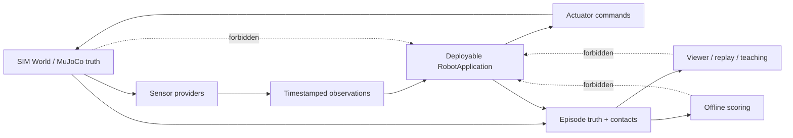

# Robot Simu 游戏、教学与专业仿真设计

版本：1.0  
日期：2026-10-26  
适用分支：`refactor/clean-rebuild`

## 1. 产品定义

Robot Simu 是同一个机器人系统的三种入口：第一次接触机器人的玩家可以完成有目标、有反馈的任务；学生和工程师可以改变参数并理解因果；专业用户可以运行可复现的 benchmark，并把同一套 ROBOT 程序部署到真机。

三种入口必须共用同一个 `RobotApplication`、传感器消息、执行器命令、固定步长物理和场景定义。难度只改变场景、信息展示、噪声与允许的操作，不替换算法，也不向 ROBOT 注入仿真真值。

| 模式 | 用户 | 核心体验 | 输出 |
|---|---|---|---|
| 探索战役 | 玩家、青少年、初学者 | 用任务逐步发现机器人为何能行动、为何会失败 | 星级、知识卡、可分享回放 |
| 机器人实验室 | 学生、教师、开发者 | 控制变量、并排比较、查看真值与机器人认知 | 实验报告、曲线、回放、配置差异 |
| Benchmark Pro | 算法和硬件团队 | 批量、加速、确定性地验证安全、性能与鲁棒性 | JSON/JSONL、score、性能分位数、CI 结果 |

产品承诺如下：

1. **可迁移。** `src/robot` 不依赖 SIM；仿真与真机通过相同 provider、measurement header、执行器契约和单调时钟运行。
2. **真实失败。** 真实的感知退化、定位不确定、不可达和碰撞可以导致失败；场景穿墙、离散地形、视觉假动作和真值泄漏不能伪造失败或成功。
3. **可解释。** 每次停车、减速、重规划、定位修正和任务失败都有来自 ROBOT 自身证据的原因；真值只在教学、回放和离线评分层作对照。
4. **先安全后表现。** 碰撞、最小净空和安全停车是硬指标；完成时间、连续性、舒适性、能耗和算力是安全成立后的优化指标。
5. **看见真实状态。** 车体、驱动轮、转向轮、万向轮、履带、传感器和后续机械臂都读取物理引擎 body/joint pose。粒子读取接触、速度、打滑和材质的 SIM 记录，绝不反向影响 ROBOT。

## 2. 一分钟体验

首次启动不展示参数表。玩家站在一个有强烈光影层次的机器人实验仓，镜头从机器人低机位掠过，轮胎、万向轮、LiDAR 和状态灯依次亮起。第一个目标在 20 秒内完成：点击发车，机器人绕过一只静止箱子到达发光停靠位。

到达后时间冻结，界面把画面一分为二：左侧是世界真值，右侧是机器人当时看到的稀疏 LiDAR、局部代价地图和估计轨迹。玩家拖动一个遮挡物后再次运行，看到相同机器人开始减速和绕行。系统只解释三个概念：传感器看到什么、机器人以为自己在哪里、为什么这条轨迹安全。

前十分钟必须提供三个情绪节点：

- **掌控感：** 任务目标清晰，机器人动作连续，镜头自动给出好看的跟随构图。
- **惊讶：** 切换“世界 / 机器人认知”后看到两者并不相同。
- **理解：** 回放自动停在关键决策点，能用一条证据链解释减速、绕行或失败。

## 3. 每局循环

每个任务使用同一套五段循环：

1. **简报。** 用场景镜头、任务路径和一条知识问题说明目标，不提前暴露隐藏动态事件。
2. **预测。** 玩家先选择“会直行、会绕开、会停车、会失败”等结果，建立可验证的理解。
3. **运行。** 1× 用于观察，2×–8× 用于重复实验，Turbo 用于 benchmark。仿真始终执行固定 1 ms 物理量子；20 ms episode transition、传感器和 ROBOT cadence 只调度这些已完成的量子，倍率不改变任何仿真时间间隔。
4. **复盘。** 时间轴自动标注感知更新、定位修正、全局/局部重规划、安全 hold、打滑和接触事件。
5. **再实验。** 一键克隆本局，只改变一个变量，并排比较结果与证据。

任务不能依靠记住关卡脚本。动态对象对 ROBOT 是匿名观测；规划算法只读取地图、传感器、估计和由感知形成的预测。关卡脚本只属于 SIM，并接受路径与静态几何完整性校验。

## 4. 战役结构

### 第 0 章：让机器人站稳

任务：识别底盘、驱动轮、被动轮、LiDAR、IMU 和计算单元；检查机器人静置、轮心高度和接地点。

传播的知识：机器人不是漂浮的盒子；质量、支撑、接触、关节轴和传感器外参决定观测与运动。玩家可打开关节轴和碰撞体 overlay，查看视觉 mesh 与 collision geometry 的差异。

失败示例：轮胎半径与配置不符导致车体倾斜；LiDAR 安装高度错误导致低障碍不可见。修复必须改变配置或模型契约，不能用渲染偏移掩盖物理错误。

### 第 1 章：传感器不是上帝视角

任务：在箱体、玻璃干扰、遮挡、雨雾和低反射材料中完成短途巡检。

传播的知识：量程、角分辨率、扫描周期、rolling shutter、噪声、延迟、丢包、安装位姿与遮挡。玩家能逐束查看 LiDAR 的采集时刻和命中点，也能看到超时如何触发独立安全停车。

挑战：用 10 Hz LiDAR、50 Hz encoder、100 Hz IMU 完成任务；任何 UI 都不能把世界 actor 身份或未来脚本送给 ROBOT。

### 第 2 章：里程计会连续，地图会修正

任务：穿过长走廊并回到起点，观察轮速/IMU 里程计漂移和 scan matching 修正。

传播的知识：REP-105 中 `odom` 连续、`map` 允许跳变，`map→odom` 承担定位校正。界面同时画出真值、连续 odom 轨迹和 map estimate；回环发生时 odom 不瞬移。

挑战：修改轮径误差、IMU bias 和协方差，预测何时只做局部匹配、何时进入分片全局重定位。协方差未达到策略条件时不能无意义全局搜索。

### 第 3 章：从未知到地图

任务：在无先验地图模式探索房间、闭环并保存地图；随后以 localization mode 复用地图。

传播的知识：unknown 不等于 occupied；局部障碍、安全层和 SLAM 地图有不同职责。讲清 scan matching、submap、pose graph、loop closure、序列化、lifelong mapping 和错误回环拒绝，设计参考 SLAM Toolbox 的 mapping/localization/lifelong 模式边界。

挑战：重复纹理、稀疏特征、移动人群和被遮挡闭环。评分分别报告地图一致性、轨迹误差、错误回环和算力，不把真值用于在线建图。

### 第 4 章：全局路线与车体几何

任务：在仓库货架、窄门和死胡同中完成多目标配送。

传播的知识：占据栅格、footprint 硬膨胀、连续衰减软代价、A* 与 Hybrid A*、最小转弯半径、倒车和终点姿态。墙角在二维距离场中同步向外膨胀，不能只沿坐标轴扩一圈。

挑战：差速和 Ackermann 使用同一张地图但产生不同可行路线；大型地图用 ROI、分层或稀疏搜索，不能靠固定 cell 上限或全图 `cells × heading × gear` 分配。

### 第 5 章：局部规划会不断重做决定

任务：穿过交叉人流、迎面叉车和会逼近的动态物体。

传播的知识：局部实时地图是局部规划和最终安全层的重要观测证据；动态跟踪来自匿名传感器前景，不来自 actor id。DWA 采样动力学可达速度，TEB-style 优化轨迹和时间，两者都要通过统一 Validator 和完整制动尾迹。

比较视图同时展示：

- 候选轨迹、被拒原因和最终轨迹。
- 预测对象的多假设轨迹与随时间增长的不确定性。
- footprint swept volume、静态/动态最小净空和制动尾迹。
- 速度、加速度、角速度、jerk、CPU 时间和是否触发 Safety。

玩家能在同一 observation replay 上切换 DWA 与 TEB-style，算法不能看到不同真值。默认算法只依据发布 benchmark 结果选择。

### 第 6 章：安全层独立于聪明程度

任务：处理突然闯入、传感器超时、定位丢失、执行器迟滞和低抓地制动。

传播的知识：局部规划可能暂时无解，最终 Collision Monitor 仍直接使用新鲜原始传感器与速度相关安全区。安全动作包含 slow、approach、stop 和锁存恢复，不能依赖全局定位正确。

挑战：同一障碍距离下比较干燥地面、湿地和坡地。ROBOT 只能依据自身轮速、IMU、执行反馈形成 grip/制动能力保守估计，不能读取 SIM friction 或接触真值。

### 第 7 章：底盘不是同一种车

任务：分别使用差速、Ackermann、履带、Mecanum 和 Swerve 完成专属场地。

传播的知识：

- 差速轮只有滚动关节，不会产生转向角。
- Ackermann 前轮转向必须满足几何关系，轮胎仍绕横向轮轴滚动。
- 万向轮包含竖直 swivel 与横向 wheel roll 两个被动关节。
- 履带和 Mecanum 的简化模型必须在 UI 标明能力边界。
- 单轮打滑、左右轮不同抓地和 caster shimmy 都来自物理状态与传感器估计的差异。

### 第 8 章：连续地形与接触

任务：驶过连续坡面、桥面、砂石、泥地、浅水和冠状被动轮测试台。

传播的知识：高度场必须连续，视觉、碰撞、raycast 和地图高程读取同一 canonical surface。块状台阶只在真实障碍场景使用。冠状胎面必须同时存在于接触几何与视觉 mesh，并通过静置漂移、直行偏航、横移摩擦、能量增长和 timestep sensitivity 测试。

### 第 9 章：部署前夜

任务：把同一 ROBOT 配置从 SIM replay、HIL loopback 切到 native provider，完成启动、任务、watchdog、安全停车和受控关闭。

传播的知识：仿真真值、评分、场景脚本和渲染不会随程序部署；地图、传感器外参、设备 profile、执行器反馈和安全约束才是部署契约。

## 5. “世界真值 / 机器人认知”双视图

双视图是本产品最重要的教学界面。默认战役先显示机器人可见内容，复盘时才展开真值对照，避免玩家把真值 overlay 误认为算法输入。

### 世界真值层（SIM-only）

- MuJoCo body/joint/contact pose、地形和材质。
- actor 物理状态与场景目标。
- 真值轨迹、碰撞、实际净空和离线误差。
- 接触法向力、切向冲量、实际滑移和能量。

### 机器人认知层（deployable）

- 原始 LiDAR/IMU/encoder measurement 及独立 source、sequence、stamp。
- 实时 LiDAR 世界坐标 overlay 由原始 range/angle 和同一 ROBOT estimate 组合；投影采用的 estimate stamp 与传感器 stamp 分开显示，不能借用真值 body pose 或 elevation。
- `odom`、`map→odom`、map pose 与协方差。
- static/local costmap、unknown、hard inflation 与 soft cost。
- 全局 route、DWA/TEB-style 候选、Validator 拒绝原因。
- 匿名动态轨迹、多假设预测、安全区和最终命令。

每个 overlay 标注数据来源和时间戳。真值层使用琥珀色边框，机器人认知使用青色边框；两层重叠时仍能通过线型区分。任何新增 overlay 先声明属于哪一侧，并由边界测试保证真值类型不能进入 `src/robot`。

实现状态：Viewer 的帧模型已将实时遥测分成 `PHYSICS TRUTH`、`ROBOT OBSERVATION`、`ROBOT ESTIMATE`、`ROBOT DECISION` 和 `GAME/EVAL` 五个有类型的 authority 记录。探索战役运行阶段只展开 ROBOT 三层，真值与离线裁判保持隐藏，到复盘阶段才允许对照；这些记录只由已完成的 episode step 构建，不能发布回 `RobotApplication`。实时 LiDAR 扇面使用记录的 ROBOT estimate 投影并显示 measurement source、sequence、stamp；真值辅助投影单独保存，只在显式 `SIM truth debug` 中以琥珀色显示。机器人状态灯读取 ROBOT decision/safety，轮胎真值打滑着色也只存在于该调试层。

## 6. 失败解释与评分

失败必须由结构化原因产生，不能只显示 `FAILED`：

| 类别 | 示例证据 | 玩家可采取的动作 |
|---|---|---|
| 感知 | scan 超时、有效回波不足、遮挡 | 调整设备 profile、速度、安装位姿 |
| 定位 | innovation 被拒、协方差增长、重定位预算耗尽 | 增加可观测结构、检查地图、执行观察动作 |
| 规划 | goal 不可达、footprint 碰撞、曲率不可行 | 改路线、底盘、地图或目标姿态 |
| 动态交互 | 全部候选制动尾迹不安全 | 等待、侧向绕行、降低速度或重新规划 |
| 控制/执行 | 跟踪误差持续、反馈超时、制动不足 | 停车、诊断执行器、调整保守限制 |
| SIM 场景 | actor 路线穿墙、表面不连续、模型契约失败 | 场景作者修复；不能归咎算法 |

评分采用“硬门槛 + 多维报告”，不压成一个容易投机的总分：

1. 安全门槛：碰撞为零、传感器超时安全动作正确、最小净空满足场景要求。
2. 任务：目标完成率、truth-side 到达、到达姿态与稳定停车。
3. 估计：位置/航向误差分布、协方差一致性、错误回环数。
4. 运动质量：时间、路径长度、速度连续性、加速度、jerk、倒车次数。
5. 资源：能量 proxy、robot tick p50/p95/p99/max、内存峰值。
6. 鲁棒性：多 seed、传感器 profile、摩擦、载荷和动态 actor 组合的成功率与置信区间。

关卡星级只从这些公开维度映射。安全失败不能用更快时间抵消。所有 threshold 属于版本化 scenario/benchmark 配置，不散落为算法魔法数字。

## 7. 回放、比较与实验报告

- 回放保存 observation、ROBOT command、diagnostics、SIM truth 和 score，但 replay 给 ROBOT 的仍只有 observation stream。
- 时间轴支持逐 sensor sample、逐 decision tick 和逐 physics step 查看。
- 关键帧包括首次观测、定位修正、route revision、候选全拒、安全动作、打滑开始、接触和目标确认。
- A/B 实验固定世界、随机 seed 和 observation replay，只改变被研究的算法或参数。
- 比较结果并排显示轨迹、动态净空、命令、CPU 分位数和结构化失败原因。
- 导出的实验报告记录 git revision、配置 hash、资产版本、MuJoCo 版本、seed、平台和是否 Turbo；Turbo 不改变任何仿真时间语义。
- Viewer 倍率调度按墙钟时长保留自适应 backlog：倍率只增加固定物理 step 的执行数量，不改变 step 大小。当前帧需求不会被固定“仿真秒”上限截断；机器跟不上、历史 backlog 被丢弃或窗口长时间停顿时必须显示 `LIMIT` 和实际倍率。最大吞吐使用 headless runner，不把渲染吞吐冒充物理吞吐。
- 场景内部使用整数 1 ms 物理时基。20 ms episode transition 由 20 个相同 MuJoCo tick 组成，传感器与控制 cadence 只在已完成 tick 上采样，不能重新切分物理积分；所有 cadence 必须是 1 ms 的整数倍。接触冲量跨 20 个 tick 聚合，打滑确认按接触响应的物理持续时间累计，不能依赖一次外层调用包含多少子步。

## 8. 视觉与声音方向

视觉主题定为“近未来公共机器人实验城”：可信工业结构加少量高识别度设计语言，不做玩具塑料感，也不追求影响读取的写实脏乱。

### 视觉语法

- 机器人：石墨灰主体、暖白结构面、青色运行灯、琥珀色注意、红色安全故障。结构缝、紧固件、检修盖和线束说明真实部件关系。
- 环境：中性混凝土和金属承担背景，任务点、通行带和危险边缘用饱和色形成层级。
- 认知 overlay：青色观测与估计，紫色规划，橙色预测，红色 safety veto，绿色已验证轨迹。
- 镜头：默认三分构图跟随，速度提高时适度拉远；转向提前看向局部 route；安全事件平滑切近，但不摇晃到无法读图。
- 运动：所有刚体、轮、caster、转向、履带和机械臂姿态由引擎状态驱动。镜头、灯光、材质和粒子可以平滑，部件 pose 不做视觉插值造假。

### 声音

电机音高读取 wheel angular velocity，负载层读取 duty/estimated torque，打滑读取接触相对速度，碰撞读取冲量。LiDAR、电机、继电器、机械制动和环境声使用独立总线；教学讲解可以关闭。声音和粒子只消费已完成 SIM step 的状态。

## 9. GLB 与 Blender 资产契约

以后 GLB 数量会持续增加，不能继续在 Viewer 中按模型猜轴向、缩放和落地偏移。每套资产包含源 `.blend` 或可重复生成脚本、导出 GLB、manifest 和验证结果。

### Canonical frame

- 单位是米，右手系，Z-up；`+X` 前、`+Y` 左、`+Z` 上。
- 车体 mesh 原点是配置定义的 `base_link`，不自行贴地。
- 轮 mesh 原点是滚动关节中心，局部 `+Y` 是轮轴；轮胎最低点必须是 `z=-radius`。
- 转向 knuckle 原点是 steer joint；转向绕 `+Z`，轮滚动仍绕局部 `+Y`。
- caster fork 原点是 swivel joint，绕 `+Z`；caster wheel 原点是 roll joint，绕局部 `+Y`。trail 由两个关节原点的配置位置产生。
- LiDAR 原点是传感器 frame；可视外壳不能改变 ray origin。
- 行人以双脚接触面中心为原点，车辆以轮胎接触面和底盘 frame 建模。任何 actor 都不能靠统一 `+z` 偏移落地。
- 机械臂每个 link 以真实 joint frame 建模；关节类型、轴、limit、mass/inertia 和视觉 mesh 分开描述。

现有以其他轮轴导出的资产作为 legacy，通过 manifest 中一次性 `asset_to_link` 变换迁移；新资产禁止在 draw call 中新增匿名 `90°/180°` 修正。

运行时契约以 GLB/GLTF 文件中实际存储的坐标为准。manifest 的 `up_axis`、`forward_axis`、`axle_axis`、pivot 和 bounds 必须描述该文件坐标；加载器先把它变到 link 的 `X 前 / Y 左 / Z 上`，随后只做一次 link-to-raylib 变换。MuJoCo 输出的每个 wheel、steer、caster 和未来 arm link pose 再作为 live joint transform 组合，Viewer 不从车速积分动画，也不按文件名猜轴。当前旧轮资产的文件轮轴是 `-Z`，已在 manifest 显式声明；车体、LiDAR、actor 和环境资产为 `+Z` up。资产审计逐轴检查 bounds，禁止通过排序三条边掩盖侧躺模型。

### Manifest

每个部件 manifest 至少声明：

- `format`、`asset_id`、`version`、`units`、`up_axis`、`forward_axis`。
- `link_frame`、`asset_to_link`、pivot、期望 bounds 和接地点。
- 适用 chassis/component、材质槽、LOD0/1/2 与可选碰撞 proxy。
- 轮胎的 outer radius、half width、tread 类型；caster 的 fork/roll pivot。
- 许可证、作者、源 `.blend`/generator 和内容 hash。

加载器只读取 manifest，不依据 bounding box、文件名或当前 pose 猜变换。缺失或越界资产回退到有明确 frame 的 procedural geometry，并在 HUD 报错。

### 建模质量

- 近景主体采用倒角和正确 weighted normal，让轮廓在移动中有高光；小于屏幕像素的螺丝使用 normal/材质细节。
- PBR 材质遵循真实金属度/粗糙度范围；安全反光条、磨损和泥尘使用可控 decal/mask。
- 轮胎有侧壁、胎肩和连续胎面。冠状被动轮的形状同时进入 collision proxy，不能只画凸起。
- 车体预留传感器、急停、充电触点、保险杠、检修盖和未来机械臂安装位，形成可辨认的产品家族。
- actor 至少有 forklift 的车轮、转向/门架层次和 worker 的基础步态骨架；物理模式决定根 pose，动画只驱动不参与碰撞的骨骼表现。
- actor 的行为能力必须显式配置。合作型行人可以声明反应时间、加速度、制动减速度和让行间隙，由 SIM 内连续相对运动预测驱动制动；测试用的无感知 actor 保持不让行。两者都只能通过传感器被 ROBOT 观察。叉车最终使用 MuJoCo 动态刚体和受限执行器，不能长期停留在运动学穿透模式。
- 环境使用 1 m/2 m 模块化 kit：墙、柱、门、货架、护栏、路缘、灯、管线、标牌、植被和地表 decal。collision 仍来自可审查的 world geometry 或明确 proxy。

### 自动验收

- Blender headless 导出后检查单位、轴、空 transform、重复材质、法线、非有限顶点、bounds 和 poly budget。
- 静置仿真检查每个承重轮接触、轮心高度、底盘离地间隙、LiDAR 外参和 actor 接地。
- joint sweep 截图检查差速轮无 steer、Ackermann steer/roll 组合、caster swivel/roll、单轮打滑和机械臂全行程。
- Viewer 提供 collision、COM、contact、joint axis、frame 和 mesh bounds overlay；截图测试覆盖初始、运动、暂停和 rebuild 后状态。

## 10. 粒子和实时效果

效果分成“物理现象”和“教学 overlay”。物理现象必须有物理状态来源；教学 overlay 必须明确标识为认知/诊断，不能混成世界物体。

| 效果 | 驱动数据 | 表现 |
|---|---|---|
| 扬尘/砂粒 | 接触点、切向相对速度、法向载荷、地面材质 | 从真实轮地接触点沿切向后方喷出，速度和寿命受材质影响 |
| 轮胎滑移烟尘 | slip ratio/angle 或接触切向功率 | 单轮独立发射；左右轮不同抓地时可直接看出 |
| 泥水飞溅 | 接触点速度、water/mud zone 深度 | 低矮扇形飞溅与车体污渍 mask，不在干地触发 |
| 碰撞火花/碎屑 | 金属接触与冲量阈值 | 一次性冲量事件；低速橡胶接触不出火花 |
| LiDAR 扫描 | 实际 measurement stamp、beam 和 hit/miss | 扫描扇按采集时序出现；miss 不画虚假命中 |
| 定位修正 | ROBOT `map→odom` correction | 认知层短暂波纹和前后 ghost，不移动真值车体 |
| 动态预测 | ROBOT 匿名轨迹与 covariance | 时间渐变 ribbon/椭圆；多假设分支显示概率或置信范围 |
| Safety 区域 | ROBOT 当前速度和制动模型 | footprint 前方半透明 stop/slow/approach 区，veto 时脉冲 |

粒子系统使用对象池、固定最大数量和按 sim step 派生的确定性 seed。渲染帧率只影响视觉采样，不影响发射事件数量或物理。Turbo 可以降低粒子 LOD 或关闭后处理，不能降低仿真 fidelity。提供低视觉刺激、色盲安全和完全关闭效果的选项。

## 11. 专业工具能力

### 场景与设备 profile

- 版本化 world、actor、semantics、weather、sensor、robot 和 benchmark 配置。
- `ideal` 仅用于隔离问题，`nominal` 是发布默认，`adverse` 覆盖噪声、延迟、丢包、低反射和摩擦变化。
- 场景作者校验连续地形、actor 路径、目标 footprint 可达、初始无穿透、语义区域和资产引用。

### 批量与性能

- Headless 固定步运行；Viewer 支持 `--rate` 与 `--turbo`，两者不得改变结果。
- Viewer 提供 `high/fast` 画质档，Turbo 在运行期间自动使用 Fast 并采用独立且有上限的单帧工作预算；阴影和 HDR 可以降级，MuJoCo 1 ms 子步、传感器采样、ROBOT cadence、物理事件和记录内容不能降级。无人值守批量实验直接使用 headless runner，避免 GPU/窗口抢占吞吐。
- 支持 seed matrix、参数 sweep、失败即保存 replay、并发 worker 和中途 checkpoint。
- 20 万平方米地图持续作为性能基线；大图采用局部窗口、分层或稀疏数据结构，禁止固定 12 万 cell 一类与地图面积直接冲突的魔法限制。
- 报告 physics、sensors、robot tick、actuation、record 的 p50/p95/p99/max，并给出造成慢 tick 的模块事件。

### 真机一致性

- Native runtime 使用同一 measurement/actuator schema、frame tree、设备 profile 和 watchdog 语义。
- SIM provider、replay provider、loopback provider 和硬件 provider 通过 conformance suite。
- 所有 ROBOT 参数有单位、范围、来源和版本；SIM 专属参数不能出现在 native 配置中。
- 发布前执行 SIL、replay、HIL、低速真机、受控故障和完整任务阶梯验证。

## 12. 技术边界

Coordinator 只串联定位、感知、规划、控制、安全和执行结果。算法状态、阈值策略、候选验证、恢复和到达判断由所属模块管理。Viewer 不能调用算法内部方法，也不能把鼠标选择、camera、actor id、接触、材质或 truth pose 作为 ROBOT observation。

## 13. 实施顺序与验收门

### G1：可读、可控、可复现

- 已完成固定步 1×/倍率/Turbo、实际 RTF、step/s、tick p99 和限流显示。
- 已完成版本化 SIM-only 目标验收：ROBOT 仍只凭自身估计、协方差和测量运动报告完成；SIM 在目标终态独立检查真值位置、航向、线速度、角速度与连续稳定样本，并输出结构化失败码。两套结论只在任务评分汇合，SIM 验收结果没有返回 ROBOT 的数据路径。
- 加速验收使用同一 seed 和配置分别运行 1×、8×、64×、Turbo 与 headless；逐项比较最终 truth、每个 ROBOT command、goal 状态、碰撞和 score hash。性能报告同时给出 physics、sensor、ROBOT、actuation、record 分项，视觉 LOD 可以降低，但 1 ms 物理子步、传感器采集时刻和算法 cadence 不得改变。
- 已完成 3D 近景跟随默认构图、自由轨道/平移/缩放、稀疏 LiDAR 诊断和默认隐藏的 SIM actor 路线。默认画面不再展示未来脚本或全量红色射线。
- 已将跟随镜头的平滑时间、前视时间、速度拉远增益和距离范围放入 scene manifest；相机按墙钟平滑而不改变仿真状态，倒车沿真实运动方向前视，玩家缩放会成为新的跟随基准距离。场景光方向、环境光、雾和局部任务灯也由 manifest 控制；shader 每帧读取真实相机位置，机器人灯跟随 MuJoCo body，目标灯只消费 Viewer 的任务表现数据。
- 已迁移 `main` 的 HDR 后处理骨架并适配当前 Viewer：3D 场景先进入半浮点渲染目标，再做亮区提取、半分辨率双向高斯模糊、ACES tone mapping、曝光与暗角；所有表现参数归 scene manifest 管理，窗口尺寸变化时安全重建目标，无 shader 时保持直接渲染回退。后处理发生在 HUD 之前，也不参与仿真步进、传感器或 ROBOT 状态。
- 已接入 3×3 PCF directional shadow map；分辨率、强度和正交覆盖范围由 scene manifest 声明。阴影相机以 MuJoCo 机器人 body 为局部中心，因此地图扩大到 20 万平方米时不会把固定纹理浪费在全图；阴影 pass 排除假接触阴影、网格、诊断线和粒子，只渲染可见实体几何。
- 已恢复 GLB 到自定义 shader 的 PBR 元数据链：metallic、roughness 和 emission 从每个材质槽编码并由光照 pass 读取，法线矩阵和相机位置使用 raylib 标准 uniform 位置；发光部件因此能正确进入 bloom，而轮胎、涂装和金属结构不再共享同一种高光。首章驱动轮镜头改到无 LiDAR 遮挡的一侧并拉远，保证选中轮、轮轴、车体和接地关系同时可读。
- 补齐暂停时间轴、单步、关键事件、真值/认知 overlay 开关和 replay seek。
- 验收：同 seed 的 1×、8×、Turbo、headless 最终 truth、command、score 一致；UI 连续响应。

### G2：资产契约和物理可视化

- 已建立版本化 manifest 和 Blender 全量导入门禁，覆盖当前 41 个 GLB/GLTF；Viewer 按资产 ID、单位、轴向、装配变换、参考尺寸和 bounds 加载，拒绝重复、缺失、越界或发生尺寸漂移的资产。
- 已建立 SIM-only scene manifest；实体环境模型必须绑定 world 中稳定且唯一的 `box_id`，地表标线必须明确声明 `surface_only`。`research_base` 已接入墙板、瓦砾、植被、服务灯、控制台、线缆盘、维护箱和叉车通道标线，Viewer 自动用 GLB 替换对应碰撞 proxy 的方块表现；缺失碰撞体、中心不一致、重复绑定或非环境资产会拒绝加载。
- 已用可重复的 Blender 5.2 生成器重做画面主体：两条 11 m 货架带真实层板、立柱、端部护栏、货物和识别灯带，并严格覆盖原 collision proxy；玻璃门具有与 0.5 m × 1.0 m 碰撞体一致的地槛和门框；维护起点加入明确为 `surface_only` 的充电/检修垫。三类资产均进入 manifest 全库存与精确 bounds 门禁。
- 已移除 Viewer 中叉车、行人、驱动轮和 caster 的匿名参考半径，统一读取 manifest；所有轮模型通过同一个资产边界映射到 `X 前/Y 左/Z 上` link frame，再叠加 MuJoCo link pose。
- 已统一 robot JSON、MuJoCo collision shell、Viewer 车体和规划 footprint 的长宽高语义；轮、转向节、support、payload 和内部 ballast 严格守恒声明质量，并从编译后的 MuJoCo 模型反查整车质量和质心。质心调整只移动无接触 ballast，不再移动腹底和碰撞壳。
- 已移除轮胎 density 与轮质量双重定义，并从等效轮惯量中扣除实体轮自身转动惯量。Ackermann 使用与 0.2 kg 真实轮质量匹配的转向电机扭矩；编码器、IMU 和关节姿态的闭环任务门禁会捕获限位摆振。
- 已将被动支撑改为明确的 caster 配置：每个 caster 独立声明 pivot、trail、半径、质量、接触摩擦、滚动摩擦长度、swivel damping 和 swivel friction。MuJoCo 直接输出 fork swivel 与 wheel roll；Ackermann idler trail 不再被复用于 caster，也不再静默把 caster 摩擦截断到 0.01。
- 后续建立 legacy 批量规范化导出器，所有新模型使用 glTF 右手系 `+Y up/+Z front`，由 manifest 明确变换到机器人 link frame。
- 重做机器人家族、叉车、worker 和第一套环境 kit。
- 增加 joint axis、collision、COM、contact overlay 与 grounding 测试。
- 验收：所有部件在初始、运动、暂停、坡面和 rebuild 后姿态正确；没有 draw-time 猜轴或落地补偿。

### G3：物理驱动效果

- 已接通轮胎 MuJoCo 接触点、实际切向相对速度、法向力、单轮材质和确定性 billboard；普通铺装滚动不再产生假尾气，砂石、泥、水和真实轮滑分别驱动效果。
- 已修正世界坐标粒子在车体矩阵内被二次变换的问题，并将静态箱体的巨大圆形假阴影改为贴合 footprint 的矩形接触阴影。
- 已将逐帧即时粒子替换为固定容量、按 SIM step 更新的对象池：暂停不重复发射，回放倒退清池，相同输入产生相同粒子，跨帧积压有上限；铺装/松散地面/泥水/真实滑移的分类仍只消费逐轮 MuJoCo 接触。
- 已将碰撞效果接到 MuJoCo 真实接触冲量：每个 1 ms 子步积分机器人与实体静态物的法向力，并读取接触点相对速度；地面、地形、材质区和普通轮地承载被排除。Viewer 只在冲量和相对速度满足版本化表现配置时发射短寿命、受重力影响的确定性火花；暂停不重复发射，回放倒退清池。地表材质显式声明 `surface_effect` 与 `fluid_depth_m`，水面高度、粒子起点、发射密度和速度按水深调制；粒子系统不再从材质名称猜测水、泥或松散地面。
- 加入 LiDAR 扫描、预测 ribbon、covariance、costmap、footprint 和 Safety 区域。
- 验收：单轮低摩擦只在该轮产生滑移效果；干地无水花；关闭渲染不改变 episode。

### G4：探索战役垂直切片

- 已落地首个新框架原生 `first_contact` field lab：内容清单在启动前选择普通 robot/sim/map/scene 配置和 `place_id` 目标；仿真时间先暂停，玩家可用鼠标或键盘检查部件并开始预测，之后才运行同一个 `ScenarioSession`。简报使用 safe-zero 执行器模式编译 MuJoCo plant，并直接显示零时刻 body/joint pose；该准备过程不推进物理、actor、传感器、ROBOT cadence、episode 或 score。`walkaround` 内容卡声明驱动轮、caster、LiDAR 和车体四个教学停靠点，Viewer 以实际物理 link 或传感器 frame 为镜头目标和高亮点。流程已下沉为与 raylib、World 和 RobotApplication 无关的纯状态机，任务时间上限只触发暂停和失败复盘，不修改 ROBOT 阈值或场景验收。复盘把 ROBOT 输入与 SIM 离线真值指标分栏，碰撞为硬失败；端到端门禁验证玻璃门停靠零碰撞、真值到达、最大定位误差与最小净空。游戏层没有算法专用捷径。
- 已把首章设为 Viewer 的零参数默认入口，并提供 `--play`、`--sandbox`、`--experience FILE` 和完整 `--help`；第一次运行直接看到任务简报、物理部件和下一步按键，工程用户仍可显式进入开放沙盒。
- 首个 3–5 分钟章节固定为“研究基地维修间 → 玻璃标定门停靠位”。玻璃门当前属于先验静态地图，因此本章明确教授 measurement、estimate、ROBOT 到达报告和 SIM 独立物理验收，不宣称机器人发现了未知玻璃障碍。玩家预测两套结论是否会独立一致；已完成首次有效观测、开始制动、稳定停车三个离线关键帧的提取与左右键浏览，停车速度和连续样本数直接读取所选 robot 的版本化 arrival policy，不另设复盘魔法值。每个 episode step 同步保存轻量动态物理快照；复盘按选中索引重建同一时刻的 body、轮/caster joint、actor、接触冲量、观测、估计、决策和截止轨迹，未来完成的目标不会提前点亮。已提供同 seed 单变量 A/B：experience 显式声明受控变量、variant 值和 step budget，复盘按 `A` 在后台重新加载完全相同的 authored files 与 seed 两次，只覆盖 `lidar.scan_period_s`；Viewer 保持响应并并排显示任务是否通过、时间、碰撞和最小净空，命令行 JSON 继续报告定位、路径、能量和 command digest。实验配置拒绝 SIM truth 等不受支持变量。
- 首章只教授三个结论：传感器实际收到什么、机器人估计自己在哪里、为什么物理停靠结果被独立接受。未建图障碍和最终 Safety 停车另设下一关，通过通用先验地图可见性构造，不能借用当前已知门体伪造结论。安全失败直接判失败，时间、平滑与能耗不能补偿碰撞。
- 随后完成第 0–2 章、五个短任务、简报、预测题、复盘和一键 A/B。内容可迁移 `main` 的 campaign/chapter/presentation/locale/scene 配置，但任务层不得控制 ROBOT 决策，也不得暴露 actor id、未来 waypoint 或真值位姿。
- 验收：新用户十分钟内完成首局并能正确回答“真值是否给了机器人”“odom 与 map 为何不同”。

### G5：实验室与 Benchmark Pro

- 参数实验、同 observation 多算法比较、报告导出、seed matrix 和 CI preset。
- 验收：DWA/TEB-style/Hybrid A* 比较可复现；20 万平方米五目标任务保持零碰撞并满足发布性能预算。

### G6：动态物理 actor 与机械臂

- 区分 deterministic kinematic test actor 与 dynamic physical actor；后者使用质量、惯量、接触几何和控制器。
- 建立通用 joint description、feedback、command、limit、故障和机械臂关节渲染。
- 验收：碰撞有双向反作用；机械臂 FK、tool frame、重力、墙接触和失力下落与 MuJoCo 一致，ROBOT 仍只读取传感器和反馈。

任何阶段只有同时通过架构边界、物理/算法模块测试、确定性回归、场景作者校验和视觉截图验收，才算完成。视觉更漂亮不能代替物理正确，单一关卡成功也不能代替算法单元与性质测试。
