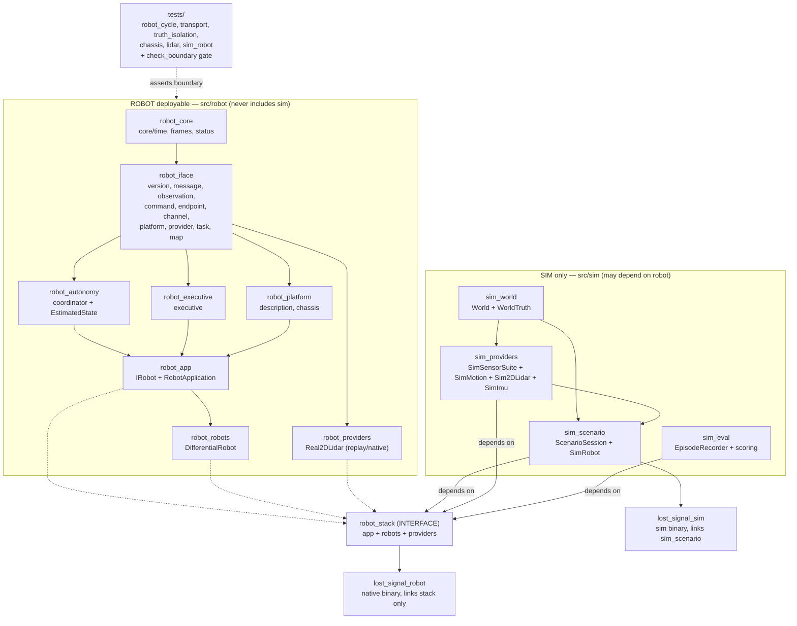
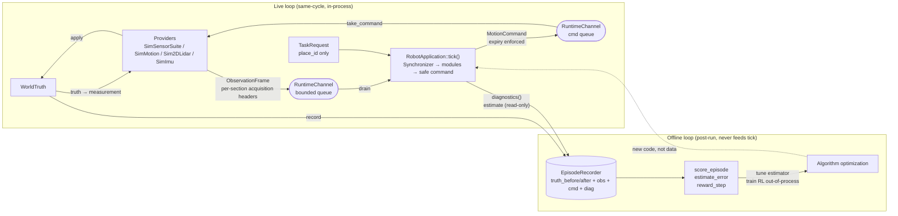
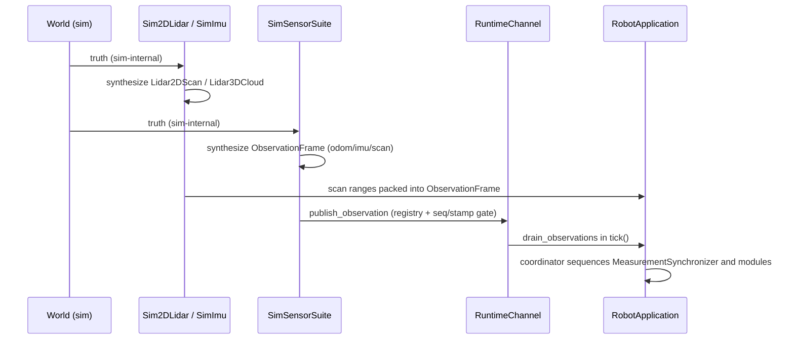
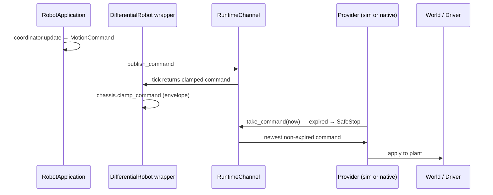
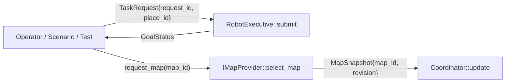
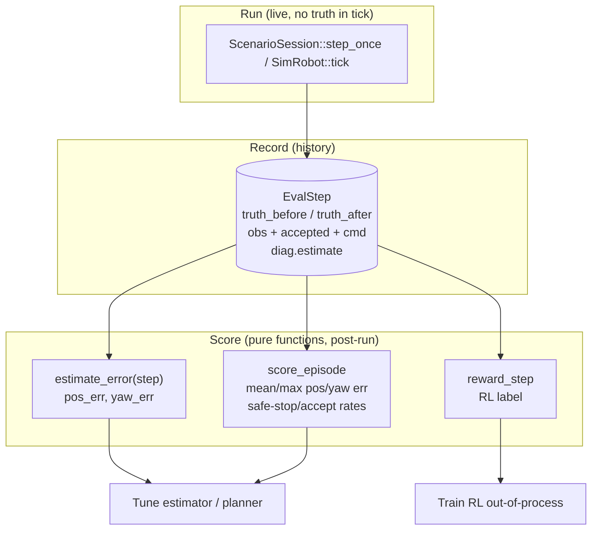

# System overview: modules + data flow

> 与代码一一对应。库名 = `CMakeLists.txt` target 名，括号里是源文件目录。

## 1. 全局模块架构

依赖方向只有一条：`sim → robot`，绝无反向。门禁见
`tests/check_boundary.py`（禁 `sim/` include、禁真值 token、禁 robot 链 sim 库）。

## 2. 数据流总览（一张图）

真值只出现在左侧 `WorldTruth → Providers → measurement` 和右侧离线记录里，
永不直达 `tick()`。优化回路是虚线：人/训练改代码，不回灌数据。

## 3. Live 观察流（provider → robot）

- 注册门：`register_provider` 先占位，未注册 source 直接拒收。
- 顺序门：transport 以及 scan/motion/IMU section 各自按 source 的
 `sequence + stamp` 检查；迟到或重复 measurement 不会倒退估计时钟。
- 容量门：obs 64 满时丢最老，记 `obs_dropped`（degraded 可见）。

## 4. Live 指令流（robot → provider → plant）

`AutonomyCoordinator` is the ROBOT sequencing seam. Measurement ordering,
deduplication, caching, IMU frame conversion and one-shot consumption live in
`MeasurementSynchronizer`; planning policy lives in the planning and decision
modules. The coordinator only passes module outputs to the next module and
holds lifecycle state. Safe stop comes out of the gates (no
observation, invalid command, safety trip, controlled-stop latch), never
from a skeleton stub. 包络、过期、空队列全部 fail-closed。

## 5. 任务意图流（operator / scenario → robot）

- 语义 place only：坐标由 ROBOT 侧 map 解析，SIM 不给坐标、不给 actor、不给路线。
- 未知 place → `Fail`，plan 永不携带真值。

## 6. 离线评估流（truth-vs-estimate，对比只为调优）

- `AutonomyCoordinator::estimate`（fused odometry：gyro-led yaw +
  scan-match/SLAM corrections）随 `diagnostics()` 只读带出。
- 对比公式：`pos_err = hypot(est.x - truth.x, est.y - truth.y)`，
  `yaw_err = |wrap_pi(est.yaw - truth.yaw)|`（`sim/eval/scoring.cpp`）。
- 测试 `test_truth_isolation` 断言：估计存在、误差有限、reward 纯离线、
  无 obs 改真值不影响指令。

## 6b. 回放流（record → JSONL → deterministic replay）

- `export_episode` 把 `EpisodeRecorder` 落盘为 JSONL v3：一行 header
 `{"v":3,"kind":"episode","map":"<id>","rev":<n>}`，之后每步一行
 `step_to_json_line(record_step(obs))`（float `%.9g` / double `%.17g`，
 joints 按 `drives:[...]` + `steers:{pos,vel}` 变长记录各底盘布局，
 保留 scan/motion/IMU 各自的采集 header 以及可选的
 intensity/time-offset 扫描字段；导入后保持
 bit-identical round-trip）。
- `ReplayProvider::load` 兼容 v2/v3，读回 header + steps（坏行
 fail-closed，不抛异常），并公开回放文件实际包含的 endpoint 描述；
  `poll` 逐个吐出 live-equivalent `ObservationFrame`，播完返回 false。
- 闭环回放：新鲜 `RobotApplication` + 新鲜 plant，吃回放 obs，`take_actuator`
  驱动新 plant；确定性 stack 的指令序列应与录制 bit 一致，任何分歧都是
  非确定性 bug（`tests/test_replay.cpp` 第 4 节断言）。
- JSON 是手写最小子集（`sim/eval/json.{hpp,cpp}`，无第三方依赖），只支持
  记录格式需要的 object/array/string/number/true/false/null。

## 7. 文件 → 模块对照表

| 模块（CMake target） | 目录 | 关键文件 |
|---|---|---|
| `robot_core` | `src/robot/core/` | `time.hpp`, `frames.hpp`, `status.hpp` |
| `robot_iface` | `src/robot/iface/` | `version.hpp`, `message.hpp/cpp` (`IMessage`, `Lidar2DScan`, `Lidar3DCloud`, `ImuMessage`), `observation.hpp`, `command.hpp`, `endpoint.hpp/cpp`, `channel.hpp/cpp`, `motion.hpp` (`IMotionEndpoint`), `provider.hpp` (`IProvider`, `ISensorProvider`), `envelope.hpp` (canonical pack), `task.hpp`, `map.hpp` |
| `robot_platform` | `src/robot/platform/` | `description.hpp/cpp` (`RobotDescription`), `chassis.hpp/cpp` (`IChassis`, `DifferentialChassis`) |
| `robot_autonomy` | `src/robot/autonomy/` | `coordinator.hpp/cpp` (pipeline order) + `estimation/` (`IEstimator`) + `perception/` (`IPerception`) + `mapping/` (`IMapper`) + `planning/` (`IGlobalPlanner`, `ILocalPlanner`) + `validation/` (`IValidator`) + `control/` (`IController`). 详见 `docs/algorithms.md` |
| `robot_executive` | `src/robot/executive/` | `executive.hpp/cpp` (`RobotExecutive`) |
| `robot_app` | `src/robot/app/` | `robot.hpp` (`IRobot`), `robot_application.hpp/cpp` (+`Diagnostics`) |
| `robot_robots` | `src/robot/robots/` | `differential_robot.hpp/cpp` |
| `robot_providers` | `src/robot/providers/` | `real_lidar2d.hpp/cpp` |
| `sim_world` | `src/sim/world/` | `world.hpp/cpp` (`WorldTruth`, 真值唯一住所) |
| `sim_providers` | `src/sim/providers/` | `sensor_suite.hpp/cpp` (composer) + `sim_motion.hpp/cpp`, `sim_imu.hpp/cpp`, `lidar2d.hpp/cpp` |
| `sim_eval` | `src/sim/eval/` | `episode.hpp` (`EvalStep`, `EpisodeRecorder`), `scoring.hpp/cpp` |
| `sim_scenario` | `src/sim/scenario/`, `src/sim/robot/` | `scenario_session.hpp/cpp`, `sim_robot.hpp/cpp` |
| binaries | `src/robot/app/main.cpp`, `src/sim/scenario/sim_main.cpp` | `lost_signal_robot`, `lost_signal_sim` |
| tests | `tests/` | `test_robot_cycle/transport/truth_isolation/chassis/lidar/sim_robot` + `check_boundary.py` |

新增模块时：ROBOT 侧只加 `src/robot/` + `robot_*` target + 接口测试；
SIM 侧加 `src/sim/` + `sim_*` target；真值类型永不进 `src/robot/`。
