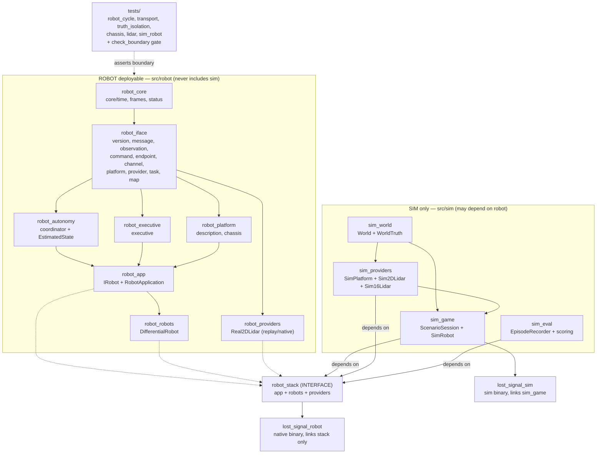
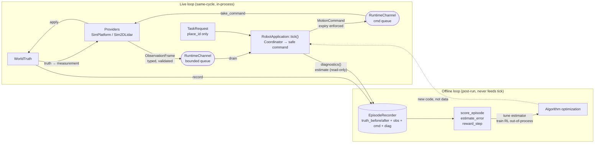
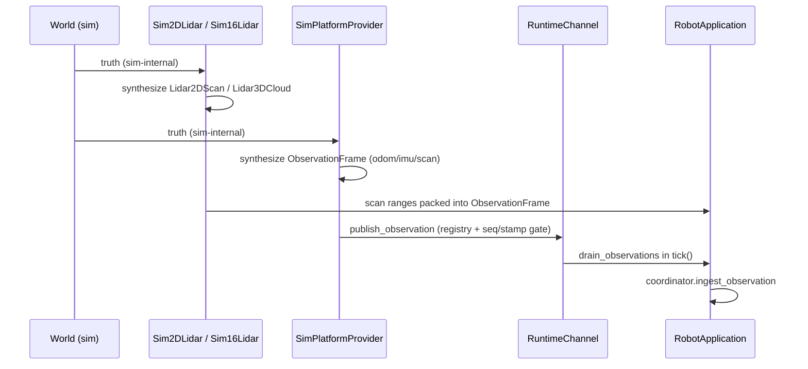
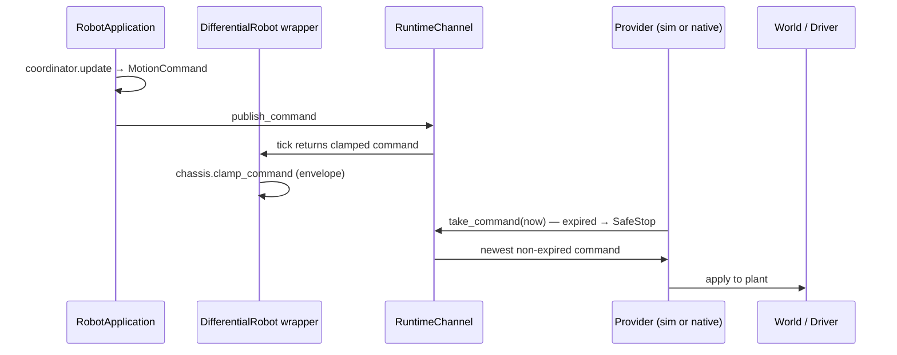
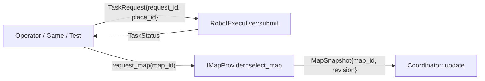
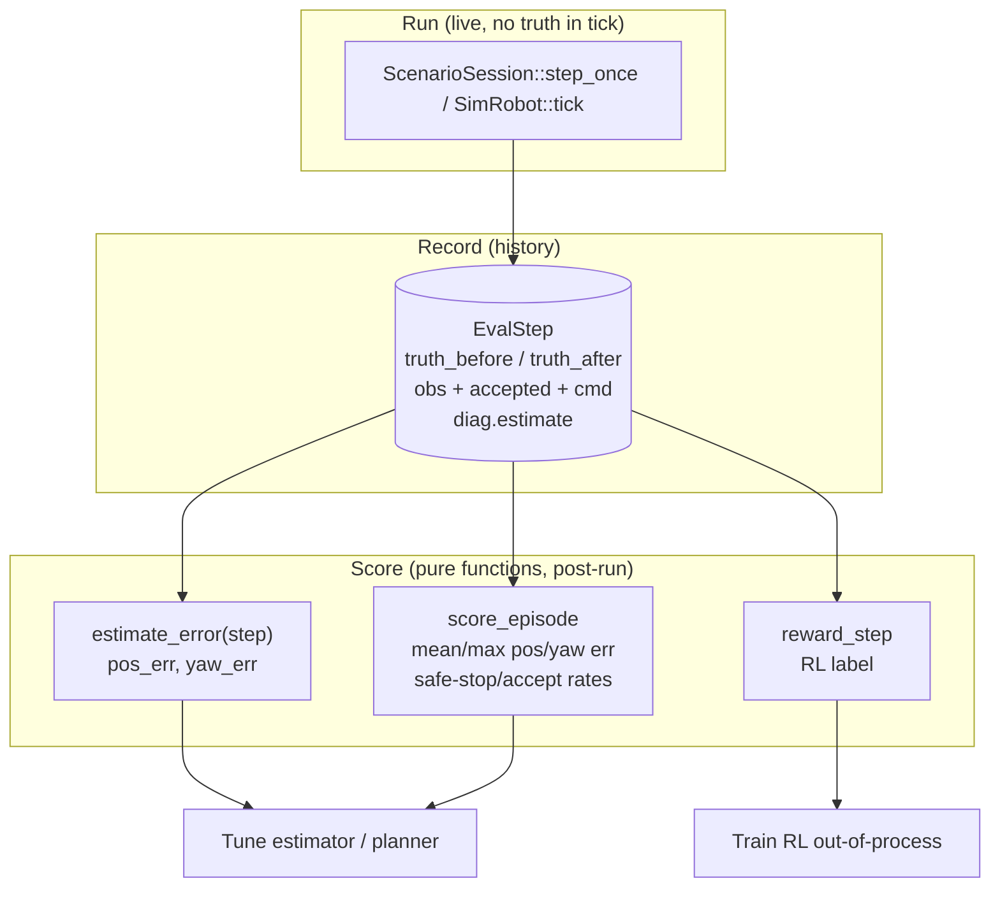

# System overview: modules + data flow

> 与代码一一对应。库名 = `CMakeLists.txt` target 名，括号里是源文件目录。

## 1. 全局模块架构

依赖方向只有一条：`sim → robot`，绝无反向。门禁见
`tests/check_boundary.py`（禁 `sim/` include、禁真值 token、禁 robot 链 sim 库）。

## 2. 数据流总览（一张图）

真值只出现在左侧 `WorldTruth → Providers → measurement` 和右侧离线记录里，
永不直达 `tick()`。优化回路是虚线：人/训练改代码，不回灌数据。

## 3. Live 观察流（provider → robot）

- 注册门：`register_provider` 先占位，未注册 source 直接拒收。
- 顺序门：每 source `sequence + stamp` 严格递增，迟到/重复计数 `obs_rejected`。
- 容量门：obs 64 满时丢最老，记 `obs_dropped`（degraded 可见）。

## 4. Live 指令流（robot → provider → plant）

v1 骨架 planner 恒发 safe-stop；包络、过期、空队列全部 fail-closed。

## 5. 任务意图流（operator / game → robot）

- 语义 place only：坐标由 ROBOT 侧 map 解析，SIM 不给坐标、不给 actor、不给路线。
- 未知 place → `Fail`，plan 永不携带真值。

## 6. 离线评估流（truth-vs-estimate，对比只为调优）

- `AutonomyCoordinator::estimate`（v1 里程计航位推算）随 `diagnostics()` 只读带出。
- 对比公式：`pos_err = hypot(est.x - truth.x, est.y - truth.y)`，
  `yaw_err = |wrap_pi(est.yaw - truth.yaw)|`（`sim/eval/scoring.cpp`）。
- 测试 `test_truth_isolation` 断言：估计存在、误差有限、reward 纯离线、
  无 obs 改真值不影响指令。

## 7. 文件 → 模块对照表

| 模块（CMake target） | 目录 | 关键文件 |
|---|---|---|
| `robot_core` | `src/robot/core/` | `time.hpp`, `frames.hpp`, `status.hpp` |
| `robot_iface` | `src/robot/iface/` | `version.hpp`, `message.hpp/cpp` (`IMessage`, `Lidar2DScan`, `Lidar3DCloud`), `observation.hpp`, `command.hpp`, `endpoint.hpp/cpp`, `channel.hpp/cpp`, `platform.hpp` (`IPlatformProvider`), `provider.hpp` (`IProvider`, `ISensorProvider`), `task.hpp`, `map.hpp` |
| `robot_platform` | `src/robot/platform/` | `description.hpp/cpp` (`RobotDescription`), `chassis.hpp/cpp` (`IChassis`, `DifferentialChassis`) |
| `robot_autonomy` | `src/robot/autonomy/` | `coordinator.hpp/cpp` (`AutonomyCoordinator`, `EstimatedState`) |
| `robot_executive` | `src/robot/executive/` | `executive.hpp/cpp` (`RobotExecutive`) |
| `robot_app` | `src/robot/app/` | `robot.hpp` (`IRobot`), `robot_application.hpp/cpp` (+`Diagnostics`) |
| `robot_robots` | `src/robot/robots/` | `differential_robot.hpp/cpp` |
| `robot_providers` | `src/robot/providers/` | `real_lidar2d.hpp/cpp` |
| `sim_world` | `src/sim/world/` | `world.hpp/cpp` (`WorldTruth`, 真值唯一住所) |
| `sim_providers` | `src/sim/providers/` | `sim_platform.hpp/cpp`, `lidar2d.hpp/cpp`, `lidar16.hpp/cpp` |
| `sim_eval` | `src/sim/eval/` | `episode.hpp` (`EvalStep`, `EpisodeRecorder`), `scoring.hpp/cpp` |
| `sim_game` | `src/sim/game/`, `src/sim/robot/` | `scenario_session.hpp/cpp`, `sim_robot.hpp/cpp` |
| binaries | `src/robot/app/main.cpp`, `src/sim/game/sim_main.cpp` | `lost_signal_robot`, `lost_signal_sim` |
| tests | `tests/` | `test_robot_cycle/transport/truth_isolation/chassis/lidar/sim_robot` + `check_boundary.py` |

新增模块时：ROBOT 侧只加 `src/robot/` + `robot_*` target + 接口测试；
SIM 侧加 `src/sim/` + `sim_*` target；真值类型永不进 `src/robot/`。
