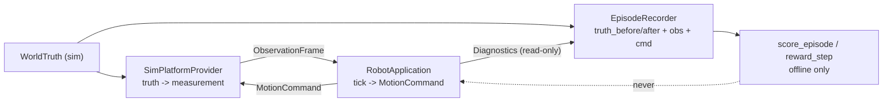

# Truth isolation (SIM truth never enters the ROBOT decision path)

## Rule

`WorldTruth` lives in `src/sim/world/` and is recorded in
`src/sim/eval/episode.hpp` as `EvalStep{truth_before, truth_after, obs, cmd}`.
It is never passed to `publish_observation()`, `tick()`, or any header under
`src/robot/`. The `robot_boundary` test fails the build if `src/robot/`
includes any `sim/` header.

## Data flow

- Live path: `ScenarioSession::step_once()` snapshots `truth_before`, steps
  the world, polls one `ObservationFrame`, publishes it, ticks once, consumes
  the command, then appends `truth_after`. Rejected observations are still
  recorded but never ticked on.
- Offline path: `score_episode()` and `reward_step()` are pure functions of
  recorded history. Training loaders read exported episodes; the live tick
  never sees the reward.

## ROBOT reference vs SIM oracle

- ROBOT reference: `RobotApplication::diagnostics()` exposes only
  `has_observation / last_obs_stamp / last_obs_seq / task / channel health`.
  SIM compares this against recorded truth (e.g. latency, drop rate, stop
  rate) after the run.
- SIM oracle: `EpisodeScore{distance_m, safe_stop_steps, obs_accepted/...}`
  and per-step `reward_step()` (progress minus stop/reject penalties) are the
  v1 reference labels. Algorithm teams replace the reward with their own
  offline function; the transport stays unchanged.

## RL wiring (offline)

1. Run `lost_signal_sim`, export `EpisodeRecorder` steps to JSONL/files.
2. Build `(obs, cmd, reward, next_obs, done)` batches from the export.
3. Train out of process. No training gradient, reward, or truth value is
   linked into `lost_signal_robot_*` targets.
