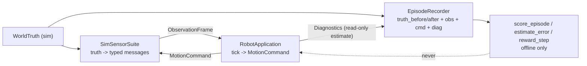

# Truth isolation (SIM truth never enters the ROBOT decision path)

## Rule

`WorldTruth` lives in `src/sim/world/` and is recorded in
`src/sim/eval/episode.hpp` as `EvalStep{truth_before, truth_after, obs, cmd}`.
It is never passed to `publish_observation()`, `tick()`, or any header under
`src/robot/`. The `robot_boundary` gate fails the build when `src/robot/`
includes any `sim/` header, names any truth/eval token (`WorldTruth`,
`EvalStep`, `EpisodeRecorder`, `MissionSnapshot`, `truth_before/after`),
or links any `lost_signal_sim_*` library.

Truth is not an algorithm input. It is an offline optimizer reference:
recorded truth vs recorded estimate, scored after the run.

## Data flow

- Live path: `ScenarioSession::step_once()` snapshots `truth_before`, steps
  the world, polls one `ObservationFrame`, publishes it, ticks once, consumes
  the command, then appends `truth_after` plus `diagnostics()`. Rejected
  observations are still recorded but never ticked on.
- Offline path: `estimate_error()` compares recorded `diag.estimate` against
  recorded `truth_after`; `score_episode()` aggregates mean/max position and
  yaw error; `reward_step()` is the RL label. Training loaders read exported
  episodes; the live tick never sees truth, error, or reward.

## ROBOT estimate vs SIM truth (optimizer reference)

- ROBOT estimate: `AutonomyCoordinator::estimate()` (v1: odometry
  dead-reckoning from measured twists only) is exposed read-only via
  `RobotApplication::diagnostics().estimate`. No truth seeds or corrects it.
- SIM truth: `WorldTruth{body_x_m, body_y_m, body_yaw_rad, ...}` recorded per
  step in the episode.
- Comparison (all offline, in `src/sim/eval/`):
  `pos_err = hypot(est.x - truth.x, est.y - truth.y)`,
  `yaw_err = |wrap_pi(est.yaw - truth.yaw)|`,
  aggregated as `mean/max` over the episode. Tune the estimator against these
  numbers; do not feed them back into the running robot.

## RL wiring (offline)

1. Run `lost_signal_sim`, export `EpisodeRecorder` steps to JSONL/files.
2. Build `(obs, cmd, reward, next_obs, done)` batches from the export.
3. Train out of process. No training gradient, reward, truth value, or error
   metric is linked into `lost_signal_robot_*` targets.
